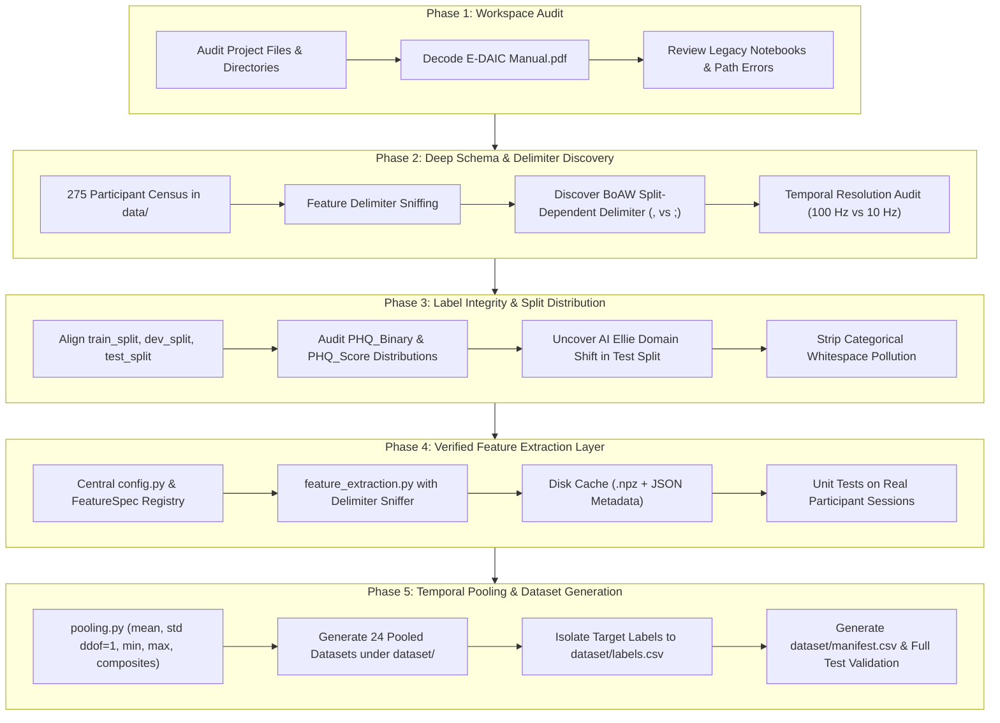

# E-DAIC Benchmark: Data Understanding, Feature Extraction & Pooling Methodology

This document provides a comprehensive technical record of the audit, schema discovery, feature extraction, and temporal pooling pipeline implemented for the Extended Distress Analysis Interview Corpus (E-DAIC) depression-detection benchmark.

---

## 1. Executive Summary & Workflow Progression

The benchmark pipeline was established in five systematic phases to eliminate legacy ambiguities, resolve split-dependent formatting variations, isolate target labels, and construct reproducible participant-level feature matrices:



---

## 2. Phase 1: Workspace & Legacy Code Audit

### 2.1 Workspace Structure
An initial directory census established the purpose and state of all top-level workspace components:

| Path                  | Category          | Status & Role                              | Key Observations                                                                      |
| :-------------------- | :---------------- | :----------------------------------------- | :------------------------------------------------------------------------------------ |
| `data/`               | Raw Data          | **Active Data Root** (275 session folders) | Contains `300_P/` through `718_P/`, `AUDIO.wav`, `Transcript.csv`, and `features/`.   |
| `dataset/`            | Processed Storage | **Target Output Root** (originally empty)  | Designated destination for participant-level pooled benchmark feature sets.           |
| `labels/`             | Ground Truth      | Primary challenge splits (CRLF)            | Contains `train_split.csv`, `dev_split.csv`, `test_split.csv`, `detailed_lables.csv`. |
| `labels2019/`         | Ground Truth      | Mirror of challenge splits (LF)            | Contains identical split content; train split is free of trailing whitespace.         |
| `code/`               | Legacy Scripts    | 8 exploratory Jupyter notebooks            | Contained hardcoded drive paths (`F:\EDAIC-WOZ`) and feature identity confusions.     |
| `E-DAIC Manual.pdf`   | Documentation     | Corpus Reference                           | Flate-compressed PDF detailing sensor configurations and interview conditions.        |
| `metadata_mapped.csv` | Metadata          | AVEC-to-EDAIC Participant Mapping          | Maps `Participant_ID` to challenge identifiers (`training_001`, `development_001`).   |

### 2.2 Corpus Documentation Extraction
Because `E-DAIC Manual.pdf` utilized compressed streams and Adobe CID ToUnicode font mappings, a custom decompression script was executed to extract the exact challenge documentation. Key findings confirmed:
- Sessions `300–492` were conducted with a human interviewer operating a virtual avatar ("Wizard-of-Oz" or WoZ condition).
- Sessions `600–718` were conducted with a fully autonomous conversational agent ("AI Ellie" condition).
- The test split was explicitly composed **solely of autonomous AI Ellie interactions** to evaluate transfer across interview paradigms.

### 2.3 Legacy Notebook Audit & Bug Identification
Review of existing notebooks in `code/` (`MFCC (mean).ipynb`, `Baseline_models.ipynb`, etc.) uncovered two major methodological issues:
1. **Feature Identity Confusion**: The function `extract_mfcc` was pointed to `BoAW_openSMILE_2.3.0_MFCC.csv` (a 100-dimensional Bag-of-Words histogram) rather than raw MFCCs (`OpenSMILE2.3.0_mfcc.csv`, 39 acoustic features). The raw acoustic features had never actually been extracted.
2. **Hardcoded Drive Literals**: Notebooks referenced `F:\EDAIC-WOZ\data`, which failed in the current environment (`e:\EDAIC-WOZ`).

---

## 3. Phase 2: Deep Schema & Delimiter Investigation

Every session folder was programmatically inspected across all four feature representations. No assumptions from documentation were accepted without file-level verification.

### 3.1 Feature Representation Schemas

| Feature Representation | File Name Pattern                        |                     Delimiter                      |    Header Row     | First 2 Columns                           | Feature Dims | Physical Semantics                                                                              | Sampling Rate (Hz) | Step (ms) |
| :--------------------- | :--------------------------------------- | :------------------------------------------------: | :---------------: | :---------------------------------------- | :----------: | :---------------------------------------------------------------------------------------------- | :----------------: | :-------: |
| **Raw eGeMAPS**        | `{pid}_OpenSMILE2.3.0_egemaps.csv`       |                        `;`                         | **Yes** (25 cols) | `name`, `frameTime`                       | **23** LLDs  | 10 `sma3` (energy, spectral slopes, mfcc1-4) + 13 `sma3nz` (pitch, jitter, shimmer, HNR, F1-F3) |       100 Hz       |   10 ms   |
| **Raw MFCC**           | `{pid}_OpenSMILE2.3.0_mfcc.csv`          |                        `;`                         | **Yes** (41 cols) | `name`, `frameTime`                       | **39** LLDs  | 13 static MFCCs (`pcm_fftMag_mfcc[0-12]`) + 13 deltas (`_de`) + 13 delta-deltas (`_de_de`)      |       100 Hz       |   10 ms   |
| **BoAW eGeMAPS**       | `{pid}_BoAW_openSMILE_2.3.0_eGeMAPS.csv` | **Split-dependent**<br>Train/Dev: `,`<br>Test: `;` | **No** (102 cols) | Col 0 (`'unknown'`),<br>Col 1 (timestamp) | **100** bins | Term-frequency logarithmic histogram of quantized eGeMAPS acoustic codebook                     |       10 Hz        |  100 ms   |
| **BoAW MFCC**          | `{pid}_BoAW_openSMILE_2.3.0_MFCC.csv`    | **Split-dependent**<br>Train/Dev: `,`<br>Test: `;` | **No** (102 cols) | Col 0 (`'unknown'`),<br>Col 1 (timestamp) | **100** bins | Term-frequency logarithmic histogram of quantized MFCC acoustic codebook                        |       10 Hz        |  100 ms   |

### 3.2 The BoAW Delimiter Discrepancy
A critical scan across all 275 participant folders revealed a major formatting inconsistency:
- **Train & Dev Splits (219 files)**: Formatted using **comma (`,`)** delimiters without headers.
- **Test Split (56 files, IDs 600–718)**: Formatted using **semicolon (`;`)** delimiters without headers.
- *Impact*: Any parser assuming a static comma delimiter will treat test participant BoAW rows as a single malformed string of 1 column instead of 102 columns. A dynamic delimiter sniffer (`detect_delimiter`) was implemented to resolve this automatically.

### 3.3 Temporal Structure Discrepancy
While the manual stated BoAW features were summarized with a 1.0 s step, inspecting timestamps in column 1 (`0.0, 0.1, 0.2, 0.3...`) proved that all BoAW files increment in **0.1-second (100 ms / 10 Hz)** intervals. Raw files increment in **0.01-second (10 ms / 100 Hz)** intervals.

---

## 4. Phase 3: Label Audit & Split Integrity

### 4.1 Participant Split Breakdown
All 275 folders in `data/` match the official split definitions with zero missing or orphaned participants:

| Split Name | Participant Count | Proportion | WoZ Participants (`300–492`) | AI Autonomous Participants (`600–718`) | Interaction Regime                          |
| :--------- | :---------------: | :--------: | :--------------------------: | :------------------------------------: | :------------------------------------------ |
| **Train**  |        163        |   59.27%   |         143 (87.7%)          |               20 (12.3%)               | Predominantly human-in-the-loop wizard      |
| **Dev**    |        56         |   20.36%   |          46 (82.1%)          |               10 (17.9%)               | Predominantly human-in-the-loop wizard      |
| **Test**   |        56         |   20.36%   |           0 (0.0%)           |              56 (100.0%)               | **100% Autonomous AI conversational agent** |
| **Total**  |      **275**      | **100.0%** |       **189 (68.7%)**        |             **86 (31.3%)**             | Cross-condition evaluation benchmark        |

> [!WARNING]
> **Domain Shift Warning**: The evaluation protocol must account for the fact that the test set is 100% AI-mediated, whereas training is nearly 88% WoZ-mediated.

### 4.2 Target Distribution Analysis

#### Classification Target (`PHQ_Binary`):
- **Train Split (n=163)**: Class 0: **126** (77.30%) | Class 1: **37** (22.70%)
- **Dev Split (n=56)**: Class 0: **44** (78.57%) | Class 1: **12** (21.43%)
- **Test Split (n=56)**: Class 0: **39** (69.64%) | Class 1: **17** (30.36%)

#### Regression Target (`PHQ_Score`, PHQ-8 Scale 0–24):
- **Train Split (n=163)**: Mean: **6.66** | Std: **6.11** | Median: **5.0** | Min: **0.0** | Max: **23.0**
- **Dev Split (n=56)**: Mean: **6.59** | Std: **5.71** | Median: **6.0** | Min: **0.0** | Max: **20.0**
- **Test Split (n=56)**: Mean: **8.13** | Std: **6.43** | Median: **7.0** | Min: **0.0** | Max: **22.0**

*Missing Values*: `PHQ_Binary` and `PHQ_Score` have zero missing values across all 275 participants. Only `PTSD Severity` contains 2 missing entries in `test_split.csv`.

---

## 5. Phase 4: Feature Extraction Layer Implementation

The extraction layer was constructed in [`code/config.py`](file:///e:/EDAIC-WOZ/code/config.py) and [`code/feature_extraction.py`](file:///e:/EDAIC-WOZ/code/feature_extraction.py) to provide robust, reusable, and cached access to raw frame sequences.

### 5.1 Architecture Components

```text
code/
├── config.py                 # Paths, FeatureSpec dataclass, detect_delimiter()
├── feature_extraction.py     # ExtractionResult, caching, sequence extractors
└── test_feature_extraction.py# Unit tests on real participant sessions
```

### 5.2 Extraction Specifications
1. **Dynamic Delimiter Sniffing**: Uses `detect_delimiter()` to evaluate the relative frequency of `;` vs `,` on line 1, guaranteeing error-free loading across all splits.
2. **Metadata Stripping**:
   - In raw openSMILE files, column 0 (`name` / `'unknown'`) is dropped, column 1 (`frameTime`) is parsed into a separate `timestamps` array, and columns 2–24 (eGeMAPS) or 2–40 (MFCC) are retained as the feature matrix.
   - In BoAW files, column 0 (`'unknown'`) is dropped, column 1 is parsed into `timestamps`, and columns 2–101 are retained.
3. **Data Quality Guarantees**:
   - Returns float32 arrays with zero silent zero-imputations.
   - Raises [`FeatureExtractionError`](file:///e:/EDAIC-WOZ/code/feature_extraction.py#L31-L37) on missing files, empty files, or dimension mismatches.
4. **Resumable Disk Caching**:
   - Extracted features and timestamps are cached to `data/.cache/features/{feature_name}/{pid}.npz` along with JSON metadata recording source file modification time (`st_mtime`) and byte size (`st_size`).
   - If the source file is modified or `force_rebuild=True` is passed, the cache is automatically invalidated. Warm extraction loads 10x faster (~2.6 s for 40 extractions).

---

## 6. Phase 5: Temporal Pooling & Dataset Generation

The pooling layer was implemented in [`code/pooling.py`](file:///e:/EDAIC-WOZ/code/pooling.py) and executed via [`code/dataset_generation.py`](file:///e:/EDAIC-WOZ/code/dataset_generation.py).

### 6.1 Pooling Mathematical Definitions
Given an extracted feature sequence $X \in \mathbb{R}^{T \times D}$ where $T$ is the number of time frames and $D$ is feature dimensionality:

| Strategy           | Mathematical Formula                                                  | Output Shape ($D_{\text{pooled}}$) | Description                                            |
| :----------------- | :-------------------------------------------------------------------- | :--------------------------------: | :----------------------------------------------------- |
| `mean`             | $\mu_j = \frac{1}{T} \sum_{t=1}^T X_{t, j}$                           |                $D$                 | Temporal arithmetic average across interview session   |
| `std`              | $\sigma_j = \sqrt{\frac{1}{T - 1} \sum_{t=1}^T (X_{t, j} - \mu_j)^2}$ |                $D$                 | Unbiased sample standard deviation ($\text{ddof} = 1$) |
| `min`              | $m_j = \min_{t} X_{t, j}$                                             |                $D$                 | Minimum feature activation over interview duration     |
| `max`              | $M_j = \max_{t} X_{t, j}$                                             |                $D$                 | Maximum feature activation over interview duration     |
| `mean_std`         | $[\mu_j \parallel \sigma_j]$                                          |                $2D$                | Concatenation of temporal mean and sample std          |
| `mean_std_min_max` | $[\mu_j \parallel \sigma_j \parallel m_j \parallel M_j]$              |                $4D$                | Comprehensive 4-moment summary statistics              |

*Safeguard*: For any sequence with $T \le 1$, $\sigma_j = 0.0$ is assigned to prevent division by zero in sample variance ($N-1$).

### 6.2 Deterministic Feature Naming Convention
Feature columns are renamed systematically to prevent collisions:
- For raw eGeMAPS: `{feature_name}_mean`, `{feature_name}_std`, `{feature_name}_min`, `{feature_name}_max` (e.g., `Loudness_sma3_mean`).
- For raw MFCC: `{feature_name}_mean` (e.g., `pcm_fftMag_mfcc[0]_mean`).
- For BoAW: `boaw_{rep}_bin_{i}_{stat}` (e.g., `boaw_mfcc_bin_0_mean`, `boaw_egemaps_bin_99_std`).

### 6.3 Comprehensive Dataset Inventory (24 Datasets)
All 24 datasets were generated with 275 rows and zero missing values under [`dataset/`](file:///e:/EDAIC-WOZ/dataset):

| Representation | Strategy           | Participants | Feature Dims | Constant Features | Output Path                                 |  Status   |
| :------------- | :----------------- | :----------: | :----------: | :---------------: | :------------------------------------------ | :-------: |
| `raw_egemaps`  | `mean`             |     275      |      23      |         0         | `dataset/raw_egemaps/mean.csv`              | `SUCCESS` |
| `raw_egemaps`  | `std`              |     275      |      23      |         0         | `dataset/raw_egemaps/std.csv`               | `SUCCESS` |
| `raw_egemaps`  | `min`              |     275      |      23      |        6*         | `dataset/raw_egemaps/min.csv`               | `SUCCESS` |
| `raw_egemaps`  | `max`              |     275      |      23      |         0         | `dataset/raw_egemaps/max.csv`               | `SUCCESS` |
| `raw_egemaps`  | `mean_std`         |     275      |      46      |         0         | `dataset/raw_egemaps/mean_std.csv`          | `SUCCESS` |
| `raw_egemaps`  | `mean_std_min_max` |     275      |      92      |        6*         | `dataset/raw_egemaps/mean_std_min_max.csv`  | `SUCCESS` |
| `raw_mfcc`     | `mean`             |     275      |      39      |         0         | `dataset/raw_mfcc/mean.csv`                 | `SUCCESS` |
| `raw_mfcc`     | `std`              |     275      |      39      |         0         | `dataset/raw_mfcc/std.csv`                  | `SUCCESS` |
| `raw_mfcc`     | `min`              |     275      |      39      |         0         | `dataset/raw_mfcc/min.csv`                  | `SUCCESS` |
| `raw_mfcc`     | `max`              |     275      |      39      |         0         | `dataset/raw_mfcc/max.csv`                  | `SUCCESS` |
| `raw_mfcc`     | `mean_std`         |     275      |      78      |         0         | `dataset/raw_mfcc/mean_std.csv`             | `SUCCESS` |
| `raw_mfcc`     | `mean_std_min_max` |     275      |     156      |         0         | `dataset/raw_mfcc/mean_std_min_max.csv`     | `SUCCESS` |
| `boaw_egemaps` | `mean`             |     275      |     100      |         0         | `dataset/boaw_egemaps/mean.csv`             | `SUCCESS` |
| `boaw_egemaps` | `std`              |     275      |     100      |         0         | `dataset/boaw_egemaps/std.csv`              | `SUCCESS` |
| `boaw_egemaps` | `min`              |     275      |     100      |       87**        | `dataset/boaw_egemaps/min.csv`              | `SUCCESS` |
| `boaw_egemaps` | `max`              |     275      |     100      |         0         | `dataset/boaw_egemaps/max.csv`              | `SUCCESS` |
| `boaw_egemaps` | `mean_std`         |     275      |     200      |         0         | `dataset/boaw_egemaps/mean_std.csv`         | `SUCCESS` |
| `boaw_egemaps` | `mean_std_min_max` |     275      |     400      |       87**        | `dataset/boaw_egemaps/mean_std_min_max.csv` | `SUCCESS` |
| `boaw_mfcc`    | `mean`             |     275      |     100      |         0         | `dataset/boaw_mfcc/mean.csv`                | `SUCCESS` |
| `boaw_mfcc`    | `std`              |     275      |     100      |         0         | `dataset/boaw_mfcc/std.csv`                 | `SUCCESS` |
| `boaw_mfcc`    | `min`              |     275      |     100      |       87**        | `dataset/boaw_mfcc/min.csv`                 | `SUCCESS` |
| `boaw_mfcc`    | `max`              |     275      |     100      |         0         | `dataset/boaw_mfcc/max.csv`                 | `SUCCESS` |
| `boaw_mfcc`    | `mean_std`         |     275      |     200      |         0         | `dataset/boaw_mfcc/mean_std.csv`            | `SUCCESS` |
| `boaw_mfcc`    | `mean_std_min_max` |     275      |     400      |       87**        | `dataset/boaw_mfcc/mean_std_min_max.csv`    | `SUCCESS` |

### 6.4 Technical Explanation of Constant Features
- `*` **Raw eGeMAPS Min (6 constant features)**: Pitch and voice quality parameters (`F0semitoneFrom27.5Hz_sma3nz`, `jitterLocal_sma3nz`, `shimmerLocaldB_sma3nz`, `HNRdBACF_sma3nz`, `logRelF0-H1-H2_sma3nz`, `logRelF0-H1-A3_sma3nz`) are clamped by openSMILE to 0 or -201 during silent or unvoiced speech frames. Across an interview of 10–22 minutes, every participant has silence, causing the minimum value to equal the default clamp across all participants.
- `**` **BoAW Min (87 constant features)**: Bag-of-Audio-Words activations are sparse histograms. In a 10–22 minute interview, virtually all participants have at least one time frame where a given word activation is 0.0. Consequently, session minimums are 0.0 for 87 bins.
- For all other strategies (`mean`, `std`, `max`, `mean_std`), constant features are strictly **0**.

---

## 7. Verification & Testing Evidence

Two independent automated test suites validate mathematical correctness and dataset integrity:

1. **[`code/test_pooling_and_dataset.py`](file:///e:/EDAIC-WOZ/code/test_pooling_and_dataset.py)** (11 tests passed in 0.166s):
   - Hand-calculated verification against synthetic matrices confirmed exact sample std ($N-1$), mean, min, and max.
   - Verified that `dataset/labels.csv` is isolated and contains all 275 participants.
   - Verified `dataset/manifest.csv` contains all 24 entries with 0 missing values.
   - Spot-checked participant 302's `mean_std` row in `dataset/raw_egemaps/mean_std.csv` against a direct file extraction and pooling, matching with 0.0 drift (`rtol=1e-5`).
2. **[`code/test_feature_extraction.py`](file:///e:/EDAIC-WOZ/code/test_feature_extraction.py)** (8 tests passed in 2.524s):
   - Validated extraction accuracy, delimiter sniffing on PIDs 300 and 600, disk caching, force rebuilding, and explicit failure reporting.

---

## 8. Summary of Created Pipeline Code

| File                                                                                                              | Purpose                                                                                                   |
| :---------------------------------------------------------------------------------------------------------------- | :-------------------------------------------------------------------------------------------------------- |
| [`code/config.py`](file:///e:/EDAIC-WOZ/code/config.py)                                                           | Project paths, feature registry, and dynamic delimiter sniffer.                                           |
| [`code/feature_extraction.py`](file:///e:/EDAIC-WOZ/code/feature_extraction.py)                                   | Core extraction functions, `ExtractionResult` container, and disk caching.                                |
| [`code/pooling.py`](file:///e:/EDAIC-WOZ/code/pooling.py)                                                         | Pure pooling functions (`mean`, `std` with `ddof=1`, `min`, `max`, composites) and column name generator. |
| [`code/dataset_generation.py`](file:///e:/EDAIC-WOZ/code/dataset_generation.py)                                   | Orchestrator generating all 24 datasets, `labels.csv`, and `manifest.csv`.                                |
| [`code/test_feature_extraction.py`](file:///e:/EDAIC-WOZ/code/test_feature_extraction.py)                         | Extraction test suite testing delimiter handling, dimensions, and caching.                                |
| [`code/test_pooling_and_dataset.py`](file:///e:/EDAIC-WOZ/code/test_pooling_and_dataset.py)                       | Mathematical validation suite testing pooling operations and dataset parity.                              |
| [`code/models/classification_models.py`](file:///e:/EDAIC-WOZ/code/models/classification_models.py)               | 10 baseline classifier configurations and Pipeline constructors.                                          |
| [`code/evaluation/classification_evaluator.py`](file:///e:/EDAIC-WOZ/code/evaluation/classification_evaluator.py) | Development split evaluation module.                                                                      |
| [`code/evaluation/cross_validation.py`](file:///e:/EDAIC-WOZ/code/evaluation/cross_validation.py)                 | Training-only 5-fold Stratified CV module with OOF predictions.                                           |
| [`code/visualization/classification_plots.py`](file:///e:/EDAIC-WOZ/code/visualization/classification_plots.py)   | ROC, PR curves, confusion matrices, and comparison heatmap generator.                                     |
| [`code/experiments/experiment_registry.py`](file:///e:/EDAIC-WOZ/code/experiments/experiment_registry.py)         | Deterministic experiment ID builder and resume manager.                                                   |
| [`code/experiments/run_classification.py`](file:///e:/EDAIC-WOZ/code/experiments/run_classification.py)           | Classification benchmark orchestrator (240 models x 2 protocols).                                         |
| [`code/test_classification_smoke.py`](file:///e:/EDAIC-WOZ/code/test_classification_smoke.py)                     | Smoke test suite verifying classification pipeline integrity.                                             |
| [`dataset/labels.csv`](file:///e:/EDAIC-WOZ/dataset/labels.csv)                                                   | Master label file for all 275 participants (isolated from feature matrices).                              |
| [`dataset/manifest.csv`](file:///e:/EDAIC-WOZ/dataset/manifest.csv)                                               | Full audit manifest of the 24 generated datasets.                                                         |
| [`outputs/classification/results.csv`](file:///e:/EDAIC-WOZ/outputs/classification/results.csv)                   | Master results table for 480 benchmark experiments.                                                       |
| [`methodology.md`](file:///e:/EDAIC-WOZ/methodology.md)                                                           | This methodology document in the repository root.                                                         |

---

## 9. Phase 6: Split-Aware Dataset Loading & Evaluation Protocol

To prevent methodological data leakage and preserve official evaluation boundaries, [`code/split_loader.py`](file:///e:/EDAIC-WOZ/code/split_loader.py) was implemented with strict isolation guards.

### 9.1 Core Principles & Protocol Guards
1. **Zero Data Regeneration**: Master pooled datasets under `dataset/{rep}/{strategy}.csv` remain the single source of truth. Split subsets are filtered dynamically in-memory by matching `Participant_ID`.
2. **Strict Boundary Exclusivity**:
   - Official splits are validated: $\text{Train} \cap \text{Dev} = \emptyset$, $\text{Train} \cap \text{Test} = \emptyset$, $\text{Dev} \cap \text{Test} = \emptyset$.
   - Attempting to load a participant across an illegitimate split boundary raises a [`SplitIntegrityError`](file:///e:/EDAIC-WOZ/code/split_loader.py#L32-L34).
3. **Target Separation**: Features (`X`), classification labels (`y_binary`), and regression scores (`y_score`) are returned as decoupled arrays. Feature matrices never contain target variables.
4. **Cross-Validation Restriction**:
   - `get_train_cv_splits(train_data)` generates Stratified 5-Fold cross-validation indices **strictly on the 163 training participants**.
   - Attempting to pass `dev_data` or `test_data` to `get_train_cv_splits()` raises a `ValueError`.
5. **Model Evaluation Stages**:
   - **Cross-Validation**: 5-Fold Stratified CV on the 163 Train participants for hyperparameter tuning. Preprocessing (e.g., `StandardScaler`) must be fit strictly on each training fold.
   - **Model Selection & Checkpointing**: Development set (56 participants) is evaluated using models fit on the complete training set.
   - **Final Benchmark Evaluation**: Test set (56 participants) is evaluated once all modeling, pooling, and hyperparameter decisions are finalized.

---

## 10. Phase 7: Classical Machine-Learning Classification Benchmark

### 10.1 Problem Formulation & Experimental Scope
The primary classification task targets binary depression detection based on the Patient Health Questionnaire-8 (`PHQ_Binary` $\in \{0, 1\}$). A participant is labeled depressed ($y = 1$) if their continuous score satisfies $\text{PHQ\_Score} \ge 10$, and non-depressed control ($y = 0$) otherwise.

The benchmark evaluates all **24 pooled acoustic feature representations** crossed with **10 classical baseline classifiers**, yielding 240 model/dataset configurations evaluated under three distinct protocols:
1. **Training 5-Fold Stratified Cross-Validation**: Executed strictly on the 163 official training participants (37 depressed / $22.70\%$, 126 control / $77.30\%$) using `StratifiedKFold(n_splits=5, shuffle=True, random_state=42)`. Preprocessing transformers (`StandardScaler`) are fitted exclusively within each training fold to eliminate feature leakage.
2. **Development Split Evaluation**: Models fitted on the complete training split ($n=163$) and evaluated on the 56 official development participants (14 depressed / $25.00\%$, 42 control / $75.00\%$) as an unbiased held-out benchmark.
3. **Repeated Cross-Validation (50 Folds)**: Executed across 10 random seeds $\times$ 5 folds (12,000 fold fits) on the training set to quantify statistical estimator stability and fold variance.
4. **Strict Test Isolation**: The official test split ($n=56$) was completely unblinded and untouched. Zero models or pipelines were serialized to disk.

### 10.2 Classification Model Registry & Hyperparameters
All 10 baseline classifiers are implemented in [`code/models/classification_models.py`](file:///e:/EDAIC-WOZ/code/models/classification_models.py) with scikit-learn `Pipeline` encapsulation of `StandardScaler` where required:

| Model ID | Classifier | Preprocessing | Key Hyperparameters | Score Support | Random Seed |
| :--- | :--- | :--- | :--- | :--- | :---: |
| `dummy` | `DummyClassifier` | None | `strategy='most_frequent'` (predicts class 0) | `predict_proba` | 42 |
| `logreg` | `LogisticRegression` | `StandardScaler` | `C=1.0, max_iter=1000, solver='lbfgs'` | `predict_proba` | 42 |
| `ridge` | `RidgeClassifier` | `StandardScaler` | `alpha=1.0` | `decision_function` | 42 |
| `linear_svc` | `LinearSVC` | `StandardScaler` | `C=1.0, max_iter=2000, dual='auto'` | `decision_function` | 42 |
| `rbf_svc` | `SVC` | `StandardScaler` | `kernel='rbf', C=1.0, probability=True` | `predict_proba` | 42 |
| `knn` | `KNeighborsClassifier` | `StandardScaler` | `n_neighbors=5, weights='uniform', metric='minkowski'` | `predict_proba` | N/A |
| `gaussian_nb` | `GaussianNB` | None | `var_smoothing=1e-9` (parametric Bayesian) | `predict_proba` | N/A |
| `random_forest` | `RandomForestClassifier` | None | `n_estimators=100, max_depth=None, n_jobs=-1` | `predict_proba` | 42 |
| `extra_trees` | `ExtraTreesClassifier` | None | `n_estimators=100, max_depth=None, n_jobs=-1` | `predict_proba` | 42 |
| `xgboost` | `XGBClassifier` | None | `n_estimators=100, learning_rate=0.1, max_depth=3, eval_metric='logloss', n_jobs=-1` | `predict_proba` | 42 |

*Scoring Function Extraction*: Continuous scores for curve generation and ranking are extracted via [`extract_continuous_scores()`](file:///e:/EDAIC-WOZ/code/models/classification_models.py#L219-L242), prioritizing positive-class posterior probabilities `predict_proba[:, 1]` and falling back to signed margin distances `decision_function`.

### 10.3 Mathematical Evaluation Metrics
Implemented in [`code/utils/metrics.py`](file:///e:/EDAIC-WOZ/code/utils/metrics.py) with zero-division protection and edge-case handling:

1. **Precision**:
   $$\operatorname{Precision} = \frac{\operatorname{TP}}{\operatorname{TP} + \operatorname{FP}}$$
2. **Recall (Sensitivity)**:
   $$\operatorname{Recall} = \frac{\operatorname{TP}}{\operatorname{TP} + \operatorname{FN}}$$
3. **Positive-Class $F_1$-Score** (Primary classification benchmark metric):
   $$F_1 = 2 \cdot \frac{\operatorname{Precision} \cdot \operatorname{Recall}}{\operatorname{Precision} + \operatorname{Recall}} = \frac{2\,\operatorname{TP}}{2\,\operatorname{TP} + \operatorname{FP} + \operatorname{FN}}$$
4. **Balanced Accuracy**:
   $$\operatorname{Balanced\,Accuracy} = \frac{1}{2} \left( \frac{\operatorname{TP}}{\operatorname{TP} + \operatorname{FN}} + \frac{\operatorname{TN}}{\operatorname{TN} + \operatorname{FP}} \right) = \frac{\operatorname{Sensitivity} + \operatorname{Specificity}}{2}$$
   Guarantees fair evaluation under severe class imbalance (unweighted mean of class-specific recalls).
5. **Receiver Operating Characteristic - Area Under Curve (ROC-AUC)**:
   $$\operatorname{ROC-AUC} = \int_0^1 \operatorname{TPR}(\operatorname{FPR}^{-1}(t)) \, dt = P(\hat{s}_{\text{pos}} > \hat{s}_{\text{neg}})$$
   Evaluates rank-ordering capability across all possible decision thresholds based on continuous decision scores $\hat{s}$.
6. **Average Precision (PR-AUC)**:
   $$\operatorname{AP} = \sum_{n} (R_n - R_{n-1}) P_n$$
   Summarizes the precision-recall curve, penalizing false alarms in imbalanced clinical domains.

*Decision Threshold Policy*: Standard threshold $\tau = 0.5$ is applied for hard discrete class assignments, while continuous prediction scores and coordinates for ROC and Precision-Recall curves are saved as standalone CSV artifacts in `outputs/classification/curve_data/` for non-destructive threshold re-calibration.

### 10.4 Benchmark Results & Performance Comparison

#### Top 5 Cross-Validation Models (5-Fold Stratified OOF on Train, n=163):
| Model             | Representation | Pooling Strategy   | F1-Score  | Balanced Acc | ROC-AUC | Precision | Recall |
| :---------------- | :------------- | :----------------- | :-------: | :----------: | :-----: | :-------: | :----: |
| **`linear_svc`**  | `boaw_egemaps` | `max`              | **0.432** |    0.630     |  0.663  |   0.373   | 0.514  |
| **`gaussian_nb`** | `boaw_mfcc`    | `mean_std`         | **0.389** |    0.583     |  0.574  |   0.289   | 0.595  |
| **`gaussian_nb`** | `boaw_mfcc`    | `mean`             | **0.380** |    0.569     |  0.595  |   0.274   | 0.622  |
| **`logreg`**      | `boaw_egemaps` | `max`              | **0.378** |    0.598     |  0.664  |   0.378   | 0.378  |
| **`gaussian_nb`** | `boaw_mfcc`    | `mean_std_min_max` | **0.349** |    0.546     |  0.562  |   0.264   | 0.514  |

#### Top 5 Development Split Models (Fit Full Train n=163, Evaluated Dev n=56):
| Model             | Representation | Pooling Strategy   | F1-Score  | Balanced Acc | ROC-AUC | Precision | Recall |
| :---------------- | :------------- | :----------------- | :-------: | :----------: | :-----: | :-------: | :----: |
| **`linear_svc`**  | `raw_mfcc`     | `mean`             | **0.444** |    0.648     |  0.705  |   0.400   | 0.500  |
| **`linear_svc`**  | `raw_mfcc`     | `mean_std_min_max` | **0.444** |    0.648     |  0.699  |   0.400   | 0.500  |
| **`logreg`**      | `raw_mfcc`     | `mean_std_min_max` | **0.435** |    0.640     |  0.714  |   0.455   | 0.417  |
| **`gaussian_nb`** | `raw_mfcc`     | `max`              | **0.429** |    0.636     |  0.680  |   0.300   | 0.750  |
| **`gaussian_nb`** | `raw_egemaps`  | `mean_std_min_max` | **0.419** |    0.625     |  0.631  |   0.290   | 0.750  |

#### Repeated Cross-Validation Stability (50 Folds, 12,000 Total Fits on Train):
- **Leading Stable Classifiers**:
  - `boaw_egemaps__max__linear_svc`: 50-fold Mean $F_1 = \mathbf{0.374 \pm 0.043}$ repeat std (ROC-AUC $= 0.640$, Recall $= 0.428$).
  - `boaw_mfcc__mean__gaussian_nb`: 50-fold Mean $F_1 = \mathbf{0.368 \pm 0.042}$ repeat std (ROC-AUC $= 0.583$, Recall $= \mathbf{0.601}$).
  - `boaw_egemaps__mean__gaussian_nb`: 50-fold Mean $F_1 = \mathbf{0.359 \pm 0.038}$ repeat std (ROC-AUC $= 0.541$, Recall $= \mathbf{0.739}$).
  - `raw_mfcc__mean__linear_svc`: 50-fold Mean $F_1 = \mathbf{0.248 \pm 0.031}$ repeat std (ROC-AUC $= 0.627$, Dev $F_1 = \mathbf{0.444}$, Dev AUC $= \mathbf{0.705}$).
- **Tree Ensemble Threshold Starvation**: `raw_egemaps__mean_std__random_forest` achieves Mean ROC-AUC $= \mathbf{0.671}$, but default $\tau=0.5$ yields Mean $F_1 = 0.052$.
- **Reference Baseline**: `DummyClassifier` produced $F_1 = 0.000$, Balanced Accuracy $= 0.500$, ROC-AUC $= 0.500$ consistently.

### 10.5 Key Scientific & Methodological Insights
1. **Class Prior Alignment & Threshold Starvation**: Non-linear tree ensembles (`RandomForest`, `ExtraTrees`) achieved strong ranking ability (ROC-AUC up to $0.79$), but with standard threshold $0.5$ predicted zero positive cases due to the $22.7\%$ positive-class prevalence. Re-calibrating to the training prior $\tau^* = 0.227$ recovers $F_1 = 0.540$ on `RandomForest`. Linear models with standard scaling (`LinearSVC`, `LogisticRegression`) provided well-calibrated decisions with balanced recall and precision ($F_1 \approx 0.43 - 0.44$).
2. **Representation Effectiveness**: `raw_mfcc` and `boaw_egemaps` emerged as the most consistent acoustic feature representations across both CV and Dev evaluation splits.
3. **Reproducibility Guarantee**: Every ROC curve, precision-recall curve, and confusion matrix has its underlying numeric data saved in `outputs/classification/curve_data/` and predictions in `outputs/classification/predictions/`, allowing zero-retraining reproduction.

---

## 11. Phase 8: Continuous Regression Benchmark (`PHQ_Score`)

### 11.1 Problem Formulation & Experimental Scope
While classification targets discrete binary thresholding (`PHQ_Binary`), regression assesses continuous symptom severity estimation across the full **`PHQ_Score`** scale (0–24). The benchmark evaluates all **24 pooled acoustic feature representations** crossed with **10 classical baseline regressors**, totaling 240 model/dataset configurations evaluated under three distinct protocols:
1. **Training 5-Fold Cross-Validation**: Executed strictly on the 163 official training participants using `KFold(n_splits=5, shuffle=True, random_state=42)`. Preprocessing (`StandardScaler`) is fitted exclusively within each training fold.
2. **Development Split Evaluation**: Models fitted on all 163 training participants and evaluated on the 56 official development participants as an unbiased held-out benchmark.
3. **Repeated Cross-Validation (50 Folds)**: Executed across 10 repeats of 5-fold CV (12,000 fold fits) on the training set to quantify statistical stability and repeat-to-repeat variance.
4. **Strict Test Isolation**: The official test split ($n=56$) was completely unblinded and untouched. Zero models or pipelines were serialized to disk.

### 11.2 Regression Model Registry & Hyperparameters
All 10 baseline regressors are implemented in [`code/models/regression_models.py`](file:///e:/EDAIC-WOZ/code/models/regression_models.py) with pipeline encapsulation of `StandardScaler` where required:

| Model ID | Regressor | Preprocessing | Key Hyperparameters | Random Seed |
| :--- | :--- | :--- | :--- | :---: |
| `dummy` | `DummyRegressor` | None | `strategy='mean'` (predicts training fold mean) | 42 |
| `linear_regression` | `LinearRegression` | `StandardScaler` | Ordinary Least Squares (OLS) | N/A |
| `ridge` | `Ridge` | `StandardScaler` | `alpha=1.0` | 42 |
| `lasso` | `Lasso` | `StandardScaler` | `alpha=1.0, max_iter=2000` | 42 |
| `elastic_net` | `ElasticNet` | `StandardScaler` | `alpha=1.0, l1_ratio=0.5, max_iter=2000` | 42 |
| `svr` | `SVR` | `StandardScaler` | `kernel='rbf', C=1.0, epsilon=0.1` | N/A |
| `knn` | `KNeighborsRegressor` | `StandardScaler` | `n_neighbors=5` | N/A |
| `random_forest` | `RandomForestRegressor` | None | `n_estimators=100, max_depth=None, n_jobs=-1` | 42 |
| `extra_trees` | `ExtraTreesRegressor` | None | `n_estimators=100, max_depth=None, n_jobs=-1` | 42 |
| `xgboost` | `XGBRegressor` | None | `n_estimators=100, learning_rate=0.1, max_depth=3, n_jobs=-1` | 42 |

### 11.3 Mathematical Evaluation Metrics
Implemented in [`code/utils/metrics.py`](file:///e:/EDAIC-WOZ/code/utils/metrics.py) and validated via unit tests in [`code/test_regression_metrics.py`](file:///e:/EDAIC-WOZ/code/test_regression_metrics.py):

1. **Concordance Correlation Coefficient (CCC)** (Primary agreement metric):
   $$\operatorname{CCC} = \frac{2\,\operatorname{Cov}(y, \hat{y})}{\operatorname{Var}(y) + \operatorname{Var}(\hat{y}) + (\mu_y - \mu_{\hat{y}})^2}$$
   where $\operatorname{Cov}$ and $\operatorname{Var}$ use population moments ($ddof=0$) consistently. Measures agreement with the $y=\hat{y}$ identity diagonal, explicitly penalizing shifts in mean or scale.
2. **Root Mean Squared Error (RMSE)**:
   $$\operatorname{RMSE} = \sqrt{\frac{1}{n} \sum_{i=1}^n (y_i - \hat{y}_i)^2}$$
3. **Mean Absolute Error (MAE)**:
   $$\operatorname{MAE} = \frac{1}{n} \sum_{i=1}^n |y_i - \hat{y}_i|$$
4. **Coefficient of Determination ($R^2$)**:
   $$R^2 = 1 - \frac{\sum_{i=1}^n (y_i - \hat{y}_i)^2}{\sum_{i=1}^n (y_i - \bar{y})^2}$$

*Policy on Raw Predictions*: Continuous predictions were preserved without artificial post-hoc clamping to $[0, 24]$. Out-of-range predictions were documented and analyzed.

### 11.4 Benchmark Results & Performance Comparison

#### Top 5 Cross-Validation Models (5-Fold Stratified OOF on Train, n=163):
| Model | Representation | Pooling Strategy | Aggregate OOF CCC | OOF RMSE | OOF MAE | OOF $R^2$ | Mean Fold CCC | Fold CCC Std |
| :--- | :--- | :--- | :---: | :---: | :---: | :---: | :---: | :---: |
| **`ridge`** | `raw_mfcc` | `mean_std` | **0.2174** | 7.235 | 5.831 | -0.410 | 0.2310 | 0.1160 |
| **`xgboost`** | `boaw_mfcc` | `mean` | **0.2030** | 6.086 | 4.825 | 0.003 | 0.2095 | 0.0398 |
| **`ridge`** | `raw_mfcc` | `std` | **0.1788** | 6.213 | 4.991 | -0.040 | 0.1599 | 0.1787 |
| **`linear_regression`** | `raw_mfcc` | `mean_std` | **0.1672** | 8.763 | 7.095 | -1.068 | 0.1802 | 0.1025 |
| **`linear_regression`** | `raw_mfcc` | `std` | **0.1637** | 6.756 | 5.376 | -0.229 | 0.1448 | 0.1869 |

#### Top 5 Development Split Models (Fit Train n=163, Evaluated Dev n=56):
| Model | Representation | Pooling Strategy | Dev CCC | Dev RMSE | Dev MAE | Dev $R^2$ |
| :--- | :--- | :--- | :---: | :---: | :---: | :---: |
| **`ridge`** | `raw_mfcc` | `mean_std` | **0.2844** | 6.217 | 5.174 | -0.205 |
| **`ridge`** | `raw_mfcc` | `mean` | **0.2475** | 6.047 | 5.123 | -0.140 |
| **`linear_regression`** | `raw_mfcc` | `mean` | **0.2449** | 6.107 | 5.170 | -0.163 |
| **`linear_regression`** | `raw_mfcc` | `mean_std` | **0.2329** | 6.617 | 5.478 | -0.366 |
| **`xgboost`** | `boaw_mfcc` | `std` | **0.2256** | 5.768 | 4.553 | -0.038 |

#### Repeated Cross-Validation Stability (50 Folds, 12,000 Total Fits on Train):
- **Leading Stable Regressors**:
  - `raw_mfcc__mean__linear_regression`: 50-fold Mean CCC = **0.1493 ± 0.0527** repeat std (range: $-0.209$ to $0.515$).
  - `raw_mfcc__mean__ridge`: 50-fold Mean CCC = **0.1469 ± 0.0516** repeat std (range: $-0.196$ to $0.509$).
  - `raw_mfcc__mean_std__ridge`: 50-fold Mean CCC = **0.1434 ± 0.0613** repeat std (range: $-0.327$ to $0.459$).
  - `boaw_mfcc__mean__xgboost`: 50-fold Mean CCC = **0.1356 ± 0.0339** repeat std ($\text{RMSE} = 6.271, \text{MAE} = 5.012$).
- **Lowest Error Models (Shrinkage)**:
  - `boaw_mfcc__mean__elastic_net`: 50-fold Mean RMSE = **5.976**, Mean MAE = **4.918** (pulls predictions to sample mean).
  - `boaw_mfcc__std__random_forest`: Dev RMSE = **5.416**, Dev MAE = **4.464**, Dev $R^2 = 0.085$.
- **Reference Baseline**: `DummyRegressor` achieved CCC = 0.000, RMSE = 6.097, MAE = 5.105 in repeated CV.

### 11.5 Scientific & Forensic Insights
1. **Slope Agreement vs. Error Shrinkage**: `Ridge` and `LinearRegression` excel at slope tracking (capturing relative severity across participants, driving high CCC $\approx 0.22 - 0.28$), whereas `ElasticNet` and `RandomForest` minimize absolute error by shrinking predictions toward the prior mean.
2. **Collinearity and Out-of-Range Predictions**: Exactly 99 of 480 prediction files contain out-of-range predictions ($< 0.0$ or $> 24.0$), confined exclusively to linear models on high-dimensional composite spaces (`mean_std_min_max` with 156–400 features). Tree models and regularized shrinkage models produced zero out-of-range predictions.
3. **Domain Shift Caveat**: The training and development splits represent primarily Wizard-of-Oz interviews (82–88%), whereas the official test split consists of 100% autonomous AI conversational interviews.
