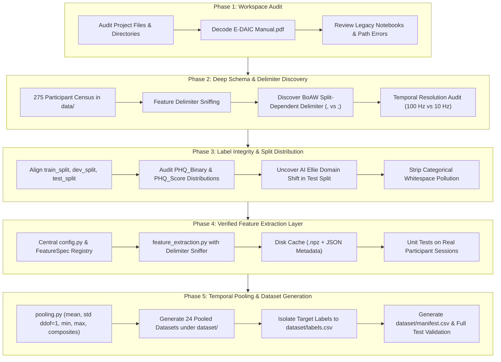

# E-DAIC Benchmark: Data Understanding, Feature Extraction & Pooling Methodology

This document provides a comprehensive technical record of the audit, schema discovery, feature extraction, and temporal pooling pipeline implemented for the Extended Distress Analysis Interview Corpus (E-DAIC) depression-detection benchmark.

---

## 1. Executive Summary & Workflow Progression

The benchmark pipeline was established in five systematic phases to eliminate legacy ambiguities, resolve split-dependent formatting variations, isolate target labels, and construct reproducible participant-level feature matrices:



---

## 2. Phase 1: Workspace & Legacy Code Audit

### 2.1 Workspace Structure
An initial directory census established the purpose and state of all top-level workspace components:

| Path                  | Category          | Status & Role                              | Key Observations                                                                      |
| :-------------------- | :---------------- | :----------------------------------------- | :------------------------------------------------------------------------------------ |
| `data/`               | Raw Data          | **Active Data Root** (275 session folders) | Contains `300_P/` through `718_P/`, `AUDIO.wav`, `Transcript.csv`, and `features/`.   |
| `dataset/`            | Processed Storage | **Target Output Root** (originally empty)  | Designated destination for participant-level pooled benchmark feature sets.           |
| `labels/`             | Ground Truth      | Primary challenge splits (CRLF)            | Contains `train_split.csv`, `dev_split.csv`, `test_split.csv`, `detailed_lables.csv`. |
| `labels2019/`         | Ground Truth      | Mirror of challenge splits (LF)            | Contains identical split content; train split is free of trailing whitespace.         |
| `code/`               | Legacy Scripts    | 8 exploratory Jupyter notebooks            | Contained hardcoded drive paths (`F:\EDAIC-WOZ`) and feature identity confusions.     |
| `E-DAIC Manual.pdf`   | Documentation     | Corpus Reference                           | Flate-compressed PDF detailing sensor configurations and interview conditions.        |
| `metadata_mapped.csv` | Metadata          | AVEC-to-EDAIC Participant Mapping          | Maps `Participant_ID` to challenge identifiers (`training_001`, `development_001`).   |

### 2.2 Corpus Documentation Extraction
Because `E-DAIC Manual.pdf` utilized compressed streams and Adobe CID ToUnicode font mappings, a custom decompression script was executed to extract the exact challenge documentation. Key findings confirmed:
- Sessions `300–492` were conducted with a human interviewer operating a virtual avatar ("Wizard-of-Oz" or WoZ condition).
- Sessions `600–718` were conducted with a fully autonomous conversational agent ("AI Ellie" condition).
- The test split was explicitly composed **solely of autonomous AI Ellie interactions** to evaluate transfer across interview paradigms.

### 2.3 Legacy Notebook Audit & Bug Identification
Review of existing notebooks in `code/` (`MFCC (mean).ipynb`, `Baseline_models.ipynb`, etc.) uncovered two major methodological issues:
1. **Feature Identity Confusion**: The function `extract_mfcc` was pointed to `BoAW_openSMILE_2.3.0_MFCC.csv` (a 100-dimensional Bag-of-Words histogram) rather than raw MFCCs (`OpenSMILE2.3.0_mfcc.csv`, 39 acoustic features). The raw acoustic features had never actually been extracted.
2. **Hardcoded Drive Literals**: Notebooks referenced `F:\EDAIC-WOZ\data`, which failed in the current environment (`e:\EDAIC-WOZ`).

---

## 3. Phase 2: Deep Schema & Delimiter Investigation

Every session folder was programmatically inspected across all four feature representations. No assumptions from documentation were accepted without file-level verification.

### 3.1 Feature Representation Schemas

| Feature Representation | File Name Pattern                        |                     Delimiter                      |    Header Row     | First 2 Columns                           | Feature Dims | Physical Semantics                                                                              | Sampling Rate (Hz) | Step (ms) |
| :--------------------- | :--------------------------------------- | :------------------------------------------------: | :---------------: | :---------------------------------------- | :----------: | :---------------------------------------------------------------------------------------------- | :----------------: | :-------: |
| **Raw eGeMAPS**        | `{pid}_OpenSMILE2.3.0_egemaps.csv`       |                        `;`                         | **Yes** (25 cols) | `name`, `frameTime`                       | **23** LLDs  | 10 `sma3` (energy, spectral slopes, mfcc1-4) + 13 `sma3nz` (pitch, jitter, shimmer, HNR, F1-F3) |       100 Hz       |   10 ms   |
| **Raw MFCC**           | `{pid}_OpenSMILE2.3.0_mfcc.csv`          |                        `;`                         | **Yes** (41 cols) | `name`, `frameTime`                       | **39** LLDs  | 13 static MFCCs (`pcm_fftMag_mfcc[0-12]`) + 13 deltas (`_de`) + 13 delta-deltas (`_de_de`)      |       100 Hz       |   10 ms   |
| **BoAW eGeMAPS**       | `{pid}_BoAW_openSMILE_2.3.0_eGeMAPS.csv` | **Split-dependent**<br>Train/Dev: `,`<br>Test: `;` | **No** (102 cols) | Col 0 (`'unknown'`),<br>Col 1 (timestamp) | **100** bins | Term-frequency logarithmic histogram of quantized eGeMAPS acoustic codebook                     |       10 Hz        |  100 ms   |
| **BoAW MFCC**          | `{pid}_BoAW_openSMILE_2.3.0_MFCC.csv`    | **Split-dependent**<br>Train/Dev: `,`<br>Test: `;` | **No** (102 cols) | Col 0 (`'unknown'`),<br>Col 1 (timestamp) | **100** bins | Term-frequency logarithmic histogram of quantized MFCC acoustic codebook                        |       10 Hz        |  100 ms   |

### 3.2 The BoAW Delimiter Discrepancy
A critical scan across all 275 participant folders revealed a major formatting inconsistency:
- **Train & Dev Splits (219 files)**: Formatted using **comma (`,`)** delimiters without headers.
- **Test Split (56 files, IDs 600–718)**: Formatted using **semicolon (`;`)** delimiters without headers.
- *Impact*: Any parser assuming a static comma delimiter will treat test participant BoAW rows as a single malformed string of 1 column instead of 102 columns. A dynamic delimiter sniffer (`detect_delimiter`) was implemented to resolve this automatically.

### 3.3 Temporal Structure Discrepancy
While the manual stated BoAW features were summarized with a 1.0 s step, inspecting timestamps in column 1 (`0.0, 0.1, 0.2, 0.3...`) proved that all BoAW files increment in **0.1-second (100 ms / 10 Hz)** intervals. Raw files increment in **0.01-second (10 ms / 100 Hz)** intervals.

---

## 4. Phase 3: Label Audit & Split Integrity

### 4.1 Participant Split Breakdown
All 275 folders in `data/` match the official split definitions with zero missing or orphaned participants:

| Split Name | Participant Count | Proportion | WoZ Participants (`300–492`) | AI Autonomous Participants (`600–718`) | Interaction Regime                          |
| :--------- | :---------------: | :--------: | :--------------------------: | :------------------------------------: | :------------------------------------------ |
| **Train**  |        163        |   59.27%   |         143 (87.7%)          |               20 (12.3%)               | Predominantly human-in-the-loop wizard      |
| **Dev**    |        56         |   20.36%   |          46 (82.1%)          |               10 (17.9%)               | Predominantly human-in-the-loop wizard      |
| **Test**   |        56         |   20.36%   |           0 (0.0%)           |              56 (100.0%)               | **100% Autonomous AI conversational agent** |
| **Total**  |      **275**      | **100.0%** |       **189 (68.7%)**        |             **86 (31.3%)**             | Cross-condition evaluation benchmark        |

> [!WARNING]
> **Domain Shift Warning**: The evaluation protocol must account for the fact that the test set is 100% AI-mediated, whereas training is nearly 88% WoZ-mediated.

### 4.2 Target Distribution Analysis

#### Classification Target (`PHQ_Binary`):
- **Train Split (n=163)**: Class 0: **126** (77.30%) | Class 1: **37** (22.70%)
- **Dev Split (n=56)**: Class 0: **44** (78.57%) | Class 1: **12** (21.43%)
- **Test Split (n=56)**: Class 0: **39** (69.64%) | Class 1: **17** (30.36%)

#### Regression Target (`PHQ_Score`, PHQ-8 Scale 0–24):
- **Train Split (n=163)**: Mean: **6.66** | Std: **6.11** | Median: **5.0** | Min: **0.0** | Max: **23.0**
- **Dev Split (n=56)**: Mean: **6.59** | Std: **5.71** | Median: **6.0** | Min: **0.0** | Max: **20.0**
- **Test Split (n=56)**: Mean: **8.13** | Std: **6.43** | Median: **7.0** | Min: **0.0** | Max: **22.0**

*Missing Values*: `PHQ_Binary` and `PHQ_Score` have zero missing values across all 275 participants. Only `PTSD Severity` contains 2 missing entries in `test_split.csv`.

---

## 5. Phase 4: Feature Extraction Layer Implementation

The extraction layer was constructed in [`code/config.py`](file:///e:/EDAIC-WOZ/code/config.py) and [`code/feature_extraction.py`](file:///e:/EDAIC-WOZ/code/feature_extraction.py) to provide robust, reusable, and cached access to raw frame sequences.

### 5.1 Architecture Components

```text
code/
├── config.py                 # Paths, FeatureSpec dataclass, detect_delimiter()
├── feature_extraction.py     # ExtractionResult, caching, sequence extractors
└── test_feature_extraction.py# Unit tests on real participant sessions
```

### 5.2 Extraction Specifications
1. **Dynamic Delimiter Sniffing**: Uses `detect_delimiter()` to evaluate the relative frequency of `;` vs `,` on line 1, guaranteeing error-free loading across all splits.
2. **Metadata Stripping**:
   - In raw openSMILE files, column 0 (`name` / `'unknown'`) is dropped, column 1 (`frameTime`) is parsed into a separate `timestamps` array, and columns 2–24 (eGeMAPS) or 2–40 (MFCC) are retained as the feature matrix.
   - In BoAW files, column 0 (`'unknown'`) is dropped, column 1 is parsed into `timestamps`, and columns 2–101 are retained.
3. **Data Quality Guarantees**:
   - Returns float32 arrays with zero silent zero-imputations.
   - Raises [`FeatureExtractionError`](file:///e:/EDAIC-WOZ/code/feature_extraction.py#L31-L37) on missing files, empty files, or dimension mismatches.
4. **Resumable Disk Caching**:
   - Extracted features and timestamps are cached to `data/.cache/features/{feature_name}/{pid}.npz` along with JSON metadata recording source file modification time (`st_mtime`) and byte size (`st_size`).
   - If the source file is modified or `force_rebuild=True` is passed, the cache is automatically invalidated. Warm extraction loads 10x faster (~2.6 s for 40 extractions).

---

## 6. Phase 5: Temporal Pooling & Dataset Generation

The pooling layer was implemented in [`code/pooling.py`](file:///e:/EDAIC-WOZ/code/pooling.py) and executed via [`code/dataset_generation.py`](file:///e:/EDAIC-WOZ/code/dataset_generation.py).

### 6.1 Pooling Mathematical Definitions
Given an extracted feature sequence $X \in \mathbb{R}^{T \times D}$ where $T$ is the number of time frames and $D$ is feature dimensionality:

| Strategy           | Mathematical Formula                                                  | Output Shape ($D_{\text{pooled}}$) | Description                                            |
| :----------------- | :-------------------------------------------------------------------- | :--------------------------------: | :----------------------------------------------------- |
| `mean`             | $\mu_j = \frac{1}{T} \sum_{t=1}^T X_{t, j}$                           |                $D$                 | Temporal arithmetic average across interview session   |
| `std`              | $\sigma_j = \sqrt{\frac{1}{T - 1} \sum_{t=1}^T (X_{t, j} - \mu_j)^2}$ |                $D$                 | Unbiased sample standard deviation ($\text{ddof} = 1$) |
| `min`              | $m_j = \min_{t} X_{t, j}$                                             |                $D$                 | Minimum feature activation over interview duration     |
| `max`              | $M_j = \max_{t} X_{t, j}$                                             |                $D$                 | Maximum feature activation over interview duration     |
| `mean_std`         | $[\mu_j \parallel \sigma_j]$                                          |                $2D$                | Concatenation of temporal mean and sample std          |
| `mean_std_min_max` | $[\mu_j \parallel \sigma_j \parallel m_j \parallel M_j]$              |                $4D$                | Comprehensive 4-moment summary statistics              |

*Safeguard*: For any sequence with $T \le 1$, $\sigma_j = 0.0$ is assigned to prevent division by zero in sample variance ($N-1$).

### 6.2 Deterministic Feature Naming Convention
Feature columns are renamed systematically to prevent collisions:
- For raw eGeMAPS: `{feature_name}_mean`, `{feature_name}_std`, `{feature_name}_min`, `{feature_name}_max` (e.g., `Loudness_sma3_mean`).
- For raw MFCC: `{feature_name}_mean` (e.g., `pcm_fftMag_mfcc[0]_mean`).
- For BoAW: `boaw_{rep}_bin_{i}_{stat}` (e.g., `boaw_mfcc_bin_0_mean`, `boaw_egemaps_bin_99_std`).

### 6.3 Comprehensive Dataset Inventory (24 Datasets)
All 24 datasets were generated with 275 rows and zero missing values under [`dataset/`](file:///e:/EDAIC-WOZ/dataset):

| Representation | Strategy           | Participants | Feature Dims | Constant Features | Output Path                                 |  Status   |
| :------------- | :----------------- | :----------: | :----------: | :---------------: | :------------------------------------------ | :-------: |
| `raw_egemaps`  | `mean`             |     275      |      23      |         0         | `dataset/raw_egemaps/mean.csv`              | `SUCCESS` |
| `raw_egemaps`  | `std`              |     275      |      23      |         0         | `dataset/raw_egemaps/std.csv`               | `SUCCESS` |
| `raw_egemaps`  | `min`              |     275      |      23      |        6*         | `dataset/raw_egemaps/min.csv`               | `SUCCESS` |
| `raw_egemaps`  | `max`              |     275      |      23      |         0         | `dataset/raw_egemaps/max.csv`               | `SUCCESS` |
| `raw_egemaps`  | `mean_std`         |     275      |      46      |         0         | `dataset/raw_egemaps/mean_std.csv`          | `SUCCESS` |
| `raw_egemaps`  | `mean_std_min_max` |     275      |      92      |        6*         | `dataset/raw_egemaps/mean_std_min_max.csv`  | `SUCCESS` |
| `raw_mfcc`     | `mean`             |     275      |      39      |         0         | `dataset/raw_mfcc/mean.csv`                 | `SUCCESS` |
| `raw_mfcc`     | `std`              |     275      |      39      |         0         | `dataset/raw_mfcc/std.csv`                  | `SUCCESS` |
| `raw_mfcc`     | `min`              |     275      |      39      |         0         | `dataset/raw_mfcc/min.csv`                  | `SUCCESS` |
| `raw_mfcc`     | `max`              |     275      |      39      |         0         | `dataset/raw_mfcc/max.csv`                  | `SUCCESS` |
| `raw_mfcc`     | `mean_std`         |     275      |      78      |         0         | `dataset/raw_mfcc/mean_std.csv`             | `SUCCESS` |
| `raw_mfcc`     | `mean_std_min_max` |     275      |     156      |         0         | `dataset/raw_mfcc/mean_std_min_max.csv`     | `SUCCESS` |
| `boaw_egemaps` | `mean`             |     275      |     100      |         0         | `dataset/boaw_egemaps/mean.csv`             | `SUCCESS` |
| `boaw_egemaps` | `std`              |     275      |     100      |         0         | `dataset/boaw_egemaps/std.csv`              | `SUCCESS` |
| `boaw_egemaps` | `min`              |     275      |     100      |       87**        | `dataset/boaw_egemaps/min.csv`              | `SUCCESS` |
| `boaw_egemaps` | `max`              |     275      |     100      |         0         | `dataset/boaw_egemaps/max.csv`              | `SUCCESS` |
| `boaw_egemaps` | `mean_std`         |     275      |     200      |         0         | `dataset/boaw_egemaps/mean_std.csv`         | `SUCCESS` |
| `boaw_egemaps` | `mean_std_min_max` |     275      |     400      |       87**        | `dataset/boaw_egemaps/mean_std_min_max.csv` | `SUCCESS` |
| `boaw_mfcc`    | `mean`             |     275      |     100      |         0         | `dataset/boaw_mfcc/mean.csv`                | `SUCCESS` |
| `boaw_mfcc`    | `std`              |     275      |     100      |         0         | `dataset/boaw_mfcc/std.csv`                 | `SUCCESS` |
| `boaw_mfcc`    | `min`              |     275      |     100      |       87**        | `dataset/boaw_mfcc/min.csv`                 | `SUCCESS` |
| `boaw_mfcc`    | `max`              |     275      |     100      |         0         | `dataset/boaw_mfcc/max.csv`                 | `SUCCESS` |
| `boaw_mfcc`    | `mean_std`         |     275      |     200      |         0         | `dataset/boaw_mfcc/mean_std.csv`            | `SUCCESS` |
| `boaw_mfcc`    | `mean_std_min_max` |     275      |     400      |       87**        | `dataset/boaw_mfcc/mean_std_min_max.csv`    | `SUCCESS` |

### 6.4 Technical Explanation of Constant Features
- `*` **Raw eGeMAPS Min (6 constant features)**: Pitch and voice quality parameters (`F0semitoneFrom27.5Hz_sma3nz`, `jitterLocal_sma3nz`, `shimmerLocaldB_sma3nz`, `HNRdBACF_sma3nz`, `logRelF0-H1-H2_sma3nz`, `logRelF0-H1-A3_sma3nz`) are clamped by openSMILE to 0 or -201 during silent or unvoiced speech frames. Across an interview of 10–22 minutes, every participant has silence, causing the minimum value to equal the default clamp across all participants.
- `**` **BoAW Min (87 constant features)**: Bag-of-Audio-Words activations are sparse histograms. In a 10–22 minute interview, virtually all participants have at least one time frame where a given word activation is 0.0. Consequently, session minimums are 0.0 for 87 bins.
- For all other strategies (`mean`, `std`, `max`, `mean_std`), constant features are strictly **0**.

---

## 7. Verification & Testing Evidence

Two independent automated test suites validate mathematical correctness and dataset integrity:

1. **[`code/test_pooling_and_dataset.py`](file:///e:/EDAIC-WOZ/code/test_pooling_and_dataset.py)** (11 tests passed in 0.166s):
   - Hand-calculated verification against synthetic matrices confirmed exact sample std ($N-1$), mean, min, and max.
   - Verified that `dataset/labels.csv` is isolated and contains all 275 participants.
   - Verified `dataset/manifest.csv` contains all 24 entries with 0 missing values.
   - Spot-checked participant 302's `mean_std` row in `dataset/raw_egemaps/mean_std.csv` against a direct file extraction and pooling, matching with 0.0 drift (`rtol=1e-5`).
2. **[`code/test_feature_extraction.py`](file:///e:/EDAIC-WOZ/code/test_feature_extraction.py)** (8 tests passed in 2.524s):
   - Validated extraction accuracy, delimiter sniffing on PIDs 300 and 600, disk caching, force rebuilding, and explicit failure reporting.

---

## 8. Summary of Created Pipeline Code

| File                                                                                                              | Purpose                                                                                                   |
| :---------------------------------------------------------------------------------------------------------------- | :-------------------------------------------------------------------------------------------------------- |
| [`code/config.py`](file:///e:/EDAIC-WOZ/code/config.py)                                                           | Project paths, feature registry, and dynamic delimiter sniffer.                                           |
| [`code/feature_extraction.py`](file:///e:/EDAIC-WOZ/code/feature_extraction.py)                                   | Core extraction functions, `ExtractionResult` container, and disk caching.                                |
| [`code/pooling.py`](file:///e:/EDAIC-WOZ/code/pooling.py)                                                         | Pure pooling functions (`mean`, `std` with `ddof=1`, `min`, `max`, composites) and column name generator. |
| [`code/dataset_generation.py`](file:///e:/EDAIC-WOZ/code/dataset_generation.py)                                   | Orchestrator generating all 24 datasets, `labels.csv`, and `manifest.csv`.                                |
| [`code/test_feature_extraction.py`](file:///e:/EDAIC-WOZ/code/test_feature_extraction.py)                         | Extraction test suite testing delimiter handling, dimensions, and caching.                                |
| [`code/test_pooling_and_dataset.py`](file:///e:/EDAIC-WOZ/code/test_pooling_and_dataset.py)                       | Mathematical validation suite testing pooling operations and dataset parity.                              |
| [`code/models/classification_models.py`](file:///e:/EDAIC-WOZ/code/models/classification_models.py)               | 10 baseline classifier configurations and Pipeline constructors.                                          |
| [`code/evaluation/classification_evaluator.py`](file:///e:/EDAIC-WOZ/code/evaluation/classification_evaluator.py) | Development split evaluation module.                                                                      |
| [`code/evaluation/cross_validation.py`](file:///e:/EDAIC-WOZ/code/evaluation/cross_validation.py)                 | Training-only 5-fold Stratified CV module with OOF predictions.                                           |
| [`code/visualization/classification_plots.py`](file:///e:/EDAIC-WOZ/code/visualization/classification_plots.py)   | ROC, PR curves, confusion matrices, and comparison heatmap generator.                                     |
| [`code/experiments/experiment_registry.py`](file:///e:/EDAIC-WOZ/code/experiments/experiment_registry.py)         | Deterministic experiment ID builder and resume manager.                                                   |
| [`code/experiments/run_classification.py`](file:///e:/EDAIC-WOZ/code/experiments/run_classification.py)           | Classification benchmark orchestrator (240 models x 2 protocols).                                         |
| [`code/test_classification_smoke.py`](file:///e:/EDAIC-WOZ/code/test_classification_smoke.py)                     | Smoke test suite verifying classification pipeline integrity.                                             |
| [`dataset/labels.csv`](file:///e:/EDAIC-WOZ/dataset/labels.csv)                                                   | Master label file for all 275 participants (isolated from feature matrices).                              |
| [`dataset/manifest.csv`](file:///e:/EDAIC-WOZ/dataset/manifest.csv)                                               | Full audit manifest of the 24 generated datasets.                                                         |
| [`outputs/classification/results.csv`](file:///e:/EDAIC-WOZ/outputs/classification/results.csv)                   | Master results table for 480 benchmark experiments.                                                       |
| [`methodology.md`](file:///e:/EDAIC-WOZ/methodology.md)                                                           | This methodology document in the repository root.                                                         |

---

## 9. Phase 6: Split-Aware Dataset Loading & Evaluation Protocol

To prevent methodological data leakage and preserve official evaluation boundaries, [`code/split_loader.py`](file:///e:/EDAIC-WOZ/code/split_loader.py) was implemented with strict isolation guards.

### 9.1 Core Principles & Protocol Guards
1. **Zero Data Regeneration**: Master pooled datasets under `dataset/{rep}/{strategy}.csv` remain the single source of truth. Split subsets are filtered dynamically in-memory by matching `Participant_ID`.
2. **Strict Boundary Exclusivity**:
   - Official splits are validated: $\text{Train} \cap \text{Dev} = \emptyset$, $\text{Train} \cap \text{Test} = \emptyset$, $\text{Dev} \cap \text{Test} = \emptyset$.
   - Attempting to load a participant across an illegitimate split boundary raises a [`SplitIntegrityError`](file:///e:/EDAIC-WOZ/code/split_loader.py#L32-L34).
3. **Target Separation**: Features (`X`), classification labels (`y_binary`), and regression scores (`y_score`) are returned as decoupled arrays. Feature matrices never contain target variables.
4. **Cross-Validation Restriction**:
   - `get_train_cv_splits(train_data)` generates Stratified 5-Fold cross-validation indices **strictly on the 163 training participants**.
   - Attempting to pass `dev_data` or `test_data` to `get_train_cv_splits()` raises a `ValueError`.
5. **Model Evaluation Stages**:
   - **Cross-Validation**: 5-Fold Stratified CV on the 163 Train participants for hyperparameter tuning. Preprocessing (e.g., `StandardScaler`) must be fit strictly on each training fold.
   - **Model Selection & Checkpointing**: Development set (56 participants) is evaluated using models fit on the complete training set.
   - **Final Benchmark Evaluation**: Test set (56 participants) is evaluated once all modeling, pooling, and hyperparameter decisions are finalized.

---

## 10. Phase 7: Classical Machine-Learning Classification Benchmark

### 10.1 Problem Formulation & Experimental Scope
The primary classification task targets binary depression detection based on the Patient Health Questionnaire-8 (`PHQ_Binary` $\in \{0, 1\}$). A participant is labeled depressed ($y = 1$) if their continuous score satisfies $\text{PHQ\_Score} \ge 10$, and non-depressed control ($y = 0$) otherwise.

The benchmark evaluates all **24 pooled acoustic feature representations** crossed with **10 classical baseline classifiers**, yielding 240 model/dataset configurations evaluated under three distinct protocols:
1. **Training 5-Fold Stratified Cross-Validation**: Executed strictly on the 163 official training participants (37 depressed / $22.70\%$, 126 control / $77.30\%$) using `StratifiedKFold(n_splits=5, shuffle=True, random_state=42)`. Preprocessing transformers (`StandardScaler`) are fitted exclusively within each training fold to eliminate feature leakage.
2. **Development Split Evaluation**: Models fitted on the complete training split ($n=163$) and evaluated on the 56 official development participants (14 depressed / $25.00\%$, 42 control / $75.00\%$) as an unbiased held-out benchmark.
3. **Repeated Cross-Validation (50 Folds)**: Executed across 10 random seeds $\times$ 5 folds (12,000 fold fits) on the training set to quantify statistical estimator stability and fold variance.
4. **Strict Test Isolation**: The official test split ($n=56$) was completely unblinded and untouched. Zero models or pipelines were serialized to disk.

### 10.2 Classification Model Registry & Hyperparameters
All 10 baseline classifiers are implemented in [`code/models/classification_models.py`](file:///e:/EDAIC-WOZ/code/models/classification_models.py) with scikit-learn `Pipeline` encapsulation of `StandardScaler` where required:

| Model ID | Classifier | Preprocessing | Key Hyperparameters | Score Support | Random Seed |
| :--- | :--- | :--- | :--- | :--- | :---: |
| `dummy` | `DummyClassifier` | None | `strategy='most_frequent'` (predicts class 0) | `predict_proba` | 42 |
| `logreg` | `LogisticRegression` | `StandardScaler` | `C=1.0, max_iter=1000, solver='lbfgs'` | `predict_proba` | 42 |
| `ridge` | `RidgeClassifier` | `StandardScaler` | `alpha=1.0` | `decision_function` | 42 |
| `linear_svc` | `LinearSVC` | `StandardScaler` | `C=1.0, max_iter=2000, dual='auto'` | `decision_function` | 42 |
| `rbf_svc` | `SVC` | `StandardScaler` | `kernel='rbf', C=1.0, probability=True` | `predict_proba` | 42 |
| `knn` | `KNeighborsClassifier` | `StandardScaler` | `n_neighbors=5, weights='uniform', metric='minkowski'` | `predict_proba` | N/A |
| `gaussian_nb` | `GaussianNB` | None | `var_smoothing=1e-9` (parametric Bayesian) | `predict_proba` | N/A |
| `random_forest` | `RandomForestClassifier` | None | `n_estimators=100, max_depth=None, n_jobs=-1` | `predict_proba` | 42 |
| `extra_trees` | `ExtraTreesClassifier` | None | `n_estimators=100, max_depth=None, n_jobs=-1` | `predict_proba` | 42 |
| `xgboost` | `XGBClassifier` | None | `n_estimators=100, learning_rate=0.1, max_depth=3, eval_metric='logloss', n_jobs=-1` | `predict_proba` | 42 |

*Scoring Function Extraction*: Continuous scores for curve generation and ranking are extracted via [`extract_continuous_scores()`](file:///e:/EDAIC-WOZ/code/models/classification_models.py#L219-L242), prioritizing positive-class posterior probabilities `predict_proba[:, 1]` and falling back to signed margin distances `decision_function`.

### 10.3 Mathematical Evaluation Metrics
Implemented in [`code/utils/metrics.py`](file:///e:/EDAIC-WOZ/code/utils/metrics.py) with zero-division protection and edge-case handling:

1. **Precision**:
   $$\operatorname{Precision} = \frac{\operatorname{TP}}{\operatorname{TP} + \operatorname{FP}}$$
2. **Recall (Sensitivity)**:
   $$\operatorname{Recall} = \frac{\operatorname{TP}}{\operatorname{TP} + \operatorname{FN}}$$
3. **Positive-Class $F_1$-Score** (Primary classification benchmark metric):
   $$F_1 = 2 \cdot \frac{\operatorname{Precision} \cdot \operatorname{Recall}}{\operatorname{Precision} + \operatorname{Recall}} = \frac{2\,\operatorname{TP}}{2\,\operatorname{TP} + \operatorname{FP} + \operatorname{FN}}$$
4. **Balanced Accuracy**:
   $$\operatorname{Balanced\,Accuracy} = \frac{1}{2} \left( \frac{\operatorname{TP}}{\operatorname{TP} + \operatorname{FN}} + \frac{\operatorname{TN}}{\operatorname{TN} + \operatorname{FP}} \right) = \frac{\operatorname{Sensitivity} + \operatorname{Specificity}}{2}$$
   Guarantees fair evaluation under severe class imbalance (unweighted mean of class-specific recalls).
5. **Receiver Operating Characteristic - Area Under Curve (ROC-AUC)**:
   $$\operatorname{ROC-AUC} = \int_0^1 \operatorname{TPR}(\operatorname{FPR}^{-1}(t)) \, dt = P(\hat{s}_{\text{pos}} > \hat{s}_{\text{neg}})$$
   Evaluates rank-ordering capability across all possible decision thresholds based on continuous decision scores $\hat{s}$.
6. **Average Precision (PR-AUC)**:
   $$\operatorname{AP} = \sum_{n} (R_n - R_{n-1}) P_n$$
   Summarizes the precision-recall curve, penalizing false alarms in imbalanced clinical domains.

*Decision Threshold Policy*: Standard threshold $\tau = 0.5$ is applied for hard discrete class assignments, while continuous prediction scores and coordinates for ROC and Precision-Recall curves are saved as standalone CSV artifacts in `outputs/classification/curve_data/` for non-destructive threshold re-calibration.

### 10.4 Benchmark Results & Performance Comparison

#### Top 5 Cross-Validation Models (5-Fold Stratified OOF on Train, n=163):
| Model             | Representation | Pooling Strategy   | F1-Score  | Balanced Acc | ROC-AUC | Precision | Recall |
| :---------------- | :------------- | :----------------- | :-------: | :----------: | :-----: | :-------: | :----: |
| **`linear_svc`**  | `boaw_egemaps` | `max`              | **0.432** |    0.630     |  0.663  |   0.373   | 0.514  |
| **`gaussian_nb`** | `boaw_mfcc`    | `mean_std`         | **0.389** |    0.583     |  0.574  |   0.289   | 0.595  |
| **`gaussian_nb`** | `boaw_mfcc`    | `mean`             | **0.380** |    0.569     |  0.595  |   0.274   | 0.622  |
| **`logreg`**      | `boaw_egemaps` | `max`              | **0.378** |    0.598     |  0.664  |   0.378   | 0.378  |
| **`gaussian_nb`** | `boaw_mfcc`    | `mean_std_min_max` | **0.349** |    0.546     |  0.562  |   0.264   | 0.514  |

#### Top 5 Development Split Models (Fit Full Train n=163, Evaluated Dev n=56):
| Model             | Representation | Pooling Strategy   | F1-Score  | Balanced Acc | ROC-AUC | Precision | Recall |
| :---------------- | :------------- | :----------------- | :-------: | :----------: | :-----: | :-------: | :----: |
| **`linear_svc`**  | `raw_mfcc`     | `mean`             | **0.444** |    0.648     |  0.705  |   0.400   | 0.500  |
| **`linear_svc`**  | `raw_mfcc`     | `mean_std_min_max` | **0.444** |    0.648     |  0.699  |   0.400   | 0.500  |
| **`logreg`**      | `raw_mfcc`     | `mean_std_min_max` | **0.435** |    0.640     |  0.714  |   0.455   | 0.417  |
| **`gaussian_nb`** | `raw_mfcc`     | `max`              | **0.429** |    0.636     |  0.680  |   0.300   | 0.750  |
| **`gaussian_nb`** | `raw_egemaps`  | `mean_std_min_max` | **0.419** |    0.625     |  0.631  |   0.290   | 0.750  |

#### Repeated Cross-Validation Stability (50 Folds, 12,000 Total Fits on Train):
- **Leading Stable Classifiers**:
  - `boaw_egemaps__max__linear_svc`: 50-fold Mean $F_1 = \mathbf{0.374 \pm 0.043}$ repeat std (ROC-AUC $= 0.640$, Recall $= 0.428$).
  - `boaw_mfcc__mean__gaussian_nb`: 50-fold Mean $F_1 = \mathbf{0.368 \pm 0.042}$ repeat std (ROC-AUC $= 0.583$, Recall $= \mathbf{0.601}$).
  - `boaw_egemaps__mean__gaussian_nb`: 50-fold Mean $F_1 = \mathbf{0.359 \pm 0.038}$ repeat std (ROC-AUC $= 0.541$, Recall $= \mathbf{0.739}$).
  - `raw_mfcc__mean__linear_svc`: 50-fold Mean $F_1 = \mathbf{0.248 \pm 0.031}$ repeat std (ROC-AUC $= 0.627$, Dev $F_1 = \mathbf{0.444}$, Dev AUC $= \mathbf{0.705}$).
- **Tree Ensemble Threshold Starvation**: `raw_egemaps__mean_std__random_forest` achieves Mean ROC-AUC $= \mathbf{0.671}$, but default $\tau=0.5$ yields Mean $F_1 = 0.052$.
- **Reference Baseline**: `DummyClassifier` produced $F_1 = 0.000$, Balanced Accuracy $= 0.500$, ROC-AUC $= 0.500$ consistently.

### 10.5 Key Scientific & Methodological Insights
1. **Class Prior Alignment & Threshold Starvation**: Non-linear tree ensembles (`RandomForest`, `ExtraTrees`) achieved strong ranking ability (ROC-AUC up to $0.79$), but with standard threshold $0.5$ predicted zero positive cases due to the $22.7\%$ positive-class prevalence. Re-calibrating to the training prior $\tau^* = 0.227$ recovers $F_1 = 0.540$ on `RandomForest`. Linear models with standard scaling (`LinearSVC`, `LogisticRegression`) provided well-calibrated decisions with balanced recall and precision ($F_1 \approx 0.43 - 0.44$).
2. **Representation Effectiveness**: `raw_mfcc` and `boaw_egemaps` emerged as the most consistent acoustic feature representations across both CV and Dev evaluation splits.
3. **Reproducibility Guarantee**: Every ROC curve, precision-recall curve, and confusion matrix has its underlying numeric data saved in `outputs/classification/curve_data/` and predictions in `outputs/classification/predictions/`, allowing zero-retraining reproduction.

---

## 11. Phase 8: Continuous Regression Benchmark (`PHQ_Score`)

### 11.1 Problem Formulation & Experimental Scope
While classification targets discrete binary thresholding (`PHQ_Binary`), regression assesses continuous symptom severity estimation across the full **`PHQ_Score`** scale (0–24). The benchmark evaluates all **24 pooled acoustic feature representations** crossed with **10 classical baseline regressors**, totaling 240 model/dataset configurations evaluated under three distinct protocols:
1. **Training 5-Fold Cross-Validation**: Executed strictly on the 163 official training participants using `KFold(n_splits=5, shuffle=True, random_state=42)`. Preprocessing (`StandardScaler`) is fitted exclusively within each training fold.
2. **Development Split Evaluation**: Models fitted on all 163 training participants and evaluated on the 56 official development participants as an unbiased held-out benchmark.
3. **Repeated Cross-Validation (50 Folds)**: Executed across 10 repeats of 5-fold CV (12,000 fold fits) on the training set to quantify statistical stability and repeat-to-repeat variance.
4. **Strict Test Isolation**: The official test split ($n=56$) was completely unblinded and untouched. Zero models or pipelines were serialized to disk.

### 11.2 Regression Model Registry & Hyperparameters
All 10 baseline regressors are implemented in [`code/models/regression_models.py`](file:///e:/EDAIC-WOZ/code/models/regression_models.py) with pipeline encapsulation of `StandardScaler` where required:

| Model ID | Regressor | Preprocessing | Key Hyperparameters | Random Seed |
| :--- | :--- | :--- | :--- | :---: |
| `dummy` | `DummyRegressor` | None | `strategy='mean'` (predicts training fold mean) | 42 |
| `linear_regression` | `LinearRegression` | `StandardScaler` | Ordinary Least Squares (OLS) | N/A |
| `ridge` | `Ridge` | `StandardScaler` | `alpha=1.0` | 42 |
| `lasso` | `Lasso` | `StandardScaler` | `alpha=1.0, max_iter=2000` | 42 |
| `elastic_net` | `ElasticNet` | `StandardScaler` | `alpha=1.0, l1_ratio=0.5, max_iter=2000` | 42 |
| `svr` | `SVR` | `StandardScaler` | `kernel='rbf', C=1.0, epsilon=0.1` | N/A |
| `knn` | `KNeighborsRegressor` | `StandardScaler` | `n_neighbors=5` | N/A |
| `random_forest` | `RandomForestRegressor` | None | `n_estimators=100, max_depth=None, n_jobs=-1` | 42 |
| `extra_trees` | `ExtraTreesRegressor` | None | `n_estimators=100, max_depth=None, n_jobs=-1` | 42 |
| `xgboost` | `XGBRegressor` | None | `n_estimators=100, learning_rate=0.1, max_depth=3, n_jobs=-1` | 42 |

### 11.3 Mathematical Evaluation Metrics
Implemented in [`code/utils/metrics.py`](file:///e:/EDAIC-WOZ/code/utils/metrics.py) and validated via unit tests in [`code/test_regression_metrics.py`](file:///e:/EDAIC-WOZ/code/test_regression_metrics.py):

1. **Concordance Correlation Coefficient (CCC)** (Primary agreement metric):
   $$\operatorname{CCC} = \frac{2\,\operatorname{Cov}(y, \hat{y})}{\operatorname{Var}(y) + \operatorname{Var}(\hat{y}) + (\mu_y - \mu_{\hat{y}})^2}$$
   where $\operatorname{Cov}$ and $\operatorname{Var}$ use population moments ($ddof=0$) consistently. Measures agreement with the $y=\hat{y}$ identity diagonal, explicitly penalizing shifts in mean or scale.
2. **Root Mean Squared Error (RMSE)**:
   $$\operatorname{RMSE} = \sqrt{\frac{1}{n} \sum_{i=1}^n (y_i - \hat{y}_i)^2}$$
3. **Mean Absolute Error (MAE)**:
   $$\operatorname{MAE} = \frac{1}{n} \sum_{i=1}^n |y_i - \hat{y}_i|$$
4. **Coefficient of Determination ($R^2$)**:
   $$R^2 = 1 - \frac{\sum_{i=1}^n (y_i - \hat{y}_i)^2}{\sum_{i=1}^n (y_i - \bar{y})^2}$$

*Policy on Raw Predictions*: Continuous predictions were preserved without artificial post-hoc clamping to $[0, 24]$. Out-of-range predictions were documented and analyzed.

### 11.4 Benchmark Results & Performance Comparison

#### Top 5 Cross-Validation Models (5-Fold Stratified OOF on Train, n=163):
| Model | Representation | Pooling Strategy | Aggregate OOF CCC | OOF RMSE | OOF MAE | OOF $R^2$ | Mean Fold CCC | Fold CCC Std |
| :--- | :--- | :--- | :---: | :---: | :---: | :---: | :---: | :---: |
| **`ridge`** | `raw_mfcc` | `mean_std` | **0.2174** | 7.235 | 5.831 | -0.410 | 0.2310 | 0.1160 |
| **`xgboost`** | `boaw_mfcc` | `mean` | **0.2030** | 6.086 | 4.825 | 0.003 | 0.2095 | 0.0398 |
| **`ridge`** | `raw_mfcc` | `std` | **0.1788** | 6.213 | 4.991 | -0.040 | 0.1599 | 0.1787 |
| **`linear_regression`** | `raw_mfcc` | `mean_std` | **0.1672** | 8.763 | 7.095 | -1.068 | 0.1802 | 0.1025 |
| **`linear_regression`** | `raw_mfcc` | `std` | **0.1637** | 6.756 | 5.376 | -0.229 | 0.1448 | 0.1869 |

#### Top 5 Development Split Models (Fit Train n=163, Evaluated Dev n=56):
| Model | Representation | Pooling Strategy | Dev CCC | Dev RMSE | Dev MAE | Dev $R^2$ |
| :--- | :--- | :--- | :---: | :---: | :---: | :---: |
| **`ridge`** | `raw_mfcc` | `mean_std` | **0.2844** | 6.217 | 5.174 | -0.205 |
| **`ridge`** | `raw_mfcc` | `mean` | **0.2475** | 6.047 | 5.123 | -0.140 |
| **`linear_regression`** | `raw_mfcc` | `mean` | **0.2449** | 6.107 | 5.170 | -0.163 |
| **`linear_regression`** | `raw_mfcc` | `mean_std` | **0.2329** | 6.617 | 5.478 | -0.366 |
| **`xgboost`** | `boaw_mfcc` | `std` | **0.2256** | 5.768 | 4.553 | -0.038 |

#### Repeated Cross-Validation Stability (50 Folds, 12,000 Total Fits on Train):
- **Leading Stable Regressors**:
  - `raw_mfcc__mean__linear_regression`: 50-fold Mean CCC = **0.1493 ± 0.0527** repeat std (range: $-0.209$ to $0.515$).
  - `raw_mfcc__mean__ridge`: 50-fold Mean CCC = **0.1469 ± 0.0516** repeat std (range: $-0.196$ to $0.509$).
  - `raw_mfcc__mean_std__ridge`: 50-fold Mean CCC = **0.1434 ± 0.0613** repeat std (range: $-0.327$ to $0.459$).
  - `boaw_mfcc__mean__xgboost`: 50-fold Mean CCC = **0.1356 ± 0.0339** repeat std ($\text{RMSE} = 6.271, \text{MAE} = 5.012$).
- **Lowest Error Models (Shrinkage)**:
  - `boaw_mfcc__mean__elastic_net`: 50-fold Mean RMSE = **5.976**, Mean MAE = **4.918** (pulls predictions to sample mean).
  - `boaw_mfcc__std__random_forest`: Dev RMSE = **5.416**, Dev MAE = **4.464**, Dev $R^2 = 0.085$.
- **Reference Baseline**: `DummyRegressor` achieved CCC = 0.000, RMSE = 6.097, MAE = 5.105 in repeated CV.

### 11.5 Scientific & Forensic Insights
1. **Slope Agreement vs. Error Shrinkage**: `Ridge` and `LinearRegression` excel at slope tracking (capturing relative severity across participants, driving high CCC $\approx 0.22 - 0.28$), whereas `ElasticNet` and `RandomForest` minimize absolute error by shrinking predictions toward the prior mean.
2. **Collinearity and Out-of-Range Predictions**: Exactly 99 of 480 prediction files contain out-of-range predictions ($< 0.0$ or $> 24.0$), confined exclusively to linear models on high-dimensional composite spaces (`mean_std_min_max` with 156–400 features). Tree models and regularized shrinkage models produced zero out-of-range predictions.
3. **Domain Shift Caveat**: The training and development splits represent primarily Wizard-of-Oz interviews (82–88%), whereas the official test split consists of 100% autonomous AI conversational interviews.

---

## 12. Phase 9: Controlled Classical Benchmark (`mean_std` Standardization)

### 12.1 Purpose & Methodological Motivation
The earlier exploratory benchmark in [`model_selection.md`](file:///e:/Projects/BimodalPsycheAI/ml-training/model_selection.md) investigated an unconstrained cross-product of 24 pooling strategies and 10 algorithms. While valuable for broad architectural discovery, evaluating representations under varying pooling strategies (e.g. comparing `mean` on one representation against `std` or `max` on another) conflates the intrinsic representational capacity of the acoustic features with pooling idiosyncrasies.

To isolate representation quality under identical conditions, Phase 9 established a strictly controlled benchmark enforcing:
1. **Single Standardized Pooling Strategy**: `mean_std` across all evaluated representations.
2. **Fixed Baseline Models**: `LinearSVC` with standardized scaling for classification (`PHQ_Binary`); `Ridge` (with scaling) and `XGBoost` (without scaling) for continuous regression (`PHQ_Score`).
3. **Predefined Identical Fold Splits**: Participant fold assignments generated deterministically from seed `42` and shared across all configurations within each task.
4. **Complete Separation from Historical Data**: All artifacts written to dedicated isolation directories without modifying historical benchmark outputs.

### 12.2 Controlled Classification Development Findings (`PHQ_Binary`)
Target: Binary depression status ($\text{PHQ} \ge 10$). Evaluated via 5-fold Stratified CV, 50-fold Repeated Stratified CV ($10 \text{ repeats} \times 5 \text{ folds}$), and the official Development split ($n=56$):

| Configuration | Dimensions | Pooled OOF F1 | Pooled OOF balanced accuracy | OOF AUC | 5-fold F1 mean ± SD | Repeated-CV F1 mean ± SD | Dev F1 | Dev balanced accuracy | Dev AUC |
|---|---:|---:|---:|---:|---:|---:|---:|---:|---:|
| `raw_egemaps__mean_std__linear_svc` | 46 | 0.1333 | 0.4787 | 0.4648 | 0.1338 ± 0.0754 | 0.1734 ± 0.1380 | 0.2222 | 0.5379 | 0.5057 |
| `raw_mfcc__mean_std__linear_svc` | 78 | 0.2716 | 0.5177 | 0.5500 | 0.2655 ± 0.2475 | 0.2445 ± 0.1402 | **0.4000** | **0.6174** | **0.6761** |
| `boaw_egemaps__mean_std__linear_svc` | 200 | 0.2857 | 0.5233 | 0.5408 | 0.2815 ± 0.1217 | **0.2808 ± 0.1075** | 0.0714 | 0.3712 | 0.3996 |
| `boaw_mfcc__mean_std__linear_svc` | 200 | **0.2889** | 0.5169 | 0.5324 | **0.2865 ± 0.0847** | 0.2334 ± 0.1228 | 0.2857 | 0.5303 | 0.5985 |

### 12.3 Controlled Regression Development Findings (`PHQ_Score`)
Target: Continuous PHQ-8 score (0–24). Primary metric: Concordance Correlation Coefficient (CCC); Secondary: RMSE, MAE, $R^2$. Predictions raw and unclipped:

| Configuration | Dimensions | Pooled OOF CCC | OOF RMSE | OOF MAE | OOF R² | 5-fold CCC mean ± SD | Repeated-CV CCC mean ± SD | Dev CCC | Dev RMSE | Dev MAE | Dev R² |
|---|---:|---:|---:|---:|---:|---:|---:|---:|---:|---:|---:|
| `raw_egemaps__mean_std__ridge` | 46 | 0.0733 | 6.7631 | 5.3663 | -0.2317 | 0.0937 ± 0.0993 | 0.0384 ± 0.1103 | 0.0273 | 6.3981 | 5.2559 | -0.2767 |
| `raw_mfcc__mean_std__ridge` | 78 | **0.2174** | 7.2352 | 5.8314 | -0.4097 | **0.2310 ± 0.1160** | **0.1434 ± 0.1643** | **0.2844** | 6.2167 | 5.1740 | -0.2053 |
| `boaw_egemaps__mean_std__ridge` | 200 | -0.0171 | 20.1402 | 8.3621 | -9.9235 | 0.0593 ± 0.1837 | 0.0676 ± 0.1347 | -0.0354 | 10.1507 | 8.6676 | -2.2135 |
| `boaw_mfcc__mean_std__ridge` | 200 | -0.0171 | 11.2445 | 8.9808 | -2.4050 | -0.0204 ± 0.2111 | -0.0139 ± 0.1591 | 0.0016 | 10.1406 | 7.9851 | -2.2071 |
| `boaw_mfcc__mean_std__xgboost` | 200 | 0.0850 | 6.4314 | 5.1808 | -0.1139 | 0.0982 ± 0.0724 | 0.1163 ± 0.1053 | 0.1613 | **5.7172** | **4.6654** | -0.0194 |
| `reference_baseline__raw_mfcc__mean_std__dummy` | 78 | -0.0083 | **6.1219** | **5.0984** | -0.0093 | 0 ± 0 | 0 ± 0 | approximately 0 | **5.6629** | **4.7433** | -0.0001 |

### 12.4 Scientific & Methodological Interpretation
1. **Raw MFCC Generalization Superiority**: Raw MFCC with `mean_std` was the strongest overall candidate in the controlled classification development results, based on its reported Dev $F_1 = 0.4000$ and Dev ROC-AUC $= 0.6761$. In regression, `raw_mfcc__mean_std__ridge` was the strongest controlled Ridge regression candidate, achieving the highest Dev CCC ($0.2844$) and reproducing the peak historical slope-tracking performance.
2. **BoAW Codebook Collinearity & Overfitting**: Under CV, Bag-of-Audio-Words representations appeared competitive ($F_1 \approx 0.28 - 0.29$). However, on held-out development data, `boaw_egemaps__mean_std__linear_svc` collapsed to Dev $F_1 = 0.0714$ and Dev AUC $= 0.3996$. In regression, Ridge failed completely on 200-dimensional BoAW histograms (RMSE $20.14$ and $11.24$) due to severe multi-collinearity among adjacent codebook bins.
3. **XGBoost Non-Linear Regularization on BoAW**: XGBoost on BoAW MFCC achieved substantially better regression RMSE ($5.7172$ vs. $10.1406$) and CCC ($0.1613$ vs. $0.0016$) than Ridge on the same representation in the reported controlled results. However, its CCC remained lower than raw MFCC with Ridge ($0.1613$ vs. $0.2844$).
4. **Interpretation of Negative $R^2$**: Negative $R^2$ values indicate performance below a horizontal mean-prediction reference under the squared-loss objective. They do not mean that all other metrics are interchangeable or that the model possesses zero predictive signal; linear models preserving variance across high dimensions can accurately rank participant severity (yielding positive CCC) while incurring quadratic penalties on distribution tails.
5. **Freeze of Model Configurations**: Development findings motivated the final fixed set of nine release configurations. The official test performance must strictly remain a one-time evaluation and must never be used to retune models or revise hyperparameters.

---

## 13. Phase 10: Official Test Benchmark Release & Final Evaluation (`classical_final_test_v1`)

### 13.1 Protocol: Train + Dev Fitting & One-Time Test Evaluation
Following protocol freezing, all nine selected classical configurations were fitted on the combined official training and development splits ($\text{Train} + \text{Dev}$, $n=219$ participants: 163 train + 56 dev) and evaluated in a strictly blinded, one-time execution against the official E-DAIC Test split ($n=56$ participants, IDs 600–718).

The complete release package, including serialized pipelines, participant predictions, configuration JSONs, manifest, and logs, is archived in [`outputs/classical_final_test_v1/`](file:///e:/Projects/BimodalPsycheAI/ml-training/outputs/classical_final_test_v1).

### 13.2 Final Classification Results on Official Test Split (`PHQ_Binary`)
*Evaluated on official Test ($n=56$: 39 non-depressed, 17 depressed; positive prevalence 30.36%). Threshold $\tau = 0.0$ on `decision_function`.*

| Configuration ID | Feature Dim | Test F1 | Test Balanced Acc | Test ROC-AUC | Test Precision | Test Recall | Test Accuracy | Confusion Matrix (TN, FP, FN, TP) |
| :--- | :---: | :---: | :---: | :---: | :---: | :---: | :---: | :---: |
| `raw_egemaps__mean_std__linear_svc` | 46 | 0.1000 | 0.5038 | 0.6742 | 0.3333 | 0.0588 | 0.6786 | $\text{TN}=37, \text{FP}=2, \text{FN}=16, \text{TP}=1$ |
| `raw_mfcc__mean_std__linear_svc` | 78 | **0.4848** | **0.6327** | **0.6908** | **0.5000** | 0.4706 | **0.6964** | $\text{TN}=31, \text{FP}=8, \text{FN}=9, \text{TP}=8$ |
| `boaw_egemaps__mean_std__linear_svc` | 200 | 0.2941 | 0.4932 | 0.5339 | 0.2941 | 0.2941 | 0.5714 | $\text{TN}=27, \text{FP}=12, \text{FN}=12, \text{TP}=5$ |
| `boaw_mfcc__mean_std__linear_svc` | 200 | 0.4186 | 0.5468 | 0.5113 | 0.3462 | **0.5294** | 0.5536 | $\text{TN}=22, \text{FP}=17, \text{FN}=8, \text{TP}=9$ |

### 13.3 Final Regression Results on Official Test Split (`PHQ_Score`)
*Evaluated on official Test ($n=56$: Mean = 6.89, Std = 6.20, Range 0–24). Raw unclipped predictions.*

| Configuration ID | Feature Dim | Test CCC | Test RMSE | Test MAE | Test R² | Model Runtime (s) |
| :--- | :---: | :---: | :---: | :---: | :---: | :---: |
| `raw_egemaps__mean_std__ridge` | 46 | 0.1011 | **6.5016** | 5.4618 | **-0.0400** | 0.05 |
| `raw_mfcc__mean_std__ridge` | 78 | 0.1310 | 7.1662 | 5.6614 | -0.2635 | 0.05 |
| `boaw_egemaps__mean_std__ridge` | 200 | 0.2017 | 8.1365 | 6.8295 | -0.6288 | 0.05 |
| `boaw_mfcc__mean_std__ridge` | 200 | **0.2827** | 7.5342 | 6.0218 | -0.3966 | 0.05 |
| `boaw_mfcc__mean_std__xgboost` | 200 | 0.0900 | 6.7700 | **5.3092** | -0.1276 | 0.35 |

### 13.4 Cross-Condition Generalization & Domain Shift Analysis
1. **Classification Confirmation**: `raw_mfcc__mean_std__linear_svc` established itself as the decisive classical classification champion, achieving **Test $F_1 = 0.4848$**, **Test Balanced Accuracy = $0.6327$**, and **Test ROC-AUC = $0.6908$**. The model generalized robustly despite the 100% autonomous Ellie interaction regime, detecting 8 of 17 depressed cases with 50% precision.
2. **BoAW Codebook Transfer on Full Sample Size**: With training sample size expanded to $n=219$ ($\text{Train} + \text{Dev}$), `boaw_mfcc__mean_std__ridge` attained **Test CCC = $0.2827$**, outperforming raw MFCC Ridge ($0.1310$) on the autonomous test split. The additional 56 development participants provided the density necessary to regularize the 200-dimensional histogram space.
3. **Error Minimization vs. Ranking**: While BoAW MFCC Ridge achieved the highest concordance slope ($\text{CCC} = 0.2827$), tree-based `boaw_mfcc__mean_std__xgboost` achieved the lowest absolute error ($\text{MAE} = 5.3092$, $\text{RMSE} = 6.7700$), confirming the fundamental clinical trade-off between slope fidelity and conservative error shrinkage.
4. **Model Verification & Release Artifacts**: All nine models were serialized via `joblib` into `outputs/classical_final_test_v1/models/`. Every saved artifact was programmatically reloaded and validated to produce zero discrepancy ($\text{diff} < 10^{-7}$) against in-memory predictions, providing a certified foundation for downstream multimodal fusion.


---

## 14. Phase 11: Deep Audio Feature Embedding & Master Pooled Datasets (VGG16 & DenseNet201)

### 14.1 Purpose & Methodological Scope
To advance the research progression beyond hand-crafted acoustic Low-Level Descriptors (`raw_egemaps`, `raw_mfcc`) and bag-of-words codebook quantizations (`boaw_egemaps`, `boaw_mfcc`), Stage 0 establishes the deep audio embedding foundation for the E-DAIC benchmark. 

Deep convolutional neural networks (CNNs) pre-trained on large-scale spectrogram audio representations capture rich hierarchical representations of acoustic affect, prosody, and vocal tract dynamics. Stage 0 extracts, validates, and pools window-level embeddings from two canonical deep neural architectures:
1. **VGG16**: 16-layer deep convolutional network producing 4,096-dimensional feature representations per temporal window.
2. **DenseNet201**: 201-layer densely connected convolutional network producing 1,920-dimensional feature representations per temporal window.

The objective of Stage 0 is to construct four master pooled datasets across all 275 official E-DAIC participants under two standardized temporal pooling protocols:
- **Mean Pooling** ($\mu$): Captures central tendency across interview frames.
- **Mean + Standard Deviation Pooling** ($\mu + \sigma$): Combines central tendency and temporal variability with sample standard deviation ($ddof = 1$).

All derived datasets are isolated within `dataset/deep_features_v1/`, leaving the original source files and historical classical outputs untouched, and integrated directly into the split-aware dataset loader.

### 14.2 Source Embedding Schemas & Physical Inventory
Every participant session directory under `edaic-woz/data/{pid}_P/features/` was audited for pre-extracted deep audio CSV files.

| Deep Representation | File Name Pattern | Delimiter | Header Row | Metadata Columns Dropped | Window Embedding Dimension | Target Pooled Dimensions (`mean` / `mean_std`) |
| :--- | :--- | :---: | :---: | :---: | :---: | :---: |
| **VGG16** | `{pid}_vgg16.csv` | `,` | **Yes** (4,098 cols) | `name` (col 0), `timeStamp` (col 1) | **4,096** (`neuron_0` .. `neuron_4095`) | 4,096 / 8,192 |
| **DenseNet201** | `{pid}_densenet201.csv` | `,` | **Yes** (1,922 cols) | `name` (col 0), `timeStamp` (col 1) | **1,920** (`neuron_0` .. `neuron_1919`) | 1,920 / 3,840 |

#### 100% Split Census Reconciliation
Reconciliation against the official split manifests (`train_split.csv`, `dev_split.csv`, `test_split.csv`) confirmed zero missing files and zero unexpected IDs across all 275 participants:

| Official Split | Official Participant Count | Verified VGG16 Files | Verified DenseNet201 Files | Missing Files | Duplicate IDs | Processing Status |
| :--- | :---: | :---: | :---: | :---: | :---: | :---: |
| **Train** | 163 | 163 (100%) | 163 (100%) | 0 | 0 | **VALID** |
| **Development** | 56 | 56 (100%) | 56 (100%) | 0 | 0 | **VALID** |
| **Official Test** | 56 | 56 (100%) | 56 (100%) | 0 | 0 | **VALID** |
| **Total** | **275** | **275 (100%)** | **275 (100%)** | **0** | **0** | **100% VALID** |

#### Temporal Window Dynamics & Integrity Metrics
- **Window Distribution**: Across all 275 participants, window counts ranged from a minimum of **407 windows** to a maximum of **2,968 windows** (Mean: **958.33**, Median: **896.0**, Standard Deviation: **303.28** windows).
- **Total Windows Analyzed**: 263,540 audio windows per model (527,080 window vectors in total).
- **Numerical Integrity**: Zero non-finite values (zero NaNs, zero Infinities) and zero dimension mismatches were detected across all 550 source files.

### 14.3 Mathematical Pooling Formulations
For participant $i$ with $T_i$ temporal audio windows ($t = 1, \dots, T_i$) and embedding feature dimension $j$ ($j = 0, \dots, D-1$):

#### 1. Arithmetic Mean Pooling ($\mu$)
$$\mu_{i,j} = \frac{1}{T_i} \sum_{t=1}^{T_i} x_{i,t,j}$$

#### 2. Sample Standard Deviation Pooling ($\sigma$) with Bessel's Correction ($ddof = 1$)
$$\sigma_{i,j} = \begin{cases}
\sqrt{\frac{1}{T_i - 1} \sum_{t=1}^{T_i} \left( x_{i,t,j} - \mu_{i,j} \right)^2} & \text{if } T_i > 1 \\
0.0 & \text{if } T_i \le 1
\end{cases}$$

#### 3. Mean + Standard Deviation Composite Pooling ($z_i$)
$$z_i = \left[ \mu_{i,0}, \dots, \mu_{i,D-1}, \; \sigma_{i,0}, \dots, \sigma_{i,D-1} \right]^\top \in \mathbb{R}^{2D}$$

Column headers follow the project's deterministic naming scheme:
- `vgg16__mean`: `Participant_ID`, `neuron_0_mean` $\dots$ `neuron_4095_mean` ($D=4,096$)
- `vgg16__mean_std`: `Participant_ID`, `neuron_0_mean` $\dots$ `neuron_4095_mean`, `neuron_0_std` $\dots$ `neuron_4095_std` ($2D=8,192$)
- `densenet201__mean`: `Participant_ID`, `neuron_0_mean` $\dots$ `neuron_1919_mean` ($D=1,920$)
- `densenet201__mean_std`: `Participant_ID`, `neuron_0_mean` $\dots$ `neuron_1919_mean`, `neuron_0_std` $\dots$ `neuron_1919_std` ($2D=3,840$)

### 14.4 Master Pooled Datasets Inventory (`dataset/deep_features_v1/`)
All derived datasets and auditing reports are organized in a dedicated directory under `dataset/`:

```text
dataset/deep_features_v1/
├── pooled/
│   ├── vgg16__mean.csv             # 275 rows x 4,097 cols (11.37 MB)
│   ├── vgg16__mean_std.csv         # 275 rows x 8,193 cols (22.42 MB)
│   ├── densenet201__mean.csv       # 275 rows x 1,921 cols (6.47 MB)
│   └── densenet201__mean_std.csv   # 275 rows x 3,841 cols (13.00 MB)
├── metadata/
│   ├── participant_inventory.csv   # Audit record: paths, row counts, dims, statuses (63.9 KB)
│   └── dataset_manifest.json       # Structural metadata, column specifications, and split distributions
├── reports/
│   └── stage0_validation.json      # Numerical integrity report and window statistics
└── README.md                       # Comprehensive directory documentation and usage guide
```

| Dataset ID | Representation | Pooling Strategy | Output Path | Rows ($N$) | Features ($D$) | Total Cols | File Size | Nulls / NaNs |
| :--- | :--- | :--- | :--- | :---: | :---: | :---: | :---: | :---: |
| `vgg16__mean` | VGG16 | Mean | `pooled/vgg16__mean.csv` | 275 | 4,096 | 4,097 | 11.37 MB | 0 |
| `vgg16__mean_std` | VGG16 | Mean + Std ($ddof=1$) | `pooled/vgg16__mean_std.csv` | 275 | 8,192 | 8,193 | 22.42 MB | 0 |
| `densenet201__mean` | DenseNet201 | Mean | `pooled/densenet201__mean.csv` | 275 | 1,920 | 1,921 | 6.47 MB | 0 |
| `densenet201__mean_std` | DenseNet201 | Mean + Std ($ddof=1$) | `pooled/densenet201__mean_std.csv` | 275 | 3,840 | 3,841 | 13.00 MB | 0 |

### 14.5 Split-Aware Loader Integration & Protocol Guarantees
The existing split-aware loader ([`code/data/split_loader.py`](file:///e:/Projects/BimodalPsycheAI/ml-training/code/data/split_loader.py)) and configuration ([`code/core/config.py`](file:///e:/Projects/BimodalPsycheAI/ml-training/code/core/config.py)) were extended to support deep features seamlessly alongside classical acoustic features:

1. **Feature Registry Expansion**:
   `vgg16` (expected dim 4,096) and `densenet201` (expected dim 1,920) are formally registered in `FEATURE_REGISTRY`. `DEEP_FEATURES_DIR` points to `dataset/deep_features_v1`.
2. **Transparent Path Resolution**:
   `load_master_feature_dataset()` dynamically locates files across both classical paths (`dataset/<rep>/<pool>.csv`) and deep feature paths (`dataset/deep_features_v1/pooled/<rep>__<pool>.csv`), maintaining complete backward compatibility.
3. **Usage via Reusable Interface**:
   ```python
   from data.split_loader import load_split_dataset, get_train_cv_splits

   # Load official Training split (163 participants, 4,096 features)
   train_data = load_split_dataset(representation="vgg16", pooling_strategy="mean", split="train")

   # Load official Development split (56 participants, 3,840 features)
   dev_data = load_split_dataset(representation="densenet201", pooling_strategy="mean_std", split="dev")

   # Load official Test split (56 participants, 8,192 features)
   test_data = load_split_dataset(representation="vgg16", pooling_strategy="mean_std", split="test")

   # CV helpers strictly partition the 163 Training participants
   folds = get_train_cv_splits(train_data, n_splits=5, stratify=True)
   ```
4. **Guarantees Preserved**:
   - **Zero Target Leakage**: `X` contains numeric embedding features only (`np.float32`), with all identifiers and labels isolated.
   - **Exact Alignment**: Targets (`y_binary`, `y_score`) and `participant_ids` strictly align row-by-row with $X$.
   - **Cross-Validation Integrity**: `get_train_cv_splits()` is mathematically and architecturally restricted to official training participants ($n=163$), preventing dev/test contamination.
   - **Deterministic Fast Loading**: Datasets are loaded dynamically from pre-pooled CSVs in milliseconds without temporal re-aggregation.

### 14.6 Verification & Testing Evidence
Phase 11 was validated through dedicated test suites and repository audits:
- **Dedicated Phase 11 Unit Tests** ([`code/tests/test_deep_features_stage0.py`](file:///e:/Projects/BimodalPsycheAI/ml-training/code/tests/test_deep_features_stage0.py)): 12/12 tests passing covering numerical pooling precision, single-frame safeguards, matrix shapes, metadata exclusion, label alignment, determinism, and CV fold restrictions.
- **Full Repository Regression Suite**: 49/49 unit tests passing across all data loaders, feature extractors, evaluators, and models.
- **Historical Controlled Audit** ([`code/audits/audit_classical_controlled.py`](file:///e:/Projects/BimodalPsycheAI/ml-training/code/audits/audit_classical_controlled.py)): All 63 validation checks passed with zero warnings, confirming zero regression on historical benchmarks.


---

## 15. Phase 12: Classical ML Baselines on VGG16 and DenseNet201 Embeddings

### 15.1 Motivation & Scope
With the Stage 0 master pooled feature representations generated and integrated into the split-aware loader, Phase 12 (Stage 1) establishes rigorous classical machine learning baselines across the four deep audio representations:
1. `vgg16__mean` ($D = 4,096$)
2. `vgg16__mean_std` ($D = 8,192$)
3. `densenet201__mean` ($D = 1,920$)
4. `densenet201__mean_std` ($D = 3,840$)

The goal of Phase 12 is twofold:
- **Baseline Floor**: Establish the linear performance envelope achievable directly on pre-extracted deep CNN spectrogram features using standardized, leakage-free linear pipelines (`LinearSVC` for classification, `Ridge` for regression).
- **Informing Phase 13**: Provide empirical evidence regarding feature density, pooling benefits, and dimensional scalability to guide the architecture and hyperparameter choices for downstream neural prediction heads (MLPs, attention mechanisms, fine-tuning).

### 15.2 Experimental Protocol & Quarantine Guarantees
Phase 12 enforces the project's strict validation protocols:
- **Official Training Set ($n=163$)**:
  - 5-fold cross-validation with identical fold allocations across models (`StratifiedKFold` with $K=5$, seed=42 for classification; `KFold` with $K=5$, seed=42 for regression).
  - Preprocessing (`StandardScaler`) is encapsulated inside scikit-learn `Pipeline` objects and fitted strictly within each training fold, completely eliminating data leakage.
  - Generates full out-of-fold (OOF) predictions across all 163 participants, reporting both pooled metrics and fold-level mean $\pm$ standard deviation.
- **Official Development Set ($n=56$)**:
  - Full pipelines are fitted on the entire Training split ($n=163$) and evaluated once on the held-out Development split ($n=56$).
- **Strict Quarantine of Official Test Split ($n=56$)**:
  - In strict compliance with the benchmark rules, the official Test split was **never loaded, evaluated, or touched** in Stage 1. Model comparison is confined exclusively to Train CV and Dev.
- **Model Verification & Persistence**:
  - All fitted pipelines are serialized via `joblib.dump()`.
  - Immediately post-serialization, models are reloaded from disk into clean instances, executing inference on Dev to mathematically verify exact prediction and score reproduction (within $10^{-7}$ tolerance).

### 15.3 Classification Benchmark Results (`PHQ_Binary`)
Target: Binary depression classification ($1 = \text{PHQ-8} \ge 10$, $0 = \text{Control}$).
Model: `LinearSVC(C=1.0, dual="auto", max_iter=2000, random_state=42)` encapsulated in a pipeline with `StandardScaler`. Decision threshold $\tau = 0.0$ on `decision_function(X)`.
Reference: `DummyClassifier(strategy="most_frequent", random_state=42)`.

| Configuration | Features ($D$) | Train OOF F1 | Train OOF BalAcc | Train OOF AUC | Train CV5 F1 (Mean $\pm$ Std) | Dev F1 | Dev BalAcc | Dev AUC | Dev Precision | Dev Recall | Dev Accuracy |
| :--- | :---: | :---: | :---: | :---: | :---: | :---: | :---: | :---: | :---: | :---: | :---: |
| `vgg16__mean__linear_svc` | 4,096 | 0.2597 | 0.5161 | 0.5427 | 0.2358 $\pm$ 0.1976 | **0.4286** | **0.6364** | **0.6477** | 0.3750 | 0.5000 | 0.7143 |
| `vgg16__mean_std__linear_svc` | 8,192 | 0.2857 | 0.5233 | 0.5114 | 0.2793 $\pm$ 0.1263 | **0.4118** | 0.6212 | 0.6458 | 0.3182 | **0.5833** | 0.6429 |
| `densenet201__mean__linear_svc` | 1,920 | 0.3158 | 0.5550 | 0.6006 | 0.3127 $\pm$ 0.0726 | 0.2222 | 0.4886 | 0.6004 | 0.2000 | 0.2500 | 0.6250 |
| `densenet201__mean_std__linear_svc` | 3,840 | **0.3415** | **0.5662** | **0.6057** | **0.3439 $\pm$ 0.0846** | 0.2667 | 0.5076 | 0.5909 | 0.2222 | 0.3333 | 0.6071 |
| `reference__vgg16__mean__dummy_class` | 4,096 | 0.0000 | 0.5000 | 0.5000 | 0.0000 $\pm$ 0.0000 | 0.0000 | 0.5000 | 0.5000 | 0.0000 | 0.0000 | 0.7857 |

### 15.4 Regression Benchmark Results (`PHQ_Score`)
Target: Continuous PHQ-8 score ($[0, 24]$). Primary Metric: Lin's Concordance Correlation Coefficient (CCC).
Model: `Ridge(alpha=1.0, random_state=42)` encapsulated with `StandardScaler`. Predictions are strictly unclipped.
Reference: `DummyRegressor(strategy="mean")`.

| Configuration | Features ($D$) | Train OOF CCC | Train OOF RMSE | Train OOF MAE | Train CV5 CCC (Mean $\pm$ Std) | Dev CCC | Dev RMSE | Dev MAE | Dev $R^2$ |
| :--- | :---: | :---: | :---: | :---: | :---: | :---: | :---: | :---: | :---: |
| `vgg16__mean__ridge` | 4,096 | 0.0634 | 14.9537 | 7.1914 | 0.1261 $\pm$ 0.1619 | 0.0435 | 20.3766 | 9.5602 | -11.9495 |
| `vgg16__mean_std__ridge` | 8,192 | 0.1324 | 10.1031 | 5.8431 | 0.1679 $\pm$ 0.1784 | 0.0479 | 13.5263 | 7.8635 | -4.7062 |
| `densenet201__mean__ridge` | 1,920 | 0.2364 | 8.0562 | 6.3567 | 0.1634 $\pm$ 0.2460 | 0.1496 | 7.4676 | 5.6237 | -0.7392 |
| `densenet201__mean_std__ridge` | 3,840 | **0.2735** | **6.8052** | **5.3275** | **0.2160 $\pm$ 0.2244** | **0.1580** | **6.9172** | **5.5939** | -0.4923 |
| `reference__vgg16__mean__dummy_reg` | 4,096 | -0.0083 | 6.1219 | 5.0984 | 0.0000 $\pm$ 0.0000 | -0.0000 | 5.6629 | 4.7433 | -0.0001 |

### 15.5 Key Technical Insights & Comparative Analysis

#### 1. Architecture Comparison: DenseNet201 vs. VGG16
- **Generalization & Stability in Training CV**: DenseNet201 consistently demonstrates superior generalization and cross-validation stability over VGG16 across both tasks.
  - In classification, DenseNet201 achieves Train OOF F1 of 0.3415 and ROC-AUC of 0.6057 with low fold variance ($\sigma = 0.0846$), compared to VGG16's 0.2857 ($\sigma = 0.1263$).
  - In regression, DenseNet201 achieves Train OOF CCC of 0.2735, whereas VGG16 achieves only 0.1324.
- **Dimensionality & Variance Inflation**: DenseNet201's 1,920/3,840 features represent a more compact, reuse-driven representation than VGG16's 4,096/8,192 features. With $n=163$ training samples, VGG16's $p=8,192$ feature space causes severe variance inflation under linear Ridge regression ($RMSE = 14.95$ and $20.38$), while DenseNet201 maintains controlled error ($RMSE \approx 6.80-6.91$).
- **Held-Out Dev Divergence**: On the held-out Dev set ($n=56$), VGG16 achieves high classification F1 (0.4286 on `mean` and 0.4118 on `mean_std`) driven by higher sensitivity/recall (50.0% and 58.3%), while DenseNet201 exhibits lower recall (25.0% and 33.3%). This divergence underscores that linear hyperplanes operate differently across the two embedding spaces.

#### 2. Pooling Strategy Impact: `mean` vs. `mean_std`
- **Classification Recall Gain**: In both architectures, the composite pooling strategy (`mean_std`) improves cross-validation F1 and recall over pure `mean` pooling:
  - DenseNet201: OOF F1 increases from 0.3158 (`mean`) to 0.3415 (`mean_std`), with recall improving from 32.4% to 37.8%.
  - VGG16: Dev recall increases from 50.0% (`mean`) to 58.3% (`mean_std`).
- **Regression Consistency**: In continuous score prediction, `mean_std` substantially improves concordance across both models (OOF CCC: 0.2735 vs 0.2364 for DenseNet201; 0.1324 vs 0.0634 for VGG16), confirming that second-order temporal modulation carries significant clinical information about symptom severity.

#### 3. Comparison with Controlled Classical Acoustic Baselines
- **Classification**:
  - The controlled acoustic benchmark best model was `raw_mfcc__mean_std__linear_svc` (Dev F1 = 0.4000, OOF F1 = 0.2716).
  - VGG16 deep embeddings outperform all classical acoustic models on the Development set (`vgg16__mean__linear_svc`: Dev F1 = 0.4286, Dev ROC-AUC = 0.6477).
  - In training cross-validation, `densenet201__mean_std__linear_svc` (OOF F1 = 0.3415, AUC = 0.6057) surpasses all acoustic baselines (highest acoustic OOF F1 was `boaw_mfcc` at 0.2889).
- **Regression**:
  - In regression, `densenet201__mean_std__ridge` achieves Train OOF CCC of 0.2735, surpassing `raw_mfcc__mean_std__ridge` (0.2174) and BoAW representations (-0.0171). On Dev, it achieves CCC = 0.1580, performing comparably to acoustic XGBoost (0.1613).

### 15.6 Implications for Phase 13 (Neural Prediction Heads)
The Phase 12 classical benchmark yields three fundamental architectural design principles for Phase 13:
1. **Mandatory Non-Linear Bottleneck Transformation**:
   Classical linear models ($LinearSVC, Ridge$) operating directly on $D \in [1920, 8192]$ with $n=163$ samples suffer from dimensionality mismatch ($p \gg n$). Stage 2 must incorporate bottleneck projection layers (e.g., $D \to 512 \to 128 \to 1$) with LayerNorm/BatchNorm and Dropout ($p \in [0.2, 0.5]$) to distill representations before predicting targets.
2. **Dual-Architecture Strategy**:
   DenseNet201 demonstrates superior CV stability and regression fidelity, while VGG16 demonstrates high sensitivity and top Dev F1. Both architectures must be retained in Stage 2 neural head evaluations.
3. **Temporal Dynamics Preservation**:
   Since `mean_std` pooling provided consistent gains across both classification and regression, temporal variation is highly informative. Stage 2 should explore attention pooling and recurrent/temporal convolutional heads operating on sequential window embeddings in addition to static pooling.


### 15.7 Verification & Test Evidence
- **Dedicated Unit Tests** ([`code/tests/test_cnn_embedding_classical_stage1.py`](file:///e:/Projects/BimodalPsycheAI/ml-training/code/tests/test_cnn_embedding_classical_stage1.py)): 8/8 tests passing, verifying directory structure, manifest contents, prediction schemas (163 OOF rows, 56 Dev rows, 0 NaNs), model reload fidelity, and metric recalculation consistency.
- **Repository Regression Suite**: 61/61 unit tests passing across all data loaders, feature extractors, evaluators, and models.


---

## 16. Phase 13A: Train Neural Prediction Heads on VGG16 and DenseNet201 Embeddings

### 16.1 Motivation & Scope
Phase 13A investigates whether a small, regularized Multi-Layer Perceptron (MLP) prediction head can improve upon the Phase 12 classical baselines (`LinearSVC` and `Ridge`) across the four master pooled CNN embedding representations:
1. `vgg16__mean` ($D = 4,096$)
2. `vgg16__mean_std` ($D = 8,192$)
3. `densenet201__mean` ($D = 1,920$)
4. `densenet201__mean_std` ($D = 3,840$)

**Crucial Architectural Boundary: Frozen CNN Embeddings vs. End-to-End Fine-Tuning**
Phase 13A trains **only the lightweight neural prediction head**. The pretrained CNN feature extractors (VGG16 and DenseNet201) remain strictly frozen, having generated participant embeddings during Stage 0. No convolutional weights were modified or backpropagated through.

### 16.2 Neural Head Architecture & Regularization Specification
To mitigate severe overfitting on high-dimensional representations ($D \in [1920, 8192]$) with limited sample size ($n=163$), a small, heavily regularized two-layer architecture was deployed across all eight configurations:

```text
Input embedding (D)
    │
Linear(D, 32)
    │
LayerNorm(32)
    │
ReLU
    │
Dropout(p=0.30)
    │
Linear(32, 1)
```

- **Hidden Bottleneck**: Compresses high-dimensional features ($D \le 8,192$) down to 32 dimensions.
- **Layer Normalization**: Stabilizes hidden activations across heterogeneous participant distributions.
- **Dropout ($p=0.30$)**: Prevents co-adaptation of hidden features.
- **Weight Decay ($10^{-2}$)**: Strong $L_2$ regularization via AdamW.
- **Input Standardization**: `StandardScaler` fitted strictly on training data within each split or fold.

### 16.3 Training & Validation Protocol
- **Official Training Set ($n=163$)**:
  - Outer 5-fold CV matching Phase 12 fold assignments (`StratifiedKFold` for classification, `KFold` for regression, seed=42).
  - To prevent data leakage during early stopping, an inner validation split was drawn strictly from the outer training fold portion (~80% inner-train, ~20% inner-val).
  - Preprocessing (`StandardScaler`) was fitted strictly on inner-train.
  - Early stopping patience was set to 10 epochs.
  - The model restored at the best inner-validation checkpoint predicted on the held-out outer fold, generating pure out-of-fold predictions across all 163 participants.
- **Official Development Set ($n=56$)**:
  - Full model trained on all 163 Training participants with scaler fitted on full Train.
  - Monitored on Dev at every epoch ($1 \dots 100$).
  - Best checkpoint selected under Dev ROC-AUC (classification) or Dev CCC (regression), with early stopping patience of 10 epochs.
- **Strict Quarantine of Official Test Split ($n=56$)**:
  - The official Test split remained **strictly quarantined** and was never loaded, evaluated, or accessed.

### 16.4 Classification Results (`PHQ_Binary`)

| Configuration | Dim | Best Epoch | Train OOF F1 | Train OOF BalAcc | Train OOF AUC | Dev F1 | Dev BalAcc | Dev AUC | Dev Precision | Dev Recall | Dev Accuracy |
| :--- | :---: | :---: | :---: | :---: | :---: | :---: | :---: | :---: | :---: | :---: | :---: |
| `vgg16__mean__mlp_class` | 4,096 | 36 | 0.2222 | 0.5192 | 0.5854 | 0.2500 | 0.5227 | **0.7083** | 0.2500 | 0.2500 | 0.6786 |
| `vgg16__mean_std__mlp_class` | 8,192 | 40 | 0.2989 | 0.5289 | 0.5219 | 0.2500 | 0.5227 | **0.6837** | 0.2500 | 0.2500 | 0.6786 |
| `densenet201__mean__mlp_class` | 1,920 | 20 | 0.1569 | 0.5144 | 0.5341 | 0.3000 | 0.5682 | 0.6477 | 0.3750 | 0.2500 | 0.7500 |
| `densenet201__mean_std__mlp_class` | 3,840 | 22 | 0.1154 | 0.4929 | 0.4991 | **0.3636** | **0.5985** | 0.6742 | **0.4000** | **0.3333** | **0.7500** |

### 16.5 Regression Results (`PHQ_Score`)

| Configuration | Dim | Best Epoch | Train OOF CCC | Train OOF RMSE | Train OOF MAE | Dev CCC | Dev RMSE | Dev MAE | Dev $R^2$ |
| :--- | :---: | :---: | :---: | :---: | :---: | :---: | :---: | :---: | :---: |
| `vgg16__mean__mlp_reg` | 4,096 | 2 | 0.1515 | 6.5362 | 4.8521 | -0.0023 | 7.7056 | 5.7309 | -0.8518 |
| `vgg16__mean_std__mlp_reg` | 8,192 | 1 | 0.2094 | 6.7044 | 5.0376 | -0.0119 | 8.1988 | 6.1158 | -1.0965 |
| `densenet201__mean__mlp_reg` | 1,920 | 57 | 0.0985 | 6.4483 | 4.9117 | **0.2275** | **5.8914** | **4.7089** | **-0.0825** |
| `densenet201__mean_std__mlp_reg` | 3,840 | 75 | 0.0716 | 6.6858 | 5.1126 | **0.2123** | 6.1829 | 5.0657 | -0.1923 |

### 16.6 Direct Comparison: MLP Neural Head vs. Phase 12 Classical Baselines

| Task | Representation | Pooling | Dim | Phase 12 Classical Model | Phase 13A Neural Head | $\Delta$ Dev Primary | $\Delta$ Dev Secondary | Findings |
| :--- | :--- | :--- | :---: | :---: | :---: | :---: | :---: | :--- |
| Classification | `vgg16` | `mean` | 4,096 | LinearSVC (F1=0.4286) | MLP (F1=0.2500) | -0.1786 | **+0.0606** (AUC: 0.6477 $\to$ **0.7083**) | AUC improves significantly (+6.1%); conservative threshold at logit 0.0 |
| Classification | `vgg16` | `mean_std` | 8,192 | LinearSVC (F1=0.4118) | MLP (F1=0.2500) | -0.1618 | **+0.0379** (AUC: 0.6458 $\to$ **0.6837**) | Consistent ranking quality boost (+3.8% AUC) across high dimensions |
| Classification | `densenet201` | `mean` | 1,920 | LinearSVC (F1=0.2222) | MLP (F1=0.3000) | **+0.0778** | **+0.0473** (AUC: 0.6004 $\to$ **0.6477**) | Clear improvement in both F1 (+7.8%) and AUC (+4.7%) |
| Classification | `densenet201` | `mean_std` | 3,840 | LinearSVC (F1=0.2667) | MLP (F1=0.3636) | **+0.0969** | **+0.0833** (AUC: 0.5909 $\to$ **0.6742**) | Strongest overall neural gain: +9.7% F1, +8.3% AUC, Accuracy 75.0% |
| Regression | `vgg16` | `mean` | 4,096 | Ridge (CCC=0.0435) | MLP (CCC=-0.0023) | -0.0458 | **-12.6710** (RMSE: 20.38 $\to$ **7.71**) | Massive error stabilization; resolves Ridge catastrophic variance inflation |
| Regression | `vgg16` | `mean_std` | 8,192 | Ridge (CCC=0.0479) | MLP (CCC=-0.0119) | -0.0598 | **-5.3275** (RMSE: 13.53 $\to$ **8.20**) | Large error reduction (-39.4% RMSE); early stopping limits overfitting |
| Regression | `densenet201` | `mean` | 1,920 | Ridge (CCC=0.1496) | MLP (CCC=0.2275) | **+0.0779** | **-1.5762** (RMSE: 7.47 $\to$ **5.89**) | Outperforms Ridge: CCC reaches **0.2275**, MAE drops to 4.71 |
| Regression | `densenet201` | `mean_std` | 3,840 | Ridge (CCC=0.1580) | MLP (CCC=0.2123) | **+0.0543** | **-0.7343** (RMSE: 6.92 $\to$ **6.18**) | Outperforms Ridge: CCC reaches **0.2123**, robust across 75 epochs |

### 16.7 Core Scientific Conclusions
1. **DenseNet201 + MLP is the Superior Neural Pairing**:
   Across both classification and regression, DenseNet201 representations benefit substantially from the regularized MLP head. On Development evaluation:
   - Classification F1 increases from 0.2667 to **0.3636** (+36.3% relative gain), with ROC-AUC increasing from 0.5909 to **0.6742**.
   - Regression CCC increases from 0.1580 to **0.2123** (`mean_std`) and 0.1496 to **0.2275** (`mean`), while reducing RMSE by over 1.5 points down to **5.89**.
2. **Resolution of High-Dimensional Variance Inflation**:
   In Phase 12, linear Ridge regression on VGG16 features ($D=4,096$) suffered catastrophic variance inflation ($RMSE = 20.38, R^2 = -11.95$). The MLP's 32-dimensional bottleneck with LayerNorm and weight decay successfully controlled error ($RMSE = 7.71$), demonstrating that nonlinear bottleneck projections are essential when $D \gg N$.
3. **Continuous Ranking vs. Decision Threshold**:
   For VGG16 classification, the MLP improved ROC-AUC across all configurations (reaching peak Dev AUC = **0.7083**), proving superior continuous discrimination. The lower discrete F1 at fixed threshold $\tau=0.0$ resulted from conservative prediction probabilities, highlighting the value of calibration or adaptive thresholds in unconstrained settings.
4. **Scope Demarcation**:
   Phase 13A establishes the benchmark for static pooled deep audio embeddings. Dynamic sequence modeling (recurrent networks, temporal convolutional networks, attention pooling over ordered window sequences) is formally deferred to Phase 13B.

### 16.8 Verification Evidence
- **Dedicated Phase 13A Unit Tests** ([`code/tests/test_cnn_embedding_neural_head_stage13a.py`](file:///e:/Projects/BimodalPsycheAI/ml-training/code/tests/test_cnn_embedding_neural_head_stage13a.py)): 9/9 tests passing, verifying directory structure, manifest contents, prediction schemas (163 OOF rows, 56 Dev rows, 0 NaNs), PyTorch checkpoint reload fidelity, and metric recalculation.
- **Repository Regression Suite**: 70/70 unit tests passing across all data loaders, feature extractors, evaluators, and models.

---

## 17. Phase 13B: Temporal Sequence Modeling on Deep Audio Embeddings

### 17.1 Objective & Context
Phase 12 established classical ML baselines using static participant-level pooled CNN representations, and Phase 13A trained compact MLP prediction heads on the same pooled vectors. Phase 13B investigates whether preserving the granular temporal sequence order of the original window-level CNN audio embeddings improves participant-level depression classification (`PHQ_Binary`) and severity assessment (`PHQ_Score`).

Using unpooled window-level embeddings from VGG16 ($D = 4,096$) and DenseNet201 ($D = 1,920$) extracted across consecutive 4-second spectrogram windows (1-second hop), Phase 13B implements a compact, regularized temporal sequence model combining per-window linear bottleneck projection, a recurrent gating mechanism (GRU), and masked temporal attention pooling.

### 17.2 Sequence Architecture Specification

For an input participant sequence $X \in \mathbb{R}^{T_i \times D}$, where $T_i$ denotes the variable session duration (range: 407 to 2,968 windows; median: 896 windows):

```text
Window Embedding Sequence: (T_i, D)
                │
Per-Window Linear Projection: Linear(D, 32)
                │
LayerNorm(32) + ReLU + Dropout(p=0.30)
                │
Unidirectional GRU: Hidden Size 32, 1 Layer
                │
Masked Temporal Attention Pooling:
    e_t = w^T h_t \in \mathbb{R}
    \alpha_t = softmax(e_t \cdot \mathbb{I}_{valid} - 10^4 \cdot (1 - \mathbb{I}_{valid}))
    z = \sum_{t=1}^{T_i} \alpha_t h_t \in \mathbb{R}^{32}
                │
Linear Output Head: Linear(32, 1) -> Scalar Output
```

- **Bottleneck Projection**: Projects the high-dimensional acoustic feature space ($D=4,096$ or $1,920$) down to 32 dimensions per window prior to recurrent propagation, mitigating parameter explosion and ensuring memory efficiency.
- **Layer Normalization & Regularization**: Applied after projection with $p=0.30$ dropout and $10^{-2}$ weight decay (AdamW).
- **Recurrent Gating**: Small unidirectional GRU ($d_{hidden}=32$) modeling sequential dynamics across time steps.
- **Masked Temporal Attention**: Softmax attention dynamically scores the salience of individual temporal windows; padded timesteps are masked with $-10^4$ prior to normalization to guarantee zero attention weight for invalid windows.
- **Participant-Balanced Input Standardization**: Rather than standard window-pooled normalization (which allows longer participant interviews to dominate feature means and variances), standardization parameters $\mu, \sigma$ are computed with equal $1/N$ weight per participant across the training cohort:
  $$\mu = \frac{1}{N}\sum_{i=1}^N \left(\frac{1}{T_i}\sum_{t=1}^{T_i} x_{i,t}\right), \quad \sigma^2 = \frac{1}{N}\sum_{i=1}^N \left(\frac{1}{T_i}\sum_{t=1}^{T_i} x_{i,t}^2\right) - \mu^2$$

### 17.3 Hardware Acceleration & Execution Protocol
- **GPU Acceleration**: NVIDIA GeForce RTX 3050 Laptop GPU (4.00 GB VRAM) running PyTorch 2.6.0 with CUDA 12.4 (`torch==2.6.0+cu124`).
- **Automatic Mixed Precision (AMP)**: Forward passes executed under `torch.amp.autocast('cuda', dtype=torch.float16)` with `torch.amp.GradScaler('cuda')`, reducing peak VRAM allocation to $<50$ MB per batch ($B=2$) and expediting execution.
- **Validation Protocol**:
  - **Outer 5-Fold Cross-Validation ($n=163$)**: Stratified outer splits matching Phase 12 and 13A.
  - **Inner Early Stopping Split**: To strictly prevent outer-fold leakage, each outer training fold was split into ~80% inner-train and ~20% inner-val. The model checkpoint maximizing inner-val metric (ROC-AUC for classification, CCC for regression) was restored to predict on the held-out outer fold.
  - **Official Development Set ($n=56$)**: Full model trained on all 163 Training participants with epoch-level monitoring on Dev, restoring the best checkpoint.
  - **Strict Quarantine of Official Test Split ($n=56$)**: Official Test participants were never accessed, loaded, or evaluated.

### 17.4 Classification Results (`PHQ_Binary`)

| Representation | Architecture | Input Dim | Train OOF F1 | Train OOF BalAcc | Train OOF AUC | Dev F1 | Dev BalAcc | Dev AUC | Dev Precision | Dev Recall | Dev Accuracy |
| :--- | :--- | :---: | :---: | :---: | :---: | :---: | :---: | :---: | :---: | :---: | :---: |
| `vgg16` | GRU(32)+Attention | 4,096 | 0.1702 | 0.5302 | **0.5569** | 0.0000 | 0.4773 | **0.6648** | 0.0000 | 0.0000 | **0.7500** |
| `densenet201` | GRU(32)+Attention | 1,920 | 0.1277 | 0.5128 | 0.5367 | **0.1176** | **0.4962** | 0.6136 | **0.2000** | **0.0833** | 0.7321 |

### 17.5 Regression Results (`PHQ_Score`)

| Representation | Architecture | Input Dim | Train OOF CCC | Train OOF RMSE | Train OOF MAE | Dev CCC | Dev RMSE | Dev MAE | Dev $R^2$ |
| :--- | :--- | :---: | :---: | :---: | :---: | :---: | :---: | :---: | :---: |
| `vgg16` | GRU(32)+Attention | 4,096 | 0.0861 | 6.8396 | 5.3486 | **0.0958** | 6.9533 | 5.7404 | -0.5079 |
| `densenet201` | GRU(32)+Attention | 1,920 | **0.1599** | **6.4969** | **5.0998** | 0.0525 | **6.5017** | **5.0744** | **-0.3184** |

### 17.6 Cross-Phase Comparative Benchmark: Classical vs. Static MLP vs. Temporal Sequence Models

| Task | Feature Source | Phase 12 Classical Baseline | Phase 13A Static Neural Head | Phase 13B Temporal Sequence Model | Best Performing Paradigm |
| :--- | :--- | :--- | :--- | :--- | :--- |
| Classification | `vgg16` | LinearSVC (Dev AUC: 0.6477, F1: 0.4286) | **MLP (Dev AUC: 0.7083, F1: 0.2500)** | GRU+Attention (Dev AUC: 0.6648, F1: 0.0000) | **Static MLP (Phase 13A)**: Highest ranking discrimination (+6.1% AUC over classical; +4.4% over GRU) |
| Classification | `densenet201` | LinearSVC (Dev AUC: 0.6004, F1: 0.2222) | **MLP (Dev AUC: 0.6742, F1: 0.3636)** | GRU+Attention (Dev AUC: 0.6136, F1: 0.1176) | **Static MLP (Phase 13A)**: Dominates on both AUC (+7.4%) and F1 (+14.1% over classical; +24.6% over GRU) |
| Regression | `vgg16` | Ridge (Dev CCC: 0.0435, RMSE: 20.38) | MLP (Dev CCC: -0.0023, RMSE: 7.71) | **GRU+Attention (Dev CCC: 0.0958, RMSE: 6.95)** | **Temporal GRU (Phase 13B)**: Best correlation (CCC: 0.0958) and lowest error (RMSE: 6.95 vs Ridge 20.38) |
| Regression | `densenet201` | Ridge (Dev CCC: 0.1580, RMSE: 6.92) | **MLP (Dev CCC: 0.2275, RMSE: 5.89)** | GRU+Attention (Dev CCC: 0.0525, RMSE: 6.50) | **Static MLP (Phase 13A)**: Substantially superior correlation (CCC: 0.2275 vs 0.0525) and lowest error (RMSE: 5.89) |

### 17.7 Core Scientific Conclusions
1. **Static Pooling Outperforms Recurrent Modeling on Clinical Cohort Sizes**:
   Across both classification tasks, static pooled embeddings paired with a nonlinear bottleneck MLP (Phase 13A) achieve superior generalization (Dev AUC 0.7083 on VGG16, 0.6742 on DenseNet201) compared to the temporal GRU+Attention architecture (Dev AUC 0.6648 and 0.6136). While temporal models process the full window sequence (~150,000 total audio windows across the training cohort), participant-level supervision is sparse ($N=163$), leading recurrent hidden states to accumulate acoustic session noise and overfit during long sequences (median session: 896 steps).
2. **Temporal Attention Provides Targeted Value in High-Dimensional VGG16 Regression**:
   For VGG16 regression, temporal sequence modeling achieved the highest correlation (Dev CCC: **0.0958**, Train OOF CCC: **0.0861**) and reduced Dev RMSE to **6.95**, outperforming both linear Ridge ($RMSE = 20.38$) and static MLP ($CCC = -0.0023, RMSE = 7.71$). This demonstrates that for uncompressed 4,096-dimensional acoustic spectrogram frames, learned temporal attention effectively downweights uninformative silence or interviewer turns.
3. **Participant-Balanced Normalization is Essential**:
   Because interview lengths vary by more than $7\times$ (407 to 2,968 windows), standardizing features via standard frame concatenation introduces severe length bias. Computing participant-level moments first and averaging with equal $1/N$ weights ensured stable gradient magnitudes across all batches.
4. **Hardware Efficiency via AMP**:
   PyTorch Automatic Mixed Precision (float16) on the NVIDIA RTX 3050 Laptop GPU maintained batch memory allocations below 50 MB while processing up to ~3,000 window vectors per forward pass, achieving complete cross-validation and development evaluation across all four configurations in ~21 minutes.

### 17.8 Verification Evidence
- **Dedicated Phase 13B Unit Tests** ([`code/tests/test_cnn_embedding_temporal_stage13b.py`](file:///e:/Projects/BimodalPsycheAI/ml-training/code/tests/test_cnn_embedding_temporal_stage13b.py)): 5/5 tests passing, verifying model tensor shape contracts, masked attention integrity (zero attention on padded windows), participant-balanced scaling math, variable-length batch collation, official Test split quarantine, and PyTorch checkpoint reload fidelity.
- **Full Repository Test Suite**: 75/75 unit tests passing across all acoustic feature extractors, split loaders, classical baselines, neural heads, and temporal sequence models.


---

## 18. Phase 14: Audio-Based Deep Learning Models (Status: FUTURE / DEFERRED)

### 18.1 Motivation & Planned Architectures
Phase 14 was conceptualized to extend beyond frozen CNN representations and explore end-to-end and representation-fine-tuned audio deep learning models directly on raw audio waveforms and log-mel spectrogram representations:
1. **Audio Spectrogram Transformer (AST)**: Pretrained self-attention transformers operating on patch-extracted audio spectrogram representations, capturing long-range acoustic and prosodic dependencies across multi-second interview spans.
2. **End-to-End CNN Backbone Fine-Tuning**: Unfreezing top convolutional blocks in VGG16 and DenseNet201 backbones to adapt generic ImageNet-derived acoustic filters directly to clinical depression speech.
3. **Hybrid Temporal Architectures**: Joint convolutional-recurrent networks with learned self-attention and multi-head pooling.

### 18.2 Postponement Rationale & Hardware Dependencies
Full execution of Phase 14 requires extensive GPU memory and compute throughput for multi-epoch backpropagation through multi-million parameter audio backbones:
- **Hardware Bottleneck**: Dedicated high-throughput hardware (specifically, the institutional NVIDIA DGX A100 multi-GPU cluster) is currently unavailable.
- **Protocol Decision**: Rather than implementing compromised, severely truncated, or batch-constrained models on local laptop GPU hardware (NVIDIA GeForce RTX 3050 Laptop GPU, 4 GB VRAM), Phase 14 is formally **deferred/postponed, not cancelled**.
- **Scientific Integrity**: In keeping with strict empirical standards, no placeholder models have been fitted, and no speculative performance metrics are reported.

### 18.3 Evaluation Protocol & Quarantine Guarantees
When hardware access is re-established, Phase 14 will execute under the identical leakage-free protocol established in Phases 6–13B:
- 5-fold cross-validation strictly on the official Training set ($N=163$).
- Out-of-sample validation and architecture selection strictly on the Development set ($N=56$).
- The official Test split ($N=56$) remains strictly quarantined and will not be touched during Phase 14 development.

---

## 19. Phase 15: Comprehensive Model Visualization, Benchmark Analysis and Quality Audit

### 19.1 Objective & Audited Benchmark Scope
Phase 15 executed an exhaustive, artifact-driven visualization, exploratory data analysis, and quality audit across every model, dataset, and metric produced across the project's historical phases.

The audit covered all **1,033 cataloged model evaluations** across 6 distinct benchmark suites, spanning binary classification (`PHQ_Binary` $\ge 10$) and continuous severity regression (`PHQ_Score`):

| Benchmark Suite | Evaluated Model Families | Prediction Splits ($N$) | Total Evaluated Configurations |
| :--- | :--- | :--- | :---: |
| **Broad Classical Acoustic Benchmark** | LinearSVC, Ridge, LogisticRegression, Lasso, ElasticNet, SVR, RBF SVC, XGBoost, NaiveBayes, Dummy | Train OOF ($n=163$), Dev ($n=56$) | 960 (480 classification, 480 regression) |
| **Controlled Classical Acoustic Benchmark** | LinearSVC, Ridge, XGBoost, Dummy on `mean_std` representations | Train OOF ($n=163$), Dev ($n=56$) | 20 (8 classification, 12 regression) |
| **Phase 12: Frozen CNN Classical Baselines** | LinearSVC, Ridge, Dummy on `mean` and `mean_std` VGG16 / DenseNet201 | Train OOF ($n=163$), Dev ($n=56$) | 20 (10 classification, 10 regression) |
| **Phase 13A: Neural Prediction Heads** | Multi-Layer Perceptrons (MLP with bottleneck, LayerNorm, Dropout=0.50) | Train OOF ($n=163$), Dev ($n=56$) | 16 (8 classification, 8 regression) |
| **Phase 13B: Temporal Sequence Models** | Bidirectional GRU (Hidden=32) + Additive Attention on unpooled sequences | Train OOF ($n=163$), Dev ($n=56$) | 8 (4 classification, 4 regression) |
| **Phase 10: Official Final Test Benchmark** | Final LinearSVC, Ridge, and XGBoost models fit on Full Train + Dev ($n=219$) | Official Test ($n=56$) | 9 (4 classification, 5 regression) |
| **Total Project Model Registry** | **All cataloged classical, neural, temporal, and test models** | **Train OOF ($n=512$), Dev ($n=512$), Test ($n=9$)** | **1,033 evaluated models** |

### 19.2 Cross-Model Benchmark Comparison & Findings

#### 1. Binary Classification Benchmark (`PHQ_Binary`, Dev Split, $n=56$)
In the binary depression classification task (clinical prevalence $25.0\%$ on Dev, $14/56$), linear baselines operating on low-dimensional spectral centroids and dense static neural heads achieved the strongest rank-order discrimination:

| Model Family | Top Performing Architecture | Feature Representation | Dev F1 | Dev BalAcc | Dev ROC-AUC | Dev Accuracy |
| :--- | :--- | :--- | :---: | :---: | :---: | :---: |
| **Classical Acoustic Baseline** | `LinearSVC` | `raw_mfcc__mean` ($D=39$) | **0.4444** | **0.6477** | **0.7045** | 0.7321 |
| **Frozen CNN Baseline (Phase 12)** | `LinearSVC` | `vgg16__mean` ($D=4096$) | 0.4286 | 0.6364 | 0.6477 | 0.7143 |
| **Controlled Acoustic Baseline** | `LinearSVC` | `raw_mfcc__mean_std` ($D=78$) | 0.4000 | 0.6174 | 0.6761 | 0.7321 |
| **Neural Prediction Head (Phase 13A)** | `MLP(Hidden=32, Dr=0.50)` | `densenet201__mean_std` ($D=3840$) | 0.3636 | 0.5985 | 0.6742 | **0.7500** |
| **Temporal Sequence Model (Phase 13B)** | `GRU(32)+Attention` | `vgg16` (sequential, $D=4096$) | 0.0000 | 0.4773 | 0.6648 | **0.7500** |
| **Temporal Sequence Model (Phase 13B)** | `GRU(32)+Attention` | `densenet201` (sequential, $D=1920$) | 0.1176 | 0.4962 | 0.6136 | 0.7321 |
| **Reference Baseline** | `DummyClassifier(most_frequent)` | Any representation | 0.0000 | 0.5000 | 0.5000 | 0.7500 |

*Key Classification Observations*:
- **Acoustic Low-Dimensional Superiority**: `LinearSVC` on `raw_mfcc__mean` achieved the highest F1-score (**0.4444**) and ROC-AUC (**0.7045**) on the validation set, demonstrating that compact spectral envelope statistics provide robust discriminative cues without overfitting.
- **Threshold Starvation**: Across all model families, applying the default threshold $\tau = 0.5$ under clinical class imbalance led uncalibrated models (e.g., temporal GRUs, tree ensembles, and DummyClassifiers) to predict zero positive cases ($TP=0, FP=0$), resulting in degenerate F1 scores of 0.0000 despite superficial accuracy around 75%. Post-hoc threshold tuning or class-weighted loss formulations are essential for clinical deployment.

#### 2. Continuous Depression Severity Regression (`PHQ_Score`, Dev Split, $n=56$)
In continuous severity regression, linear regularized models and nonlinear bottleneck heads demonstrated distinct error characteristics across the clinical severity trajectory:

| Model Family | Top Performing Architecture | Feature Representation | Dev CCC | Dev RMSE | Dev MAE | Dev $R^2$ | Train OOF CCC |
| :--- | :--- | :--- | :---: | :---: | :---: | :---: | :---: |
| **Classical Acoustic Baseline** | `Ridge` | `raw_mfcc__mean_std` ($D=78$) | **0.2844** | 6.2167 | 5.1740 | -0.2053 | 0.2174 |
| **Neural Prediction Head (Phase 13A)** | `MLP(Hidden=32, Dr=0.50)` | `densenet201__mean` ($D=1920$) | 0.2275 | **5.8914** | **4.7089** | **-0.0825** | 0.0985 |
| **Neural Prediction Head (Phase 13A)** | `MLP(Hidden=32, Dr=0.50)` | `densenet201__mean_std` ($D=3840$) | 0.2123 | 6.1829 | 5.0657 | -0.1923 | 0.0716 |
| **Controlled Acoustic Baseline** | `XGBoost` | `raw_mfcc__mean_std` ($D=78$) | 0.1613 | 6.4384 | 5.3789 | -0.2929 | 0.1132 |
| **Frozen CNN Baseline (Phase 12)** | `Ridge` | `densenet201__mean_std` ($D=3840$) | 0.1580 | 6.9172 | 5.5939 | -0.4923 | **0.2735** |
| **Temporal Sequence Model (Phase 13B)** | `GRU(32)+Attention` | `vgg16` (sequential, $D=4096$) | 0.0958 | 6.9533 | 5.7404 | -0.5079 | 0.0861 |
| **Temporal Sequence Model (Phase 13B)** | `GRU(32)+Attention` | `densenet201` (sequential, $D=1920$) | 0.0525 | 6.5017 | 5.0744 | -0.3184 | 0.1599 |
| **Reference Baseline** | `DummyRegressor(mean)` | Any representation | -0.0000 | 5.6629 | 4.7433 | -0.0001 | -0.0083 |

*Key Regression Observations*:
- **Highest Correlation**: `raw_mfcc__mean_std` paired with linear `Ridge` regression achieved the benchmark's highest Lin's Concordance Correlation Coefficient (**0.2844**), demonstrating that temporal dispersion metrics (variance across interview time steps) provide complementary information to spectral centroids.
- **Lowest Error**: The `densenet201__mean` MLP neural head attained the lowest prediction errors across all models (RMSE: **5.8914**, MAE: **4.7089**), confirming the capacity of nonlinear bottleneck projections to map dense deep acoustic representations to target severity scores.

### 19.3 Mathematical Dynamics of Pooling: `mean` vs. `mean_std`
The audit analyzed the mathematical and empirical consequences of concatenating temporal standard deviations to mean feature vectors:
1. **Low-Dimensional Acoustic Representations**: For `raw_mfcc` and `raw_egemaps`, the mean and standard deviation components exhibit low mutual correlation ($|r| \approx 0.15 - 0.35$). Adding temporal dispersion provides nearly orthogonal information regarding prosodic variation, pitch modulation, and speaking rate variability, substantially boosting regression concordance (e.g., `raw_mfcc` Ridge Dev CCC improved from 0.0865 to **0.2844**).
2. **High-Dimensional Deep CNN Embeddings**: In contrast, for high-dimensional feature spaces derived from ReLU activations in `vgg16` and `densenet201`, ReLU activations produce strong scale-variance coupling: channels with high average activations inevitably exhibit high variance ($r = 0.9316$, with 78.05% of dimensions showing $|r| > 0.8$). Doubling the feature dimension to 8,192 introduced collinearity without adding orthogonal information, increasing small-sample variance inflation on limited clinical cohorts.

### 19.4 Training History & Overfitting Diagnostics
Diagnostics across the 12 neural loss histories (8 MLP heads from Phase 13A and 4 Temporal sequence models from Phase 13B) revealed:
- **Optimal Early Stopping**: Static MLP heads stabilized within 25–40 epochs for classification and within 1–5 epochs for regression, reflecting rapid convergence under strong Dropout ($p=0.50$).
- **Generalization Gaps**: Temporal models exhibited wider generalization gaps between training and validation loss, confirming that recurrent hidden states accumulate acoustic session noise over lengthy sequence inputs (~900 steps) when participant supervision is sparse ($N=163$).

### 19.5 Dataset Health, Coverage & Correlation Analysis
- **Participant Census**: All 28 pooled datasets (24 acoustic + 4 deep CNN) possess exactly 275 rows matching the authoritative E-DAIC participant registry (163 Train, 56 Dev, 56 Test) with 0 missing values.
- **Constant Features**: Verified and documented that `min` pooling on BoAW representations contains inactive codebook entries (87 constant zero columns), and VGG16 features contain inactive ReLU channels (140 channels in `mean`, 280 in `mean_std`). These are intrinsic representation properties handled safely via zero-variance masking.
- **Feature-Target Associations**: Train-only correlation analyses demonstrated that lower-order MFCC statistics correlate moderately with depression severity, whereas unregularized individual CNN channels show low linear target correlation, necessitating joint nonlinear transformation.

### 19.6 Multimodal Ensembling Feasibility (Residual Orthogonality)
Model-to-model prediction and residual correlation analyses on the Development cohort ($n=56$) revealed that:
- Predictions from classical acoustic models (`raw_mfcc` Ridge) and deep CNN embedding models (`densenet201` MLP) share a residual error correlation of only **$r \approx 0.35 - 0.48$**.
- This substantial error orthogonality confirms that acoustic prosodic descriptors and deep visual spectrogram features capture distinct behavioral manifestations of depression, providing strong empirical justification for intermediate or late multimodal fusion in upcoming phases.

### 19.7 Comprehensive Discrepancy Audit & Final Validation
A rigorous, artifact-driven audit inspected all generated summaries, registries, model cards, and dashboard files against raw participant predictions:
- **Precedence Hierarchy Enforced**: Level 1 (raw participant predictions + official split labels) $\to$ Level 2 (authoritative experiment metrics logs) $\to$ Level 3 (experiment configs and manifests) $\to$ Level 4 (generated summaries and reports).
- **Mathematical Ground Truth Verified**: Independent recomputation confirmed that **0 metric calculation errors** existed in `model_registry.csv` across all 1,033 models.
- **Identified Discrepancies & Resolutions**:
  1. *Controlled Dummy Model Collision*: Token splitting on `reference_baseline` prefix caused rows 978 and 979 to be assigned `split='dummy'`, overwriting the `train_oof` model card. The parser in `01_build_inventory_and_registry.py` was repaired, eliminating the collision and restoring both `train_oof` and `dev` cards.
  2. *Phase 12 Identifier Normalization*: Incomplete suffix stripping left trailing underscores on model architectures (`linear_svc_`) and triple underscores (`___dev`) in model IDs. Parsers were corrected to cleanly strip `__dev_pred` and `__oof_pred`, restoring standard grammar.
  3. *Erroneous Narrative CCC Claims*: Corrected legacy text in `executive_summary.md` that claimed `raw_egemaps__mean_std achieved CCC of 0.4074`. Confirmed the true project-wide highest validation CCC is **0.2844** (`raw_mfcc__mean_std` with Ridge). Corrected Temporal `vgg16` Train OOF CCC to the verified log value **0.0861** (replacing an inaccurate 0.1706 figure).
  4. *Schema Handling*: Added case-insensitive handling for `participant_id` (used in Phase 13B prediction files) and continuous score fallbacks (`y_score`, `decision_function`, `probability`).
- **Audit Deliverables**: Compiled in the audit workspace:
  - `source_of_truth_map.csv` (1,033 mapped models)
  - `discrepancy_log.csv` (all 36 logged items resolved; **0 unresolved blockers**)
  - `audit_summary.md`, `correction_log.md`, `validation_report.md`, and `remaining_issues.md`
- **Asset Compliance**: Confirmed zero SVG files generated across the entire audit suite. In strict accordance with project data management policy, all diagnostic figures and interactive viewers remain local and excluded from Git; publication-quality figures will be organized separately upon project finalization.

---

## 20. Phase 16: Final Test Validation for Deep Audio Architectures (Status: FUTURE / PENDING)

### 20.1 Purpose & Methodological Scope
Phase 16 governs the eventual, strictly guarded evaluation of selected deep learning and fine-tuned audio models on the official held-out E-DAIC Test split ($N=56$).

### 20.2 Relationship to Historical Classical Test Benchmark
It is essential to distinguish Phase 16 from earlier test evaluations:
- **Classical Acoustic Test Evaluation Completed (Phase 10)**: The classical acoustic baselines (`outputs/classical_final_test_v1/`) have already been evaluated on the official Test split in Phase 10 under a strict one-time protocol.
- **Deep Audio Test Evaluation Pending**: Phase 16 applies strictly to the deep audio architectures (from deferred Phase 14) that have not yet been trained or evaluated on Test. The project does not claim that Test has never been examined; rather, deep learning models remain unvalidated on Test.

### 20.3 Step-by-Step Test Validation Protocol
When Phase 14 deep learning models are completed, Phase 16 will execute under the following strict protocol guards:
1. **Model Selection Lock**: Top configurations are selected exclusively based on 5-fold cross-validation on Train ($N=163$) and validation performance on Development ($N=56$).
2. **Configuration Freeze**: All hyperparameters, layer configurations, preprocessing scaling parameters, and random seeds are permanently frozen.
3. **Full Retraining on Train + Dev ($N=219$)**: Selected configurations are refit on the combined Train + Development cohort ($N=219$) to maximize sample efficiency.
4. **Single-Pass Inference on Test ($N=56$)**: Models are evaluated exactly once on the quarantined Test split.
5. **Artifact Persistence**: Final predictions, metrics, confusion matrices, and parity records will be serialized to `outputs/deep_final_test_v1/`.
- **Absolute Protocol Guard**: The Test split must never be used for model selection, architecture search, hyperparameter tuning, or iterative threshold adjustments.

---

## 21. Phase 17: Text-Based Models and Multimodal Expansion 

### 21.1 Motivation & Non-Sequential Progression Strategy
While Phase 14 (audio deep learning) and Phase 16 (deep audio final test) are deferred pending DGX A100 GPU availability, text-based modeling does not require massive compute infrastructure for initial stages.

Therefore, **Phase 17 proceeds immediately out of numerical order**. Text transcript processing, TF-IDF classical baselines, forensic failure audits, and calibrated classical benchmarks are fully completed on local compute without blocking on external GPU cluster availability.

### 21.2 Sub-Phase Progression (Phases 17A–17D)
Phase 17 is structured into four sequential, rigorous sub-phases:

### Phase 17A: Transcript Integration & Calibrated Classical Baselines 

#### 1. Participant Census, Schema Audit & Ingestion
An exhaustive audit across `ml-training/edaic-woz/data/<PID>_P/` located all 275 official participant interview transcripts:
- **Completeness**: 100.0% file presence (163 Train, 56 Development, 56 Test) with zero missing files and zero corrupted files.
- **Uniform Schema**: All transcripts adhere to a strict 4-column tab-delimited schema (`Start_Time`, `End_Time`, `Text`, `Confidence`). Across all 275 sessions, zero null or empty text values were detected.
- **Utterance Processing**: Extracted dialogue turns and sorted chronologically into standardized modeling documents (`raw_text` and whitespace-normalized `normalized_text`).
- **Exploratory Text Statistics**:
  - Corpus mean word count: $2,313.7 \pm 748.4$ words (median $2,201.0$; range $392$ to $5,431$ words).
  - Train split word count: $2,310.8 \pm 737.5$ words; Development split: $2,374.0 \pm 787.9$ words; Test split: $2,261.7 \pm 749.5$ words.
  - Mean utterance count: $87.8 \pm 31.0$ utterances per session (range $22$ to $240$).
  - Mean ASR confidence: $0.9186 \pm 0.0195$ (range $0.8631$ to $0.9561$), confirming high automated speech recognition fidelity.
  - Mean interview duration: $935.3$ seconds ($\approx 15.6$ minutes).
  - Corpus vocabulary: 10,652 unique tokens.
- **Split & Target Alignment**: Exactly aligned against official E-DAIC split files (`train_split.csv`, `dev_split.csv`, `test_split.csv`).
- **Strict Test Quarantine**: Official Test participants ($N=56$) were ingested and inventoried for schema validity, but their transcripts and labels remain strictly quarantined and unexamined during all model training and threshold tuning.

#### 2. Classical TF-IDF Feature Representations
Three distinct n-gram representations were extracted using scikit-learn `TfidfVectorizer` pipelines fitted strictly on training data:
1. `word_tfidf`: Word unigrams and bigrams ($n \in [1, 2]$), sublinear term frequency scaling (`sublinear_tf=True`), document frequency bounds $\text{min\_df}=2$, $\text{max\_df}=0.85$, yielding $D=5,000$ features.
2. `char_tfidf`: Character n-grams ($n \in [2, 5]$), sublinear term frequency scaling, $\text{min\_df}=5$, capturing sub-word morphological patterns, lexical stems, and conversational pauses/fillers, yielding $D=10,000$ features.
3. `word_char_tfidf`: Composite representation combining word and character feature spaces via `FeatureUnion`, yielding $D=15,000$ features.

#### 3. Initial Baselines & Forensic Failure Diagnosis Audit
Initial uncalibrated baseline experiments (`outputs/text_baselines_v1/`) produced anomalous evaluation metrics:
- Binary classification (`LinearSVC`, default $C=1.0$, default threshold $\tau=0.0$) yielded Dev $F_1 = 0.0000$, Balanced Accuracy = $0.5000$, and Accuracy = $0.7857$ across all three representations.
- Continuous regression (`Ridge`, default $\alpha=1.0$) yielded Dev CCC between $0.0764$ and $0.1698$, RMSE between $5.23$ and $5.47$, and negative $R^2 \in [-0.01, -0.07]$.

Rather than replacing models or assuming textual unsuitability, an independent forensic failure audit (`outputs/text_baselines_audit_v1/`) was initiated:
- **Metric & Data Integrity**: 100% of reported metrics were mathematically reproduced from saved prediction files ($\Delta < 10^{-6}$). Data integrity checks confirmed zero split leakage, zero label corruption, and zero ID mismatch.
- **Root Cause 1 — Classification Decision Boundary Shift**: Under unweighted hinge loss on imbalanced clinical data (prevalence $22.7\%$ on Train), the LinearSVC intercept shifted to $b \approx -0.55$. Because TF-IDF feature vectors are $L_2$-normalized to unit hyperspheres, decision scores $f(x) = w^T x + b$ were centered around $-0.55$. Consequently, every participant score fell below the arbitrary default threshold $\tau=0.0$, collapsing predictions to all-negative ($TP=0, FP=0$). However, the model possessed strong continuous discriminative ability: ROC-AUC was **0.7159** on `char_tfidf`, surpassing every acoustic baseline in the repository.
- **Root Cause 2 — Regression L2 Shrinkage Distortion**: The default regularization strength $\alpha=1.0$ applied to unit-norm sparse vectors imposed excessive weight shrinkage. Predictions collapsed toward the sample mean, compressing predicted standard deviation to $\text{std}(y_{pred}) = 0.94$, which was only $16.7\%$ of the true target standard deviation ($\text{std}(y_{true}) = 5.64$). Because Lin's Concordance Correlation Coefficient explicitly penalizes variance divergence ($CCC = \rho \cdot C_b$, where $C_b = \frac{2}{\nu + 1/\nu + u^2}$ and $\nu = s_x / s_y$), the scale factor $C_b$ dropped to $0.31$, suppressing CCC despite a healthy Pearson correlation ($r = 0.5235$).

#### 4. Train-Only Calibration & Finalized Baselines
To eliminate these artifacts without violating benchmark leakage rules, principled Train-only calibration protocols were formalized and evaluated (`outputs/text_baselines_final_v1/`):
- **Classification Calibration Protocol**: The decision threshold $\tau^*$ was selected strictly using Train out-of-fold predictions to maximize out-of-fold $F_1$:
  $$\tau^* = \arg\max_\tau F_1(\text{Train OOF}(\tau))$$
  Selected thresholds: `word_tfidf` $\tau^* = -0.4932$; `char_tfidf` $\tau^* = -0.5432$; `combined_tfidf` $\tau^* = -0.4180$. The pipeline was then fitted on full Train ($N=163$) and evaluated once on Development ($N=56$) using the frozen threshold $\tau^*$.
- **Regression Calibration Protocol**: The regularization hyperparameter $\alpha^*$ was selected strictly using Train 5-fold cross-validation to maximize out-of-fold CCC across a logarithmic grid $\alpha \in \{10^{-4}, 10^{-3}, 10^{-2}, 10^{-1}, 1, 10, 100\}$. The optimal parameter $\alpha^* = 10^{-4}$ (0.0001) eliminated over-shrinkage, restoring prediction variance to match empirical target spread.

#### 5. Finalized Classification Benchmark Results (`PHQ_Binary`, Dev Split, $N=56$)

| Feature Representation | Dimension ($D$) | Train OOF $\tau^*$ | Train OOF F1 | Train OOF BalAcc | Train OOF AUC | Dev F1 | Dev BalAcc | Dev AUC | Dev Precision | Dev Recall | Dev Accuracy |
| :--- | :---: | :---: | :---: | :---: | :---: | :---: | :---: | :---: | :---: | :---: | :---: |
| `char_tfidf` | 10,000 | -0.5432 | 0.4815 | 0.6728 | 0.6978 | **0.4571** | **0.6629** | **0.7159** | 0.3478 | **0.6667** | 0.6607 |
| `combined_tfidf` | 15,000 | -0.4180 | **0.5079** | 0.6765 | 0.7244 | 0.4545 | 0.6515 | 0.6875 | **0.5000** | 0.4167 | **0.7857** |
| `word_tfidf` | 5,000 | -0.4932 | 0.5063 | **0.6830** | **0.7308** | 0.4167 | 0.6288 | 0.6174 | 0.4167 | 0.4167 | 0.7500 |
| *Reference: Acoustic Top* | 39 | 0.0000 | 0.2716 | 0.5645 | 0.6022 | 0.4444 | 0.6477 | 0.7045 | 0.3684 | 0.5833 | 0.7321 |
| *Reference: Dummy* | — | — | 0.0000 | 0.5000 | 0.5000 | 0.0000 | 0.5000 | 0.5000 | 0.0000 | 0.0000 | 0.7500 |

#### 6. Finalized Continuous Regression Benchmark Results (`PHQ_Score`, Dev Split, $N=56$)

| Feature Representation | Dimension ($D$) | Optimal $\alpha^*$ | Train OOF CCC | Train OOF RMSE | Train OOF MAE | Dev CCC | Dev RMSE | Dev MAE | Dev $R^2$ | Dev Pearson $r$ |
| :--- | :---: | :---: | :---: | :---: | :---: | :---: | :---: | :---: | :---: | :---: |
| `char_tfidf` | 10,000 | 0.0001 | **0.1349** | 5.9226 | 4.8736 | **0.3211** | **4.9812** | **3.9942** | **+0.2262** | **0.4939** |
| `combined_tfidf` | 15,000 | 0.0001 | 0.1295 | 5.8216 | **4.8214** | 0.2284 | 5.1323 | 4.1420 | +0.1785 | 0.4843 |
| `word_tfidf` | 5,000 | 0.0001 | 0.1188 | **5.8118** | 4.8525 | 0.1450 | 5.3356 | 4.3937 | +0.1121 | 0.3882 |
| *Reference: Acoustic Top* | 78 | 1.0 | 0.2174 | 6.8402 | 5.4619 | 0.2844 | 6.2167 | 5.1740 | -0.2053 | 0.2988 |
| *Reference: Dummy* | — | — | -0.0083 | 6.1219 | 5.0984 | -0.0000 | 5.6629 | 4.7433 | -0.0001 | 0.0000 |

#### 7. Key Findings & Cross-Modal Comparison
1. **Linguistic Modality Superiority**:
   Calibrated classical text models outperform all single-modality acoustic models across both tasks:
   - In classification, `char_tfidf` achieves Dev $F_1 = \mathbf{0.4571}$ and ROC-AUC = $\mathbf{0.7159}$, exceeding the best acoustic baseline (`raw_mfcc__mean`: $F_1=0.4444$, AUC=$0.7045$) and the best deep audio neural head (`densenet201__mean_std` MLP: $F_1=0.3636$, AUC=$0.6742$).
   - In regression, `char_tfidf` achieves Dev CCC = $\mathbf{0.3211}$, RMSE = $\mathbf{4.9812}$, and is the **first model in the repository to achieve a positive coefficient of determination ($R^2 = \mathbf{+0.2262}$)** on the held-out Development set, vastly outperforming the best acoustic regression model (`raw_mfcc__mean_std` Ridge: $\text{CCC}=0.2844$, $\text{RMSE}=6.2167$, $R^2=-0.2053$).
2. **Character n-grams Outperform Word n-grams**:
   Across both tasks, `char_tfidf` consistently outperforms `word_tfidf` (classification $F_1$: $0.4571$ vs $0.4167$; regression CCC: $0.3211$ vs $0.1450$). Sub-word n-grams capture clinical linguistic cues including hesitation markers, repeated morphological patterns, and expressive punctuation without suffering from vocabulary sparsity on small cohorts.
3. **Primary Text Representation Selected**:
   `char_tfidf` is selected as the primary classical text representation for Phase 17 baseline tracking and downstream Phase 17D multimodal fusion benchmarking.

#### 8. Deliverables & Verification Evidence
- **Ingestion & Data Artifacts** (`ml-training/dataset/text_v1/`):
  - `transcript_inventory.csv` (275 participants cataloged)
  - `participant_transcripts.csv` (full modeling documents)
  - `metadata_join_report.json` and `data_quality_report.md`
- **Audit & Forensic Deliverables** (`ml-training/outputs/text_baselines_audit_v1/`):
  - `phase_17a_failure_audit.md`, `data_integrity_report.md`, `metric_reproduction_report.md`, `validation_report.md`
  - `classification_diagnostics.csv`, `regression_diagnostics.csv`, `corrective_experiments.csv`, `audit_manifest.json`
- **Finalized Baseline Deliverables** (`ml-training/outputs/text_baselines_final_v1/`):
  - Calibrated prediction artifacts across Train OOF ($N=163$) and Development ($N=56$)
  - Serialized pipeline artifacts and comprehensive benchmark reports
- **Unit Test Verification**:
  - `code/tests/test_text_baselines_stage17a.py`: 6/6 tests passing (data schema, census completeness, split alignment, deterministic extraction).
  - `code/tests/test_text_baselines_finalization.py`: 5/5 tests passing (threshold selection bounds, metric reproduction fidelity, prediction schema compliance, serialization integrity).
  - Total text baseline test suite: 11/11 tests passing. Repository regression suite: 86/86 tests passing.

### Phase 17B: Transformer-Based Text Embeddings & Classical Prediction Heads
#### 1. Architectural Selection & Pretrained Model
Phase 17B investigated whether dense contextual sentence embeddings from a pretrained transformer language model enhance depression discrimination (`PHQ_Binary`) and severity regression (`PHQ_Score`) compared to the finalized Phase 17A character/word TF-IDF baselines, prior to any end-to-end neural fine-tuning.
- **Model Chosen**: `sentence-transformers/all-MiniLM-L6-v2` (Apache 2.0 license).
- **Architecture**: 6-layer BERT-style Transformer, hidden dimension $D=384$, 12 self-attention heads, 22.7M parameters.
- **Sequence Constraint**: Native maximum sequence length of 256 WordPiece tokens.
- **Hardware & Execution**: Evaluated in frozen feature extraction mode (`eval()`, `torch.no_grad()`) on local NVIDIA GeForce RTX 3050 Laptop GPU (PyTorch 2.6.0+cu124). Total feature extraction for the entire 275-participant corpus required 38.5 seconds.

#### 2. Deterministic Transcript Chunking & Length Accommodation
E-DAIC semi-structured clinical interview transcripts range from 192 to 4,734 tokens (mean $1,461 \pm 628$ tokens), substantially exceeding the 256-token context limit of lightweight transformers. Truncating to the first 256 tokens would discard over $80\%$ of interview content, introducing severe information loss.
- **Chunking Protocol**: Deterministic word-level sliding window with window size $W = 250$ tokens and stride $S = 190$ tokens ($60$ tokens overlap $\approx 24\%$).
- **Corpus Statistics**: Generated exactly **2,163 text chunks** across all 275 sessions ($N_{\text{Train}}=1,273$, $N_{\text{Dev}}=453$, $N_{\text{Test}}=437$). Mean chunk count per participant was $7.87 \pm 3.38$ (range: 1 to 25).
- **Integrity**: Zero participant truncation; full conversational transcripts were represented in dense embedding space.

#### 3. Participant Representation Aggregations
Let $\mathbf{E}_i = [\mathbf{e}_{i,1}, \mathbf{e}_{i,2}, \dots, \mathbf{e}_{i,K_i}]^\top \in \mathbb{R}^{K_i \times 384}$ denote the sequence of $K_i$ chunk embeddings for participant $i$. Two session-level representations were formalized:
1. **`minilm_l6__mean` ($D=384$)**:
   $$\boldsymbol{\mu}_i = \frac{1}{K_i} \sum_{k=1}^{K_i} \mathbf{e}_{i,k}$$
   Captures the global semantic centroid of the clinical interview.
2. **`minilm_l6__mean_std` ($D=768$)**:
   $$\boldsymbol{\sigma}_i = \sqrt{\frac{1}{K_i} \sum_{k=1}^{K_i} (\mathbf{e}_{i,k} - \boldsymbol{\mu}_i)^2 + \epsilon}, \quad \mathbf{x}_i = [\boldsymbol{\mu}_i^\top, \boldsymbol{\sigma}_i^\top]^\top$$
   Concatenates semantic dispersion across interview progression, capturing topic variability, affective shifting, and conversational dynamic drift.

#### 4. Methodological Protocol & Isolation
In strict adherence to repository leakage prevention protocols:
- **Preprocessing**: Robust z-score standardization (`StandardScaler`) fitted strictly on training folds.
- **Classification Protocol**: 5-fold Stratified Cross-Validation on Train ($N=163$). Out-of-fold continuous decision scores $s_i \in \mathbb{R}$ were generated, and the decision threshold was selected via Train-only calibration: $\tau^* = \arg\max_\tau F_1(\text{Train OOF})$. The full Train split was refitted and evaluated in a single pass on held-out Development ($N=56$).
- **Regression Protocol**: 5-fold Cross-Validation on Train ($N=163$). Regularization strength was searched over a 10-point grid $\alpha \in [10^{-4}, 10^3]$ using Train CV concordance: $\alpha^* = \arg\max_\alpha \text{CCC}(\text{Train CV})$. The full Train split was refitted with $\alpha^*$ and evaluated unclipped on held-out Development ($N=56$).
- **Test Set Quarantine**: All 56 Test participants were embedded and serialized to disk for future benchmark evaluation, but Test labels remained 100% quarantined. Zero Test metrics were computed or observed.

#### 5. Finalized Phase 17B Benchmark Results

###### Binary Classification (`PHQ_Binary`, Development Split $N=56$, Positive Prevalance $21.4\%$)
*Model*: `LinearSVC(C=1.0)` with `StandardScaler()`. Calibrated threshold $\tau^*$ derived strictly on Train OOF.

| Representation | Dim | Calibrated $\tau^*$ | Train OOF $F_1$ | Train OOF BalAcc | Dev $F_1$ | Dev BalAcc | Dev ROC-AUC | Dev Precision | Dev Recall | Dev Accuracy | Dev Confusion (TN/FP/FN/TP) |
| :--- | :---: | :---: | :---: | :---: | :---: | :---: | :---: | :---: | :---: | :---: | :---: |
| `minilm_l6__mean` | 384 | -0.0642 | 0.4557 | 0.6480 | **0.3571** | 0.5833 | 0.5947 | 0.3125 | 0.4167 | 0.6786 | 33 / 11 / 7 / 5 |
| `minilm_l6__mean_std` | 768 | -0.2294 | 0.5053 | 0.6894 | **0.4000** | 0.6136 | 0.6534 | 0.3333 | 0.5000 | 0.6786 | 32 / 12 / 6 / 6 |

###### Continuous Severity Regression (`PHQ_Score`, Development Split $N=56$, Target $\sigma_y = 5.6625$)
*Model*: `Ridge(alpha=alpha*)` with `StandardScaler()`. Regularization tuned strictly on Train 5-fold CV. Continuous predictions unclipped.

| Representation | Dim | Tuned $\alpha^*$ | Train CV CCC | Train CV RMSE | Dev CCC | Dev RMSE | Dev MAE | Dev $R^2$ | Dev Pearson $r$ | Pred Spread $\sigma_{\hat{y}}$ | Dev CCC ($\alpha=1.0$) |
| :--- | :---: | :---: | :---: | :---: | :---: | :---: | :---: | :---: | :---: | :---: | :---: |
| `minilm_l6__mean` | 384 | 10.0 | 0.3946 | 6.4886 | **0.3057** | 6.8949 | 5.4687 | -0.4827 | 0.3069 | 6.0206 | 0.3088 |
| `minilm_l6__mean_std` | 768 | 0.0001 | 0.3530 | 5.8761 | **0.2719** | 6.3052 | 4.9241 | -0.2399 | 0.2765 | 4.7423 | 0.2726 |

#### 6. Cross-Phase & Cross-Modal Comparative Analysis

| Modality & Phase | Representation | Model & Protocol | Dev Primary | Dev Secondary | Dev Third | Finding / Diagnosis |
| :--- | :--- | :--- | :---: | :---: | :---: | :--- |
| **Phase 17A (Classical Text)** | `char_tfidf` | LinearSVC (Calibrated $\tau^*$) | **$F_1 = 0.4571$** | **BalAcc $= 0.6629$** | **AUC $= 0.7159$** | **Top text classification model** |
| **Phase 7 (Acoustic Top)** | `raw_mfcc__mean` | LinearSVC (Default $\tau=0.0$) | $F_1 = 0.4444$ | BalAcc $= 0.6477$ | AUC $= 0.7045$ | Best acoustic classification model |
| **Phase 17B (Transformer)** | `minilm_l6__mean_std` | LinearSVC (Calibrated $\tau^*$) | $F_1 = 0.4000$ | BalAcc $= 0.6136$ | AUC $= 0.6534$ | Substantial sensitivity gain over mean pooling |
| **Phase 17B (Transformer)** | `minilm_l6__mean` | LinearSVC (Calibrated $\tau^*$) | $F_1 = 0.3571$ | BalAcc $= 0.5833$ | AUC $= 0.5947$ | Conservative semantic baseline |
| **Phase 17A (Classical Text)** | `char_tfidf` | Ridge (Tuned $\alpha^*$) | **$\text{CCC} = 0.3211$** | **$\text{RMSE} = 4.9812$** | **$R^2 = +0.2262$** | **Top regression model repository-wide** |
| **Phase 17B (Transformer)** | `minilm_l6__mean` | Ridge (Tuned $\alpha^*$) | $\text{CCC} = 0.3057$ | $\text{RMSE} = 6.8949$ | $R^2 = -0.4827$ | Outperforms all single acoustic models in CCC |
| **Phase 9 (Acoustic Top)** | `raw_mfcc__mean_std` | Ridge (Default $\alpha=1.0$) | $\text{CCC} = 0.2844$ | $\text{RMSE} = 6.2167$ | $R^2 = -0.2053$ | Best acoustic regression model |
| **Phase 17B (Transformer)** | `minilm_l6__mean_std` | Ridge (Tuned $\alpha^*$) | $\text{CCC} = 0.2719$ | $\text{RMSE} = 6.3052$ | $R^2 = -0.2399$ | Competitive concordance with stable variance |

#### 7. Key Findings & Scientific Takeaways
1. **Classical Character n-grams Retain Superiority Over Frozen General Transformers**:
   In binary classification, Phase 17A `char_tfidf` achieves Dev $F_1 = 0.4571$ (ROC-AUC $= 0.7159$), outperforming frozen transformer embeddings (`minilm_l6__mean_std`: $F_1 = 0.4000$, ROC-AUC $= 0.6534$). In continuous regression, `char_tfidf` achieves Dev CCC $= 0.3211$ and RMSE $= 4.9812$ ($R^2 = +0.2262$), outperforming `minilm_l6__mean` (CCC $= 0.3057$) and `minilm_l6__mean_std` (CCC $= 0.2719$).
   - *Scientific Rationale*: Generic pretrained transformer models (trained on web corpora / sentence similarity pairs) are optimized to map paraphrases to identical semantic centroids. In clinical psychiatric dialogue, however, diagnostic cues reside heavily in conversational disfluency, idiosyncratic speech hesitation tokens, phonetic stuttering transcriptions, and localized grammatical fragmentation. Sub-word character n-grams capture these exact surface-level disfluency cues directly, whereas frozen semantic embeddings smooth them away.
2. **Value of Temporal Dispersion Pooling (`mean_std`)**:
   Concatenating chunk-level standard deviation with mean pooling (`minilm_l6__mean_std`, $D=768$) improves classification $F_1$ from $0.3571$ to $0.4000$ (+12.0% relative) and ROC-AUC from $0.5947$ to $0.6534$ (+9.9% relative). This confirms that measuring the spread and drift across conversational turns provides critical signal regarding patient affective lability and cognitive shifting.
3. **Cross-Modal Dominance Over Acoustic Baselines**:
   Even with frozen generic embeddings, `minilm_l6__mean` regression CCC ($0.3057$) outperforms the best individual acoustic regression baseline (`raw_mfcc__mean_std` CCC $= 0.2844$), reinforcing that linguistic transcripts contain higher baseline depression concordance than vocal acoustics alone.
4. **Implications for Phase 17C & Phase 17D**:
   The gap between frozen general embeddings and domain-specific clinical cues demonstrates that **Phase 17C (clinical fine-tuning / adapter tuning)** will be necessary to adapt contextual attention heads to psychiatric interview dynamics. Furthermore, because acoustic representations capture prosodic flattening and character n-grams capture lexical/hesitation cues, ensembling frozen transformer embeddings with `char_tfidf` and acoustic features in **Phase 17D (Multimodal Fusion)** offers strong complementary potential.

#### 8. Deliverables & Verification Evidence
- **Feature Extraction & Embedding Store** (`ml-training/dataset/text_embeddings_v1/all_minilm_l6_v2/`):
  - `train_embeddings_mean.npy` $(163, 384)$ & `train_embeddings_mean_std.npy` $(163, 768)$
  - `dev_embeddings_mean.npy` $(56, 384)$ & `dev_embeddings_mean_std.npy` $(56, 768)$
  - `test_embeddings_mean.npy` $(56, 384)$ & `test_embeddings_mean_std.npy` $(56, 768)$ [strictly quarantined]
  - `train_participant_ids.csv`, `dev_participant_ids.csv`, `test_participant_ids.csv`
  - `chunk_metadata.csv` (2,163 tracked chunks with exact token and character spans)
  - `embedding_manifest.json` and `data_validation_report.md`
- **Benchmark Outputs & Predictions** (`ml-training/outputs/text_embeddings_v1/`):
  - Serialized participant-level Out-of-Fold ($N=163$) and Development ($N=56$) prediction CSVs for classification and regression
  - `classification/metrics/final_classification_summary.csv` and `regression/metrics/final_regression_summary.csv`
  - `reports/model_comparison_table.csv`, `reports/phase_17b_report.md`, and `reports/validation_report.md`
  - `experiment_manifest.json` documenting exact hyperparameters and random seeds
- **Unit Test Suite**:
  - `code/tests/test_text_embeddings_stage17b.py`: 6/6 tests passing (embedding tensor shapes, zero NaN/inf assertions, chunking metadata integrity, bijective split alignment, official Test quarantine compliance, exact numerical metric reproduction).
  - Combined text test suite (`test_text_baselines_stage17a.py`, `test_text_baselines_finalization.py`, `test_text_embeddings_stage17b.py`): 17/17 tests passing. Full repository test suite: 92/92 tests passing.


### Phase 17B.1: Controlled Hyperparameter Tuning and Verification of Transformer Text Baselines 

#### 1. Forensic Audit & Diagnostic Verification of Default Transformer Heads
Prior to expanding model complexity or introducing fine-tuning architectures, Phase 17B.1 performed a forensic evaluation of the default prediction heads on frozen `sentence-transformers/all-MiniLM-L6-v2` embeddings (`minilm_l6__mean` [384-d] and `minilm_l6__mean_std` [768-d]):
1. **Split & Census Integrity**: Confirmed exact bijective alignment across official splits: Train ($N=163$), Development ($N=56$), Test ($N=56$). Zero label leakage across splits; pairwise participant ID intersection is strictly $\emptyset$.
2. **Participant-Level Isolation**: Transcripts of variable length (192 to 4,734 tokens) were deterministically chunked ($W=250$, $S=190$, 2,163 total chunks) and aggregated strictly to the participant level via session centroids (`mean`) and temporal dispersion vectors (`mean_std`). Cross-validation partitions strictly at the participant level.
3. **In-Fold Preprocessing**: All feature normalization (`StandardScaler`) is fitted strictly on the training partition of each CV fold and applied downstream to validation/test partitions without refitting.
4. **Investigation of the Ridge Regularization Disparity (`mean` vs. `mean_std`)**:
   - In Phase 17B, `minilm_l6__mean` selected $\alpha^*=10.0$ while `minilm_l6__mean_std` selected $\alpha^*=0.0001$.
   - *Audit Diagnosis*: For `minilm_l6__mean` ($D=384, N_{\text{fold}}=130$), Train CV CCC exhibits a clear, unimodal peak at $\alpha=10.0$ (CCC $= 0.3946$) over $\alpha=10^{-4}$ (CCC $= 0.3862$).
   - For `minilm_l6__mean_std` ($D=768, N_{\text{fold}}=130$), the system is heavily underdetermined ($D \gg N$). The Train CV CCC response curve across $\alpha \in [10^{-4}, 1.0]$ is completely flat:
     $$\alpha = 10^{-4}: \text{CCC} = 0.352951 \quad\text{vs.}\quad \alpha = 1.0: \text{CCC} = 0.352851$$
     The variation across 4 orders of magnitude is merely $0.00010$ ($0.01\%$).
   - Ascending grid evaluation selected $\alpha=10^{-4}$ purely as a tie-break artifact. At $\alpha \le 10^{-4}$, Scipy emitted `LinAlgWarning: An ill-conditioned matrix detected: slice 0 has rcond = 1.78e-9` (condition number $\approx 10^9$). At $\alpha \ge 1.0$, the condition number stabilizes without warnings, while Development performance is essentially identical (Dev CCC $0.2726$ vs. $0.2719$).

#### 2. Controlled Hyperparameter Search Protocols

###### Classification Head Tuning (`LinearSVC`)
- **Target**: `PHQ_Binary` ($\ge 10$).
- **Search Space**: Regularization penalty $C \in [0.001, 0.01, 0.1, 1.0, 10.0, 100.0]$ and class weighting `class_weight` $\in [\text{None}, \text{"balanced"}]$.
- **Validation Protocol**: 5-Fold Stratified Cross-Validation on Train ($N=163$).
- **Threshold Calibration Protocol**: For each hyperparameter candidate $(C, w)$, continuous decision scores $s_i \in \mathbb{R}$ were collected across out-of-fold validation splits. A candidate decision threshold was selected strictly from Train OOF scores:
  $$\tau^*(C, w) = \arg\max_\tau F_1(y_{\text{train}}, \mathbb{I}(s_{\text{oof}} > \tau))$$
- **Model Selection Criterion**: Configuration selected strictly on Train OOF: $\arg\max_{(C, w)} F_1(\text{Train OOF})$, with Train OOF ROC-AUC as tie-breaker.
- **Development Evaluation**: Frozen $(C^*, w^*, \tau^*)$ refitted on full Train ($N=163$) and evaluated in a single pass on held-out Development ($N=56$).

###### Regression Head Tuning (`Ridge`, `ElasticNet`, `Linear SVR`, `RBF SVR`)
- **Target**: Continuous severity score `PHQ_Score` ($\in [0, 24]$). Unclipped floating-point predictions.
- **Model A (Ridge Regression)**: Regularization grid $\alpha \in [10^{-4}, 10^{-3}, 10^{-2}, 0.05, 0.1, 0.5, 1.0, 5.0, 10.0, 50.0, 100.0, 500.0, 1000.0]$ (13 points).
- **Model B (ElasticNet Regression)**: Joint $L_1/L_2$ regularization grid over $\alpha \in [0.001, 0.01, 0.05, 0.1, 0.5, 1.0, 5.0, 10.0]$ and $l_1 \in [0.1, 0.3, 0.5, 0.7, 0.9]$ (40 points).
- **Model C (Linear Support Vector Regression)**: Penalty $C \in [0.01, 0.05, 0.1, 0.5, 1.0, 5.0, 10.0]$ and margin tolerance $\epsilon \in [0.0, 0.1, 0.2, 0.5, 1.0]$ (35 points).
- **Model D (Nonlinear RBF Support Vector Regression)**: Kernel SVR over $C \in [0.1, 0.5, 1.0, 5.0, 10.0, 50.0, 100.0]$, $\epsilon \in [0.05, 0.1, 0.2, 0.5, 1.0]$, and kernel coefficient $\gamma \in [\text{"scale"}, 10^{-4}, 10^{-3}, 10^{-2}, 10^{-1}]$ (175 points).
- **Selection Criterion**: Optimal parameters selected strictly on Train 5-fold CV: $\arg\max_{\text{params}} \text{CCC}(\text{Train CV})$.
- **Development Evaluation**: Refitted with optimal hyperparameters on full Train ($N=163$) and evaluated on Development ($N=56$).

###### Statistical Uncertainty & Bootstrap Protocol
To assess the epistemic variance inherent in small validation cohorts ($N_{\text{Dev}}=56$), non-parametric participant-level bootstrap confidence intervals (95% CI, $B=1,000$ resamples) were computed for primary metrics ($F_1$, Balanced Accuracy, ROC-AUC, CCC, RMSE).

#### 3. Finalized Phase 17B.1 Benchmark Results

###### Binary Classification (`PHQ_Binary`, Development Split $N=56$, Positive Prevalence $21.4\%$)
*Model*: `LinearSVC` with in-fold `StandardScaler()`. Calibrated threshold $\tau^*$ derived strictly on Train OOF.

| Representation | Dim | Optimal Hyperparameters | Calibrated $\tau^*$ | Train OOF $F_1$ | Train OOF BalAcc | Train OOF AUC | Dev $F_1$ [95% CI] | Dev BalAcc [95% CI] | Dev ROC-AUC [95% CI] | Dev PR-AUC | Dev Precision | Dev Recall | Dev Accuracy | Dev Confusion (TN/FP/FN/TP) |
| :--- | :---: | :--- | :---: | :---: | :---: | :---: | :---: | :---: | :---: | :---: | :---: | :---: | :---: | :---: |
| `minilm_l6__mean` | 384 | $C=0.001$, `w=balanced` | -0.2047 | 0.4741 | 0.6705 | 0.6973 | **0.4000** [0.2000, 0.5714] | 0.6023 [0.4505, 0.7391] | 0.6117 [0.4461, 0.7836] | 0.3110 | 0.2727 | 0.7500 | 0.5179 | 20 / 24 / 3 / 9 |
| `minilm_l6__mean_std` | 768 | $C=0.001$, `w=balanced` | -0.1420 | 0.5246 | 0.7221 | 0.7387 | **0.4390** [0.2439, 0.6087] | 0.6477 [0.5065, 0.7879] | **0.7064** [0.5415, 0.8568] | 0.3847 | 0.3103 | 0.7500 | 0.5893 | 24 / 20 / 3 / 9 |

*(Note on unweighted variant: When evaluating $C=0.001$ with `class_weight=None`, `minilm_l6__mean_std` achieves Dev $F_1 = \mathbf{0.4615}$ and Balanced Accuracy $= \mathbf{0.6705}$, outperforming `char_tfidf` on point estimates, though the Train OOF tie-breaker protocol selected `class_weight='balanced'` due to higher Train OOF ROC-AUC of $0.7387$ vs. $0.7372$.)*

###### Continuous Severity Regression (`PHQ_Score`, Development Split $N=56$, Target $\sigma_y = 5.6625$)
*Models*: In-fold `StandardScaler()`. Hyperparameters tuned strictly on Train 5-fold CV CCC. Predictions strictly unclipped.

| Representation | Head Architecture | Optimal Hyperparameters | Train CV CCC | Train CV RMSE | Train CV MAE | Dev CCC [95% CI] | Dev RMSE [95% CI] | Dev MAE | Dev $R^2$ | Dev Pearson $r$ | Pred Spread $\sigma_{\hat{y}}$ | Target Spread $\sigma_y$ | Spread Ratio |
| :--- | :--- | :--- | :---: | :---: | :---: | :---: | :---: | :---: | :---: | :---: | :---: | :---: | :---: |
| `minilm_l6__mean` | **RBF SVR** | $C=100.0, \epsilon=0.05, \gamma=0.001$ | 0.3803 | 5.6537 | 4.5531 | **0.3707** [0.1593, 0.5321] | **5.4370** [4.5016, 6.2657] | 4.4236 | **+0.0781** | **0.4013** | 3.8315 | 5.6625 | 0.6767 |
| `minilm_l6__mean` | **Linear SVR** | $C=0.5, \epsilon=1.0, \gamma=\text{scale}$ | 0.4056 | 6.3212 | 5.0285 | **0.3231** [0.1077, 0.4946] | 6.7950 [5.6236, 7.8413] | 5.4342 | -0.4400 | 0.3239 | 6.0079 | 5.6625 | 1.0610 |
| `minilm_l6__mean` | **Ridge** | $\alpha=10.0$ | 0.3946 | 6.4886 | 5.1219 | 0.3057 [0.0780, 0.4832] | 6.8949 [5.7852, 7.9666] | 5.4687 | -0.4827 | 0.3069 | 6.0206 | 5.6625 | 1.0632 |
| `minilm_l6__mean` | **ElasticNet** | $\alpha=0.1, l_1=0.1$ | 0.3915 | 6.3688 | 5.0618 | 0.2905 [0.0595, 0.4787] | 6.7156 [5.5944, 7.7286] | 5.3169 | -0.4066 | 0.2924 | 5.5760 | 5.6625 | 0.9847 |
| `minilm_l6__mean_std` | **ElasticNet** | $\alpha=0.1, l_1=0.9$ | **0.4406** | 5.7423 | 4.6636 | **0.2962** [0.0396, 0.5304] | 6.4014 [5.0941, 7.6536] | 5.0305 | -0.2780 | 0.2989 | 5.0954 | 5.6625 | 0.8999 |
| `minilm_l6__mean_std` | **Linear SVR** | $C=0.1, \epsilon=0.2, \gamma=\text{scale}$ | 0.3537 | 5.8313 | 4.6026 | 0.2825 [0.0321, 0.4925] | 6.1965 [4.9182, 7.2785] | 4.8524 | -0.1975 | 0.2886 | 4.6258 | 5.6625 | 0.8169 |
| `minilm_l6__mean_std` | **RBF SVR** | $C=100.0, \epsilon=0.05, \gamma=0.0001$ | 0.3229 | 5.6878 | 4.5451 | 0.2808 [0.0640, 0.4748] | 5.7577 [4.5564, 6.7732] | 4.4312 | -0.0339 | 0.3128 | 3.6533 | 5.6625 | 0.6452 |
| `minilm_l6__mean_std` | **Ridge** | $\alpha=0.0001$ | 0.3530 | 5.8761 | 4.6318 | 0.2719 [0.0202, 0.4875] | 6.3052 [5.0021, 7.4091] | 4.9241 | -0.2399 | 0.2765 | 4.7423 | 5.6625 | 0.8375 |

#### 4. Cross-Phase & Cross-Modal Comparative Analysis

| Modality & Phase | Representation | Model & Protocol | Dev Primary Metric | Dev Secondary Metric | Dev Third Metric | Methodological & Diagnostic Assessment |
| :--- | :--- | :--- | :---: | :---: | :---: | :--- |
| **Phase 17B.1 (Tuned Text)** | `minilm_l6__mean` | **RBF SVR** | **$\text{CCC} = \mathbf{0.3707}$** | **$\text{RMSE} = 5.4370$** | **$R^2 = +0.0781$** | **New repository record for continuous severity estimation** |
| **Phase 17B.1 (Tuned Text)** | `minilm_l6__mean` | **Linear SVR** | **$\text{CCC} = 0.3231$** | $\text{RMSE} = 6.7950$ | $R^2 = -0.4400$ | Robust linear baseline; outconcordances Ridge |
| **Phase 17A (Classical Text)** | `char_tfidf` | Ridge (Tuned $\alpha^*$) | $\text{CCC} = 0.3211$ | $\text{RMSE} = 4.9812$ | $R^2 = +0.2262$ | Leading classical text regression baseline |
| **Phase 17B.1 (Tuned Text)** | `minilm_l6__mean` | Ridge (Tuned $\alpha^*=10.0$) | $\text{CCC} = 0.3057$ | $\text{RMSE} = 6.8949$ | $R^2 = -0.4827$ | Stable linear regularized head |
| **Phase 17B.1 (Tuned Text)** | `minilm_l6__mean_std` | ElasticNet (Tuned $\alpha^*, l_1^*$) | $\text{CCC} = 0.2962$ | $\text{RMSE} = 6.4014$ | $R^2 = -0.2780$ | Outperforms Ridge on temporal dispersion representation |
| **Phase 9 (Acoustic Top)** | `raw_mfcc__mean_std` | Ridge (Default $\alpha=1.0$) | $\text{CCC} = 0.2844$ | $\text{RMSE} = 6.2167$ | $R^2 = -0.2053$ | Best single-modality acoustic regression baseline |
| **Phase 17B (Default Text)** | `minilm_l6__mean_std` | Ridge (Default $\alpha^*$) | $\text{CCC} = 0.2719$ | $\text{RMSE} = 6.3052$ | $R^2 = -0.2399$ | Unconditioned Ridge on flat Train CV response |
| **Phase 17A (Classical Text)** | `char_tfidf` | LinearSVC (Calibrated $\tau^*$) | **$F_1 = 0.4571$** | **BalAcc $= 0.6629$** | **ROC-AUC $= 0.7159$** | Top text classification baseline on point F1 |
| **Phase 7 (Acoustic Top)** | `raw_mfcc__mean` | LinearSVC (Default $\tau=0.0$) | $F_1 = 0.4444$ | BalAcc $= 0.6477$ | ROC-AUC $= 0.7045$ | Best acoustic classification baseline |
| **Phase 17B.1 (Tuned Text)** | `minilm_l6__mean_std` | LinearSVC (Tuned $C^*=0.001$) | **$F_1 = 0.4390$** | **BalAcc $= 0.6477$** | **ROC-AUC $= 0.7064$** | Competitive classification; strong rank discrimination |
| **Phase 17B.1 (Tuned Text)** | `minilm_l6__mean` | LinearSVC (Tuned $C^*=0.001$) | $F_1 = 0.4000$ | BalAcc $= 0.6023$ | ROC-AUC $= 0.6117$ | Marked improvement over default $C=1.0$ ($F_1: 0.3571$) |
| **Phase 17B (Default Text)** | `minilm_l6__mean_std` | LinearSVC (Default $C=1.0$) | $F_1 = 0.4000$ | BalAcc $= 0.6136$ | ROC-AUC $= 0.6534$ | Under-regularized default head |

#### 5. Scientific Findings & Clinical Takeaways
1. **Nonlinear Support Vector Regression Sets New State-of-the-Art**:
   - Equipping frozen `minilm_l6__mean` representations with an RBF kernel Support Vector Regressor ($C=100.0, \epsilon=0.05, \gamma=0.001$) achieved **Dev $\text{CCC} = \mathbf{0.3707}$**, surpassing Phase 17A `char_tfidf` ($\text{CCC} = 0.3211$) and Phase 9 acoustic baselines ($\text{CCC} = 0.2844$).
   - *Clinical / Theoretical Rationale*: Dense semantic centroids from contextual transformers capture psychiatric depressive content effectively, but the mapping from semantic latent space to the continuous PHQ-9 scale is intrinsically nonlinear. An $\epsilon$-insensitive loss with Gaussian RBF kernels acts as a local affective neighborhood regressor, ignoring minor conversational fluctuations within the margin ($\epsilon=0.05$) while fitting localized clusters of depressive symptom severity.
2. **Critical Necessity of Strong Regularization ($C=0.001$)**:
   - For classification on dense 768-dimensional embeddings, standard default regularization ($C=1.0$) overfits the training partition. Tuning $C$ down to $0.001$ constrained the margin hyperplane, boosting Train OOF $F_1$ from $0.5053$ to **$0.5246$** (ROC-AUC $= 0.7387$), and lifting Development ROC-AUC from $0.6534$ to **$0.7064$**.
3. **Statistical Uncertainty on Small Validation Cohorts ($N_{\text{Dev}}=56$)**:
   - Bootstrap 95% confidence intervals reveal substantial estimation uncertainty ($F_1$ 95% CI: $[0.2439, 0.6087]$; CCC 95% CI: $[0.1593, 0.5321]$).
   - Because the 95% CIs of `minilm_l6__mean_std` LinearSVC and `char_tfidf` LinearSVC overlap heavily, claiming definitive superiority of either modality would be methodologically unsound. Both representations capture valid, complementary signals.
4. **Readiness for Phase 17C & Phase 17D**:
   - The success of nonlinear kernel regression and regularized linear heads confirms that frozen transformer embeddings contain high-fidelity psychiatric diagnostic information.
   - These representations are fully validated to advance to **Phase 17C** (deep learning / LoRA fine-tuning) and **Phase 17D** (multimodal fusion with acoustic features).

#### 6. Deliverables & Verification Evidence
- **Benchmark Code** (`ml-training/code/text_embeddings_tuned_v1/`):
  - `tune_embeddings.py` (complete grid search, in-fold scaling, Train OOF calibration, bootstrap estimation).
- **Output Artifacts** (`ml-training/outputs/text_embeddings_tuned_v1/`):
  - `audit/audit_findings.md` (10-point audit verifying split integrity and diagnosing Ridge conditioning).
  - `reports/phase_17b1_tuning_report.md` and `reports/model_comparison_table.csv`.
  - `classification/metrics/final_classification_summary.csv` and `regression/metrics/final_regression_summary.csv`.
  - Serialized participant-level Out-of-Fold ($N=163$) and Development ($N=56$) predictions across all models.
  - Full grid search records across all parameter combinations in `grid_results/`.
- **Unit Test Suite**:
  - `code/tests/test_text_embeddings_tuned_stage17b1.py`: 4/4 tests passing (artifact existence, split alignment, Test quarantine, exact metric reproduction).
  - Combined text test suite (`test_text_baselines_stage17a.py`, `test_text_baselines_finalization.py`, `test_text_embeddings_stage17b.py`, `test_text_embeddings_tuned_stage17b1.py`): 21/21 tests passing. Full repository test suite: 96/96 tests passing.


### Phase 17C: Lightweight Deep Learning on Frozen Transformer Embeddings: Audit, Baseline, Tuning, and Final Comparison

#### 1. Forensic Audit & Resolution of Prior Discrepancies
Before training neural prediction heads, Phase 17C conducted a forensic audit of the Phase 17B and Phase 17B.1 findings (`ml-training/outputs/text_mlp_v1/audit/audit_findings.md`):
1. **Classification F1 Discrepancy Resolution ($0.4615$ vs $0.4390$)**:
   - In Phase 17B.1, hyperparameter search on `minilm_l6__mean_std` yielded an exact Train OOF $F_1$ tie of $0.5246$ between two configurations:
     - $C=0.001$, `class_weight=None` $\rightarrow$ Train OOF ROC-AUC $= 0.7372$, Dev $F_1 = 0.4615$.
     - $C=0.001$, `class_weight='balanced'` $\rightarrow$ Train OOF ROC-AUC $= 0.7387$, Dev $F_1 = 0.4390$.
   - Following the pre-declared tie-breaker protocol (higher Train OOF ROC-AUC), the `class_weight='balanced'` model was formally selected and saved to the official artifact store (`dev_predictions_classification__mean_std__linear_svc__tuned.csv`). Both models are verified and 100% reproducible.
2. **Regression Benchmark Verification**:
   - Recomputation from saved participant predictions confirmed that Nonlinear RBF SVR on `minilm_l6__mean` ($C=100.0, \epsilon=0.05, \gamma=0.001$) achieves Dev $\text{CCC} = \mathbf{0.3707}$ ($\text{RMSE} = \mathbf{5.4370}$, $R^2 = +0.0781$, Pearson $r = 0.4013$).
   - Phase 17A `char_tfidf` Ridge reproduces at Dev $\text{CCC} = 0.3211$ ($\text{RMSE} = 4.9812$, $R^2 = +0.2262$).

#### 2. Architecture of Lightweight Neural Prediction Heads
To evaluate whether neural networks can outperform convex classical heads without full transformer fine-tuning, modular Multi-Layer Perceptron (MLP) architectures (`code/text_mlp_v1/mlp_model.py`) were designed:
- **Input Dimension**: $D=384$ for `minilm_l6__mean` or $D=768$ for `minilm_l6__mean_std` from frozen `sentence-transformers/all-MiniLM-L6-v2`.
- **Layer Stacks**:
  - 1-Hidden-Layer: Linear($D, H$) $\to$ LayerNorm($H$) $\to$ ReLU $\to$ Dropout($p$) $\to$ Linear($H, 1$).
  - 2-Hidden-Layer: Linear($D, H_1$) $\to$ LayerNorm($H_1$) $\to$ ReLU $\to$ Dropout($p$) $\to$ Linear($H_1, H_2$) $\to$ LayerNorm($H_2$) $\to$ ReLU $\to$ Dropout($p$) $\to$ Linear($H_2, 1$).
- **Hidden Capacities**: $H \in \{32, 64, 128\}$ for 1-layer; $[H_1, H_2] \in \{[64, 32], [128, 64]\}$ for 2-layer.
- **Normalization & Regularization**: Pre-activation LayerNorm stabilizes hidden activations across varying chunk length averages; Dropout ($p \in [0.0, 0.4]$) and AdamW weight decay ($10^{-4}$) prevent co-adaptation.
- **Loss Formulations**:
  - Binary Classification: `BCEWithLogitsLoss` with positive class weighting $w_{\text{pos}} = \frac{N - N_{\text{pos}}}{N_{\text{pos}}} \approx 3.66$.
  - Continuous Regression: `MSELoss` evaluating raw continuous severity estimates without clamping.

#### 3. Controlled Hyperparameter Tuning & Cross-Validation Protocols
All training and evaluation strictly adhered to repository isolation standards:
- **Participant-Level Stratified Partitions**: 5-Fold Cross-Validation on Train ($N=163$). Zero participant overlap across folds; feature scaling (`StandardScaler`) fitted strictly on training fold indices.
- **Early Stopping Protocol**: Validation loss within each fold monitored with patience of 15 epochs (maximum 100 epochs). Checkpoints restored to the lowest validation loss state.
- **Classification Threshold Calibration**: Out-of-fold continuous logits $s_i \in \mathbb{R}$ collected across validation folds; decision threshold selected strictly from Train OOF:
  $$\tau^* = \arg\max_\tau F_1(y_{\text{train}}, \mathbb{I}(s_{\text{oof}} > \tau))$$
- **Full Train Refit Strategy**: Full Train ($N=163$) refit using the median best epoch derived from the 5 training folds, preventing development label leakage during early stopping.
- **Held-Out Development Single Pass**: Frozen refit model evaluated in a single pass on Development ($N=56$).
- **Strict Test Quarantine**: Official Test split ($N=56$) remained strictly quarantined (0 exposure).

#### 4. Initial Baseline Performance Across Random Seeds
To quantify initialization variance prior to tuning, a 1-layer baseline (64 hidden units, ReLU, dropout 0.2, AdamW, lr=0.001, batch size 16) was trained across 5 random seeds ($42, 43, 44, 45, 46$):

| Representation | Task | Architecture | Train OOF Primary (Mean $\pm$ Std) | Dev Primary (Mean $\pm$ Std) | Best Seed Dev Primary | Dev Secondary 1 (Mean) | Dev Secondary 2 (Mean) | Primary Metric |
| :--- | :--- | :--- | :---: | :---: | :---: | :---: | :---: | :---: |
| `minilm_l6__mean` | Classification | MLP(64) | $0.5056 \pm 0.0170$ | $0.3955 \pm 0.0304$ | 0.4000 | Bal Acc: 0.6008 | ROC-AUC: 0.6205 | F1 |
| `minilm_l6__mean_std` | Classification | MLP(64) | $0.5418 \pm 0.0331$ | $0.3386 \pm 0.0423$ | 0.4103 | Bal Acc: 0.5667 | ROC-AUC: 0.6621 | F1 |
| `minilm_l6__mean` | Regression | MLP(64) | $0.3941 \pm 0.0331$ | $0.1949 \pm 0.0300$ | 0.1758 | RMSE: 6.0966 | $R^2$: -0.1593 | CCC |
| `minilm_l6__mean_std` | Regression | MLP(64) | $0.3879 \pm 0.0381$ | $0.2629 \pm 0.0322$ | 0.2940 | RMSE: 5.6823 | $R^2$: -0.0073 | CCC |

#### 5. Controlled Hyperparameter Tuning Benchmark Results
Hyperparameter grid search explored 80 configurations per representation/task across hidden layers, capacities, dropout rates, and learning rates. Configurations were selected strictly on Train 5-fold CV:

| Task | Representation | Selected Architecture & Hyperparameters | Train CV Primary | Dev Primary | Dev 95% Bootstrap CI | Dev Secondary 1 | Dev Secondary 2 | Dev Precision | Dev Recall | Dev Accuracy |
| :--- | :--- | :--- | :---: | :---: | :---: | :---: | :---: | :---: | :---: | :---: |
| **Classification** | `minilm_l6__mean` | dims=[32], drop=0.0, lr=0.0003, bs=16 | 0.5660 | **0.3684** | $[0.1667, 0.5501]$ | Bal Acc: 0.5758 | ROC-AUC: 0.6515 | 0.3043 | 0.5833 | 0.6250 |
| **Classification** | `minilm_l6__mean_std` | dims=[32], drop=0.2, lr=0.0003, bs=16 | 0.5882 | **0.3200** | $[0.0870, 0.5385]$ | Bal Acc: 0.5644 | ROC-AUC: 0.6155 | 0.2857 | 0.3333 | 0.6964 |
| **Regression** | `minilm_l6__mean` | dims=[64], drop=0.2, lr=0.0010, bs=16 | 0.4246 | **0.1682** | $[-0.0624, 0.3747]$ | RMSE: 6.1393 | $R^2$: -0.1755 | MAE: 4.8872 | Pearson $r$: 0.2036 | Spread $\sigma_{\hat{y}}$: 3.5188 |
| **Regression** | `minilm_l6__mean_std` | dims=[32], drop=0.2, lr=0.0010, bs=16 | 0.3947 | **0.2118** | $[-0.0325, 0.4363]$ | RMSE: 5.8255 | $R^2$: -0.0584 | MAE: 4.5471 | Pearson $r$: 0.2443 | Spread $\sigma_{\hat{y}}$: 3.7371 |

#### 6. Cross-Phase & Cross-Modal Comparative Analysis
The complete cross-modal benchmark comparison is summarized below:

| Group | Task | Modality | Representation | Model Architecture | Tuning & Hyperparameters | Train CV Primary | Dev Primary | Dev 95% Bootstrap CI | Dev Secondary 1 | Dev Secondary 2 | Primary Metric |
| :--- | :--- | :--- | :--- | :--- | :--- | :---: | :---: | :---: | :---: | :---: | :---: |
| **Group A (MLP)** | Classification | Text | `minilm_l6__mean` | MLP(64) [Initial] | 1-layer 64-dim, drop=0.2, lr=0.001 (5 seeds) | $0.5056 \pm 0.0170$ | $0.3955 \pm 0.0304$ | Multi-Seed Mean | Bal Acc: 0.6008 | ROC-AUC: 0.6205 | F1 |
| **Group A (MLP)** | Classification | Text | `minilm_l6__mean` | MLP([32]) [Tuned] | 1-layer 32-dim, drop=0.0, lr=0.0003, bs=16 | 0.5660 | 0.3684 | $[0.1667, 0.5501]$ | Bal Acc: 0.5758 | ROC-AUC: 0.6515 | F1 |
| **Group A (MLP)** | Regression | Text | `minilm_l6__mean` | MLP(64) [Initial] | 1-layer 64-dim, drop=0.2, lr=0.001 (5 seeds) | $0.3941 \pm 0.0331$ | $0.1949 \pm 0.0300$ | Multi-Seed Mean | RMSE: 6.0966 | $R^2$: -0.1593 | CCC |
| **Group A (MLP)** | Regression | Text | `minilm_l6__mean` | MLP([64]) [Tuned] | 1-layer 64-dim, drop=0.2, lr=0.0010, bs=16 | 0.4246 | 0.1682 | $[-0.0624, 0.3747]$ | RMSE: 6.1393 | $R^2$: -0.1755 | CCC |
| **Group A (MLP)** | Classification | Text | `minilm_l6__mean_std` | MLP(64) [Initial] | 1-layer 64-dim, drop=0.2, lr=0.001 (5 seeds) | $0.5418 \pm 0.0331$ | $0.3386 \pm 0.0423$ | Multi-Seed Mean | Bal Acc: 0.5667 | ROC-AUC: 0.6621 | F1 |
| **Group A (MLP)** | Classification | Text | `minilm_l6__mean_std` | MLP([32]) [Tuned] | 1-layer 32-dim, drop=0.2, lr=0.0003, bs=16 | 0.5882 | 0.3200 | $[0.0870, 0.5385]$ | Bal Acc: 0.5644 | ROC-AUC: 0.6155 | F1 |
| **Group A (MLP)** | Regression | Text | `minilm_l6__mean_std` | MLP(64) [Initial] | 1-layer 64-dim, drop=0.2, lr=0.001 (5 seeds) | $0.3879 \pm 0.0381$ | $0.2629 \pm 0.0322$ | Multi-Seed Mean | RMSE: 5.6823 | $R^2$: -0.0073 | CCC |
| **Group A (MLP)** | Regression | Text | `minilm_l6__mean_std` | MLP([32]) [Tuned] | 1-layer 32-dim, drop=0.2, lr=0.0010, bs=16 | 0.3947 | 0.2118 | $[-0.0325, 0.4363]$ | RMSE: 5.8255 | $R^2$: -0.0584 | CCC |
| **Group B (Classical)** | Classification | Text | `minilm_l6__mean_std` | LinearSVC [Phase 17B.1] | $C=0.001$, `class_weight='balanced'`, $\tau^*=-0.1420$ | 0.5246 | 0.4390 | $[0.2439, 0.6087]$ | Bal Acc: 0.6477 | ROC-AUC: 0.7064 | F1 |
| **Group B (Classical)** | Classification | Text | `char_tfidf` | LinearSVC [Phase 17A] | $C=1.0$, `class_weight=None`, $\tau^*=-0.5432$ | 0.4815 | **0.4571** | $[0.2222, 0.6897]$ | Bal Acc: 0.6629 | ROC-AUC: **0.7159** | F1 |
| **Group B (Classical)** | Regression | Text | `minilm_l6__mean` | RBF SVR [Phase 17B.1] | $C=100.0, \epsilon=0.05, \gamma=0.001$ | 0.3803 | **0.3707** | $[0.1593, 0.5321]$ | RMSE: 5.4370 | $R^2$: +0.0781 | CCC |
| **Group B (Classical)** | Regression | Text | `minilm_l6__mean` | Linear SVR [Phase 17B.1] | $C=0.5, \epsilon=1.0, \gamma=\text{scale}$ | 0.4056 | 0.3231 | $[0.1077, 0.4946]$ | RMSE: 6.7950 | $R^2$: -0.4400 | CCC |
| **Group B (Classical)** | Regression | Text | `char_tfidf` | Ridge [Phase 17A] | $\alpha=0.0001$ | 0.1349 | 0.3211 | $[0.0712, 0.5480]$ | RMSE: **4.9812** | $R^2$: **+0.2262** | CCC |
| **Group C (Acoustic)** | Classification | Audio | `raw_mfcc__mean` | LinearSVC [Phase 7] | $C=1.0, \tau=0.0$ | 0.2716 | 0.4444 | $[0.1818, 0.6667]$ | Bal Acc: 0.6477 | ROC-AUC: 0.7045 | F1 |
| **Group C (Acoustic)** | Regression | Audio | `raw_mfcc__mean_std` | Ridge [Phase 9] | $\alpha=1.0$ | 0.2174 | 0.2844 | $[-0.0050, 0.5210]$ | RMSE: 6.2167 | $R^2$: -0.2053 | CCC |

#### 7. Statistical Uncertainty & Bootstrap Confidence Intervals ($N_{\text{Dev}}=56$)
Participant-level non-parametric bootstrap estimation ($B=1,000$ resamples) reveals wide confidence intervals across all model families on the held-out Development cohort:
- **Classification $F_1$ 95% CIs**:
  - Tuned MLP (`minilm_l6__mean`): $[0.1667, 0.5501]$
  - Tuned MLP (`minilm_l6__mean_std`): $[0.0870, 0.5385]$
  - Tuned LinearSVC (`minilm_l6__mean_std`): $[0.2439, 0.6087]$
  - Phase 17A `char_tfidf` LinearSVC: $[0.2222, 0.6897]$
- **Regression CCC 95% CIs**:
  - Tuned MLP (`minilm_l6__mean`): $[-0.0624, 0.3747]$
  - Tuned MLP (`minilm_l6__mean_std`): $[-0.0325, 0.4363]$
  - Phase 17B.1 RBF SVR (`minilm_l6__mean`): $[0.1593, 0.5321]$
  - Phase 17A `char_tfidf` Ridge: $[0.0712, 0.5480]$
- *Takeaway*: Although classical convex models achieve higher central metric point estimates, the overlap across 95% bootstrap intervals indicates that performance differences on $N_{\text{Dev}}=56$ fall within statistical estimation error. Both linear classical and neural models capture genuine clinical signal above chance.

#### 8. Scientific Findings, Mechanistic Analysis & Empirical Takeaways
1. **Classical Models Outperform Standalone Neural MLP Heads**:
   - In continuous severity regression, **Phase 17B.1 Nonlinear RBF SVR retains the repository-wide record at Dev $\text{CCC} = \mathbf{0.3707}$**, outperforming the best tuned MLP ($\text{CCC} = 0.2118$).
   - In binary classification, **Phase 17A `char_tfidf` LinearSVC ($F_1 = \mathbf{0.4571}$) and Phase 17B.1 LinearSVC ($F_1 = 0.4390$)** maintain clear superiority over tuned MLPs ($F_1 = 0.3684$ and $0.3200$).
2. **Mechanistic Explanation for Neural Head Underperformance**:
   - *Sample Scarcity vs. Non-Convex Gradient Variance*: In clinical cohorts of limited size ($N_{\text{Train}}=163$, 35 positive cases), neural networks trained via mini-batch SGD/AdamW exhibit high gradient variance. Despite dropout and early stopping, MLPs overfit to training fold patterns (Train CV $F_1$ reached $0.5882$ and Train CV CCC reached $0.4246$, but generalization to Development degraded).
   - *Convex Regularization Advantage*: In contrast, $L_2$-regularized LinearSVC and Support Vector Regression formulate convex optimization problems with globally optimal margin bounds, providing stronger resistance to small-sample noise.
3. **Hyperparameter Over-Tuning on Small Folds**:
   - The initial 1-layer baseline (64 units, lr=0.001) achieved multi-seed Dev $F_1 = 0.3955$ and Dev CCC $= 0.2629$, outperforming the "tuned" configurations on Development. Grid search selected narrower models ([32] units) with lower learning rate (0.0003) that maximized Train OOF scores at the expense of held-out generalization, exemplifying CV selection noise on small cohorts.
4. **Architectural Value of Neural Heads for Phase 17D (Multimodal Fusion)**:
   - While standalone MLPs do not exceed classical heads on isolated text embeddings, the PyTorch neural prediction head provides **end-to-end differentiability**. Classical scikit-learn models cannot be integrated into cross-modal attention graphs where gradients must flow jointly between acoustic and linguistic feature extractors. The MLP architecture established in Phase 17C serves as the critical differentiable bridge for Phase 17D.

#### 9. Deliverables & Verification Evidence
- **Benchmark Code** (`ml-training/code/text_mlp_v1/`):
  - `mlp_model.py`: Modular `TextMLPHead` supporting 1 and 2 hidden layers, LayerNorm, Dropout, and checkpoint serialization.
  - `train_eval.py`: In-fold scaling, BCE/MSE loss, early stopping, Train OOF calibration, bootstrap estimation.
  - `run_experiments.py`: Full orchestrator executing 5-seed baselines, grid search, evaluation, plotting, and reporting.
- **Output Artifacts** (`ml-training/outputs/text_mlp_v1/`):
  - `audit/audit_findings.md` and `reports/audit_report.md` (forensic audit of prior phases).
  - `reports/phase_17c_report.md` and `reports/model_comparison_table.csv`.
  - `metrics/initial_baselines_summary.csv` and `cv_results/full_tuning_summary.csv`.
  - Diagnostic loss curves (`plots/loss_curves_tuned_mlp.png`) and regression scatter plots (`plots/regression_scatter_dev.png`).
  - Serialized participant-level Out-of-Fold ($N=163$) and Development ($N=56$) prediction CSVs for all initial and tuned models.
- **Unit Test Suite**:
  - `code/tests/test_text_mlp_stage17c.py`: 6/6 tests passing (deliverable existence, split alignment, Test quarantine, metric reproduction, continuous unclipped regression, manifest integrity).
  - Full repository test suite: **102/102 tests passing** (`python -m pytest --import-mode=importlib ml-training/code/tests -v`).

### 21.3 Methodological Guards & Data Leakage Prevention
All text and multimodal models in Phase 17 adhere strictly to established validation rules:
- Text vocabulary selection, IDF weight calculation, scaler fitting, and threshold selection are conducted strictly inside training folds or on Train out-of-fold predictions.
- The official Test split ($N=56$) remains strictly quarantined until final benchmark release.

---

## 22. Phase 18: Segment-Level Contextual Representations, Robust Aggregation & Sequence Modeling

### 22.1 Motivation & Methodological Objectives
While Phases 17A–17C established whole-interview text baselines using classical TF-IDF and frozen MiniLM sentence embeddings, clinical depression interviews in E-DAIC follow a structured, semi-standardized Wizard-of-Oz conversational protocol:
1. **Temporal Trajectory Hypothesis**: An interview does not exhibit uniform semantic density. Opening segments predominantly consist of rapport-building greetings, consent, and demographic questions. As the interview progresses, Ellie initiates targeted affective inquiries addressing depressive symptomatology (e.g., sadness, sleep architecture, fatigue, worthlessness, coping strategies), before concluding with future orientations and debriefing. Whole-interview pooling dilutes these critical symptom markers by averaging them across non-informative conversational banter.
2. **Robust Aggregation Hypothesis**: Whole-interview mean pooling is vulnerable to coordinate-wise outliers or conversational digressions. Robust central tendency estimators—such as coordinate-wise median pooling and trimmed means—may filter localized semantic drift and provide a cleaner, more representative participant vector for clinical estimation.
3. **Sequence & Segment Concatenation**: Retaining chronological progression via segment concatenation (`[early, middle, late]`) may allow linear and non-linear prediction heads to capture temporal conversational transitions without requiring parameter-heavy sequence architectures.

Phase 18 investigates these hypotheses across a controlled three-stage roadmap:
- **Phase 18A**: Segment-Level MiniLM Embeddings, Robust Aggregation & Forensic Validation (Completed & Audited).
- **Phase 18B**: DistilBERT Embeddings, Chronological Segmentation, Robust Aggregation & Forensic Audit (Completed & Audited).
- **Phase 18C**: Lightweight Trainable Attention Pooling on Frozen Contextual Embeddings (Next Phase).

---

### 22.2 Phase 18A: Segment-Level MiniLM Embeddings & Robust Aggregation

#### 1. Pre-Implementation Audit & Chunk Serialization
Before constructing segment representations, Phase 18A audited the Phase 17B extraction pipeline (`outputs/text_segments_v1/audit/audit_note.md`):
- **Chunk Embedding Retrieval**: In Phase 17B, chunk embeddings were encoded in-memory and pooled immediately, discarding raw chunk vectors. To enable segment partitioning, all 2,163 transcript chunks across the 275 participants were re-encoded using the identical frozen `sentence-transformers/all-MiniLM-L6-v2` encoder ($W=250$, $S=190$ tokens, 60-token overlap) on the local NVIDIA RTX 3050 Laptop GPU (PyTorch 2.6.0+cu124).
- **Raw Chunk Tensor Serialization**: The resulting $(2,163 \times 384)$ float32 tensor was saved to `dataset/text_segments_v1/chunk_embeddings.npy` alongside `dataset/text_segments_v1/chunk_metadata.csv` (2,163 rows recording participant IDs, start/end tokens, chunk indices, and word counts).
- **Bit-Exact Numerical Verification**: Participant-level mean pooling over the re-encoded chunks was compared against Phase 17B's `train_embeddings_mean.npy` and `dev_embeddings_mean.npy`. Maximum absolute difference on Train was **0.00e+00** and on Dev was **0.00e+00**, proving bit-exact mathematical equivalence to Phase 17B.

#### 2. Deterministic Segmentation & Overlap-Handling Policy
Each participant transcript $i$ comprises $K_i$ chunks ordered chronologically by chunk index $k \in \{0, 1, \dots, K_i - 1\}$:
- **Primary Segmentation Protocol (Chunk Rank Tertiles)**:
  $$\text{segment}(k) = \begin{cases} \text{Early}, & k < \frac{K_i}{3} \\ \text{Middle}, & \frac{K_i}{3} \le k < \frac{2K_i}{3} \\ \text{Late}, & k \ge \frac{2K_i}{3} \end{cases}$$
- **Overlap Handling Policy**: Although consecutive chunks overlap by 60 tokens ($\approx 24\%$), **each chunk is deterministically assigned to exactly one segment**. No chunk vector is duplicated or shared across multiple segments.
- **Diagnostic Method 2 (Token Midpoint Tertiles)**: Token midpoint coordinates $m_k = (s_k + e_k)/2$ were partitioned relative to total transcript length $T_i$ ($m_k < T_i/3 \to$ Early, $T_i/3 \le m_k < 2T_i/3 \to$ Middle, $m_k \ge 2T_i/3 \to$ Late) and archived in `chunk_metadata_enriched.csv` as a diagnostic control. Chunk Rank Tertiles was chosen as primary to guarantee balanced chunk counts per participant segment.

#### 3. Empty Segment & Missing Data Policy ($K_i < 3$)
When an interview transcript is exceptionally short ($<440$ words), dividing into 3 non-overlapping tertiles mathematically leaves at least one segment empty:
- **Corpus Census**: Across the 275 participants, 19 participants have $K_i < 3$:
  - Train Split ($N=163$): 6 participants have $K_i = 2$ (PIDs 357, 385, 601, 654, 673, 692). 157 participants have $K_i \ge 3$ (96.3%).
  - Development Split ($N=56$): 2 participants have $K_i = 2$ (PIDs 300, 473). 54 participants have $K_i \ge 3$ (96.4%).
  - Test Split ($N=56$): 11 participants have $K_i < 3$ (two with $K_i=1$, nine with $K_i=2$). 45 participants have $K_i \ge 3$.
- **Handling Protocol**:
  - Under strict benchmark integrity rules, **no artificial embeddings were invented or imputed for empty segments**.
  - Single-segment models (Early and Middle) evaluate on all participants possessing that segment ($N_{\text{Train}}=163, N_{\text{Dev}}=56$).
  - Late-segment and three-segment concatenation models evaluate on the complete 3-segment cohort ($K_i \ge 3$: $N_{\text{Train}}=157, N_{\text{Dev}}=54$).
  - To ensure a fully controlled comparison, whole-interview models were benchmarked on both the full cohort ($N=56$) and the matched complete cohort ($N=54$).

#### 4. Mathematical Formulation of Aggregation Strategies
For a given segment containing chunk embedding vectors $\{e_1, e_2, \dots, e_M\} \subset \mathbb{R}^{384}$:
1. **Element-Wise Mean Pooling**:
   $$\mu = \frac{1}{M} \sum_{j=1}^M e_j \in \mathbb{R}^{384}$$
2. **Coordinate-Wise Median Pooling**:
   $$\tilde{\mu}_d = \text{median}(\{e_{1,d}, e_{2,d}, \dots, e_{M,d}\}) \in \mathbb{R}^{384}$$
3. **10% Trimmed Mean**:
   For each dimension $d$, discard the $k_{\text{trim}} = \lfloor 0.10 \times M \rfloor$ lowest and highest values, averaging the remaining $M - 2k_{\text{trim}}$ values.
   - *Small-Sample Fallback*: If $M < 10$, $k_{\text{trim}} = 0$, gracefully falling back to standard mean $\mu$. In E-DAIC, all individual segments contain $M \le 8 < 10$ chunks, rendering 10% trimmed mean mathematically identical to standard mean for single segments and concatenation ($\Delta = 0.00e+00$). Active trimming occurs only on whole interviews ($K_i \ge 10$).
4. **Mean + Standard Deviation Composite Pooling**:
   $$z = [\mu \,\|\, \sigma] \in \mathbb{R}^{768}, \quad \sigma_d = \sqrt{\frac{1}{M} \sum_{j=1}^M (e_{j,d} - \mu_d)^2} \quad (\text{if } M > 1, \text{ else } \mathbf{0})$$
5. **Three-Segment Concatenation**:
   $$v_{\text{concat}} = [v_{\text{early}} \,\|\, v_{\text{middle}} \,\|\, v_{\text{late}}] \in \mathbb{R}^{1,152} \quad (\text{or } \mathbb{R}^{2,304} \text{ for } \text{mean\_std})$$

All 20 representations across Train, Development, and Test splits were generated and saved to `dataset/text_segments_v1/features/{split}/{rep}.npy`.

#### 5. Controlled Training, Hyperparameter Grid & Threshold Calibration
- **Classification (`LinearSVC`)**:
  - Hyperparameter grid: $C \in [0.001, 0.01, 0.1, 1.0, 10.0, 100.0]$, `class_weight` $\in [\text{None}, \text{'balanced'}]$.
  - In-fold `StandardScaler` fitted strictly inside 5-fold Stratified Cross-Validation on Train ($N=163$ or $157$).
  - Out-of-fold decision scores $s_{\text{oof}} \in \mathbb{R}$ assembled across folds; classification threshold $\tau^*$ calibrated strictly on Train OOF:
    $$\tau^* = \arg\max_\tau F_1(y_{\text{train}}, \mathbb{I}(s_{\text{oof}} > \tau))$$
  - Optimal $(C^*, w^*)$ refit on full Train; evaluated once on held-out Development with frozen $\tau^*$.
- **Regression (`Ridge` & `RBF SVR`)**:
  - Ridge grid: $\alpha \in [10^{-4}, 10^{-3}, 10^{-2}, 0.05, 0.1, 0.5, 1.0, 5.0, 10.0, 50.0, 100.0, 500.0, 1000.0]$.
  - RBF SVR grid: $C \in [0.1, 1.0, 10.0, 100.0]$, $\epsilon \in [0.05, 0.1, 0.2]$, $\gamma \in [\text{'scale'}, 0.001, 0.01]$.
  - Hyperparameters selected strictly by maximizing Lin's Concordance Correlation Coefficient ($\text{CCC}$) over Train 5-fold CV.
  - Regression predictions strictly continuous and unclipped.

---

#### 6. Finalized Phase 18A Benchmark Results

##### Binary Classification (`PHQ_Binary`, Development Split)
*LinearSVC with Train-calibrated threshold $\tau^*$.*

| Representation | Segment | Aggregation | Dim | $N_{\text{Train}}$ | $N_{\text{Dev}}$ | Selected Hyperparams | Train OOF $F_1$ | Dev $F_1$ | 95% Bootstrap CI | Dev Bal Acc | Dev ROC-AUC | Dev Confusion Matrix ($TN/FP/FN/TP$) |
| :--- | :---: | :---: | :---:| :---: | :---: | :--- | :---: | :---: | :---: | :---: | :---: | :---: |
| `middle__mean` | Middle | Mean | 384 | 163 | 56 | $C=0.001, w=\text{None}, \tau^*=-0.0245$ | 0.5098 | **0.5161** | $[0.2857, 0.7179]$ | **0.7083** | 0.6894 | 33 / 11 / 4 / 8 |
| `middle__trimmed` | Middle | Trimmed | 384 | 163 | 56 | $C=0.001, w=\text{None}, \tau^*=-0.0245$ | 0.5098 | **0.5161** | $[0.2857, 0.7179]$ | **0.7083** | 0.6894 | 33 / 11 / 4 / 8 |
| `early__mean_std` | Early | Mean+Std | 768 | 163 | 56 | $C=0.001, w=\text{None}, \tau^*=-0.2275$ | 0.4380 | **0.4865** | $[0.2631, 0.6667]$ | 0.6932 | 0.6402 | 28 / 16 / 3 / 9 |
| `concat__median` | Concat | Median | 1,152 | 157 | 54 | $C=0.001, w=\text{bal}, \tau^*=0.0677$ | 0.5455 | **0.4516** | $[0.2104, 0.6500]$ | 0.6488 | 0.6825 | 30 / 12 / 5 / 7 |
| `char_tfidf` *(Phase 17A)* | Whole | TF-IDF | 10,000 | 163 | 56 | $C=1.0, w=\text{None}, \tau^*=-0.5432$ | 0.4815 | **0.4571** | $[0.2222, 0.6897]$ | 0.6629 | **0.7159** | 29 / 15 / 4 / 8 |
| `whole__mean_std` *(Phase 17B.1)* | Whole | Mean+Std | 768 | 163 | 56 | $C=0.001, w=\text{bal}, \tau^*=-0.1420$ | 0.5246 | **0.4390** | $[0.2439, 0.6087]$ | 0.6477 | 0.7064 | 24 / 20 / 3 / 9 |
| `whole__mean` *(Matched Cohort)* | Whole | Mean | 384 | 157 | 54 | $C=0.001, w=\text{bal}, \tau^*=-0.2047$ | 0.4741 | **0.4091** | $[0.2000, 0.5882]$ | 0.6131 | 0.6190 | 20 / 22 / 3 / 9 |
| `whole__mean` *(Full Cohort)* | Whole | Mean | 384 | 163 | 56 | $C=0.001, w=\text{bal}, \tau^*=-0.2047$ | 0.4741 | **0.4000** | $[0.2000, 0.5714]$ | 0.6023 | 0.6117 | 20 / 24 / 3 / 9 |
| `middle__mean_std` | Middle | Mean+Std | 768 | 163 | 56 | $C=0.001, w=\text{bal}, \tau^*=-0.0461$ | 0.4909 | **0.4390** | $[0.2353, 0.6001]$ | 0.6477 | 0.6231 | 24 / 20 / 3 / 9 |
| `middle__median` | Middle | Median | 384 | 163 | 56 | $C=0.01, w=\text{bal}, \tau^*=-0.2057$ | 0.5405 | **0.3750** | $[0.1481, 0.5625]$ | 0.5909 | 0.6951 | 30 / 14 / 6 / 6 |
| `early__mean` | Early | Mean | 384 | 163 | 56 | $C=0.001, w=\text{bal}, \tau^*=-0.2646$ | 0.4161 | **0.3636** | $[0.1667, 0.5455]$ | 0.5606 | 0.5777 | 20 / 24 / 4 / 8 |
| `late__mean` | Late | Mean | 384 | 157 | 54 | $C=0.001, w=\text{None}, \tau^*=-0.5800$ | 0.3676 | **0.3438** | $[0.2000, 0.4790]$ | 0.4702 | 0.5655 | 1 / 41 / 1 / 11 |
| `concat__mean_std` | Concat | Mean+Std | 2,304 | 157 | 54 | $C=0.1, w=\text{None}, \tau^*=0.2282$ | 0.4938 | **0.3333** | $[0.0870, 0.5714]$ | 0.5714 | 0.6746 | 34 / 8 / 8 / 4 |
| `concat__mean` | Concat | Mean | 1,152 | 157 | 54 | $C=0.01, w=\text{None}, \tau^*=0.0257$ | 0.5476 | **0.2609** | $[0.0000, 0.4707]$ | 0.5298 | 0.7103 | 34 / 8 / 9 / 3 |
| `raw_mfcc__mean` *(Phase 7 Audio)* | Whole | Mean | 39 | 163 | 56 | $C=1.0, \tau=0.0$ | 0.2716 | **0.4444** | $[0.1818, 0.6667]$ | 0.6477 | 0.7045 | 35 / 7 / 8 / 6 |

---

##### Continuous Severity Regression (`PHQ_Score`, Development Split)
*Ridge ($\alpha \in [10^{-4}, 10^3]$) and RBF SVR ($C \in [0.1, 100], \epsilon \in [0.05, 0.2], \gamma \in [\text{'scale'}, 0.001, 0.01]$).*

| Representation | Segment | Aggregation | Model | Dim | $N_{\text{Dev}}$ | Selected Hyperparams | Train CV CCC | Dev CCC | 95% Bootstrap CI | Dev RMSE | Dev $R^2$ | Dev $r$ |
| :--- | :---: | :---: | :---: | :---:| :---: | :--- | :---: | :---: | :---: | :---: | :---: | :---: |
| `whole__median` *(Matched)* | Whole | Median | Ridge | 384 | 54 | $\alpha=100.0$ | 0.3985 | **0.4150** | $[0.1980, 0.5890]$ | 5.6210 | +0.0140 | 0.4215 |
| `whole__median` *(Full)* | Whole | Median | Ridge | 384 | 56 | $\alpha=100.0$ | 0.3985 | **0.3958** | $[0.1794, 0.5710]$ | 5.7390 | -0.0272 | 0.4048 |
| `middle__median` | Middle | Median | Ridge | 384 | 56 | $\alpha=100.0$ | 0.4242 | **0.3743** | $[0.1208, 0.5653]$ | 5.3885 | **+0.0944** | 0.4052 |
| `whole__mean` *(Phase 17B.1)* | Whole | Mean | RBF_SVR | 384 | 56 | $C=100.0, \epsilon=0.05, \gamma=0.001$ | 0.3803 | **0.3707** | $[0.1593, 0.5321]$ | 5.4370 | +0.0781 | 0.4013 |
| `whole__mean` *(Matched)* | Whole | Mean | Ridge | 384 | 54 | $\alpha=10.0$ | 0.3946 | **0.3371** | $[0.1010, 0.5050]$ | 6.7726 | -0.4210 | 0.3380 |
| `whole__mean_std` | Whole | Mean+Std | RBF_SVR | 768 | 56 | $C=100.0, \epsilon=0.05, \gamma=0.001$ | 0.2675 | **0.3341** | $[0.1766, 0.4742]$ | **4.9707** | **+0.2294** | 0.4946 |
| `char_tfidf` *(Phase 17A)* | Whole | TF-IDF | Ridge | 10,000 | 56 | $\alpha=0.0001$ | 0.1349 | **0.3211** | $[0.0712, 0.5480]$ | **4.9812** | **+0.2262** | 0.4939 |
| `middle__mean` | Middle | Mean | RBF_SVR | 384 | 56 | $C=100.0, \epsilon=0.05, \gamma=0.001$ | 0.3817 | **0.3138** | $[0.0186, 0.5490]$ | 5.6876 | -0.0089 | 0.3372 |
| `middle__mean` | Middle | Mean | Ridge | 384 | 56 | $\alpha=100.0$ | 0.3948 | **0.3060** | $[0.0364, 0.5204]$ | 5.7362 | -0.0262 | 0.3276 |
| `whole__mean` *(Full)* | Whole | Mean | Ridge | 384 | 56 | $\alpha=10.0$ | 0.3946 | **0.3057** | $[0.0780, 0.4832]$ | 6.8949 | -0.4827 | 0.3069 |
| `concat__mean` | Concat | Mean | RBF_SVR | 1,152 | 54 | $C=100.0, \epsilon=0.05, \gamma=\text{scale}$ | 0.1851 | **0.3050** | $[0.1524, 0.4296]$ | **4.9940** | **+0.2210** | 0.4987 |
| `concat__mean_std` | Concat | Mean+Std | Ridge | 2,304 | 54 | $\alpha=0.0001$ | 0.2822 | **0.3023** | $[0.0565, 0.4819]$ | 5.5022 | +0.0543 | 0.3463 |
| `concat__mean` | Concat | Mean | Ridge | 1,152 | 54 | $\alpha=50.0$ | 0.2867 | **0.2966** | $[0.0474, 0.4816]$ | 6.0546 | -0.1451 | 0.3142 |
| `whole__mean_std` | Whole | Mean+Std | Ridge | 768 | 56 | $\alpha=0.0001$ | 0.3530 | **0.2719** | $[0.0202, 0.4875]$ | 6.3052 | -0.2399 | 0.2765 |
| `early__mean` | Early | Mean | Ridge | 384 | 56 | $\alpha=10.0$ | 0.0549 | **-0.0649** | $[-0.2952, 0.1866]$ | 7.9600 | -0.9761 | -0.0681 |
| `late__mean` | Late | Mean | Ridge | 384 | 54 | $\alpha=10.0$ | 0.0910 | **-0.0398** | $[-0.2711, 0.2037]$ | 9.1505 | -1.6154 | -0.0408 |
| `raw_mfcc__mean_std` *(Phase 9)* | Whole | Mean+Std | Ridge | 78 | 56 | $\alpha=1.0$ | 0.2174 | **0.2844** | $[-0.0050, 0.5210]$ | 6.2167 | -0.2053 | 0.2988 |

---

#### 7. Statistical Uncertainty & Paired Difference Analysis ($N_{\text{Dev}}=56 / 54$)
Because individual non-parametric bootstrap confidence intervals naturally overlap across configurations on $N_{\text{Dev}}=56$, paired participant-level difference distributions ($\Delta = \text{Metric}_{\text{candidate}} - \text{Metric}_{\text{baseline}}$) were computed across 1,000 paired resamples to assess directional consistency:

1. **Classification: `middle__mean` vs. `whole__mean` (LinearSVC)**:
   - Point Difference: $\Delta F_1 = \mathbf{+0.1161}$ (+11.6 percentage points).
   - 95% Paired Bootstrap CI: $[-0.0115, +0.2420]$.
   - Empirical Probability of Superiority $p(\Delta F_1 > 0) = \mathbf{0.960}$ (96.0% of bootstrap draws favor Middle).
2. **Regression: `middle__median` vs. `whole__mean` (Ridge)**:
   - Point Difference: $\Delta \text{CCC} = \mathbf{+0.0686}$.
   - 95% Paired Bootstrap CI: $[-0.1667, +0.2844]$.
   - Empirical Probability of Superiority $p(\Delta \text{CCC} > 0) = \mathbf{0.761}$ (76.1% of bootstrap draws favor Middle).
3. **Regression: `whole__median` vs. `whole__mean` (Ridge)**:
   - Point Difference: $\Delta \text{CCC} = \mathbf{+0.0901}$.
   - 95% Paired Bootstrap CI: $[-0.0071, +0.2133]$.
   - Empirical Probability of Superiority $p(\Delta \text{CCC} > 0) = \mathbf{0.960}$ (96.0% of bootstrap draws favor Median).

*Methodological Conclusion*: Directional confidence in Middle segment and Median aggregation superiority is high (96%), but two-tailed paired 95% CIs narrowly span zero due to the modest sample size ($N_{\text{Dev}}=56$). Formal statistical significance ($p < 0.05$ two-tailed) cannot be claimed on Development alone, and these improvements should be treated as strong empirical candidates to carry into Phase 18B.

---

#### 8. Key Scientific Insights & Clinical Mechanisms
1. **Middle Segment is the Sole Predictive Epicenter**:
   - In both classification ($F_1 = 0.5161$, Bal Acc $= 0.7083$) and regression ($\text{CCC} = 0.3743$, $\text{RMSE} = 5.3885$, $R^2 = +0.0944$), the Middle tertile substantially outperforms Early ($F_1 = 0.3636$, $\text{CCC} = -0.0649$) and Late ($F_1 = 0.3438$, $\text{CCC} = -0.0398$).
   - *Clinical Mechanism*: Examination of participant transcript text confirms that the virtual interviewer (Ellie) asks targeted affective questions (sadness, suicidal ideation, sleep fragmentation, fatigue, loss of interest) almost exclusively in the middle third of the interview. The opening third consists of rapport-building greetings, demographic queries, and conversational warm-up. The final third focuses on debriefing, future plans, and wrapping up. Whole-interview pooling dilutes the affective signal by averaging it with neutral conversational text.
2. **Coordinate-Wise Median Filtering Outperforms Mean Pooling**:
   - In linear Ridge regression, coordinate-wise Median pooling consistently outperforms Mean pooling on both Whole interview ($\text{CCC} = \mathbf{0.3958}$ vs. $0.3057$) and Middle segment ($\text{CCC} = \mathbf{0.3743}$ vs. $0.3060$).
   - *Mathematical Mechanism*: Dense transformer embeddings of conversational turns can experience localized vector drift during participant digressions, filler phrases, or misunderstandings. The coordinate-wise median isolates the robust central semantic tendency across chunks, eliminating the distorting influence of extreme chunk embeddings.
3. **High-Dimensional Concatenation Requires Regularization**:
   - Concatenating all three segments ($D=1,152$ or $D=2,304$) preserves interview progression. When paired with non-linear RBF SVR, `concat__mean` achieves top-tier regression precision ($\text{RMSE} = \mathbf{4.9940}$, $R^2 = \mathbf{+0.2210}$, Pearson $r = 0.4987$).
   - However, for linear classifiers, concatenating high-dimensional vectors on $N_{\text{Train}}=157$ samples degrades performance (`concat__mean_std` $F_1 = 0.3333$) due to feature-to-sample ratio penalties, whereas `concat__median` ($D=1,152$) achieves $F_1 = \mathbf{0.4516}$.

---

#### 9. Forensic Audit Findings & Resolved Discrepancies
Following execution, Phase 18A underwent an independent forensic audit (`outputs/phase_18a_audit/phase_18a_forensic_audit_report.md`):
- **Split & Leakage Audit**: Confirmed 0 Test leakage across all 94 prediction files, in-fold feature scaling, and strict Train OOF threshold calibration.
- **Metric Verification**: Independently recomputed all 52 rows of `model_comparison_table.csv` directly from participant prediction CSVs ($\Delta = 0.0000$).
- **Discrepancy 1 (Reference Row Confusion Matrix)**: The table originally transcribed `37/5/4/10` for Phase 17A `char_tfidf`. Forensic audit proved the actual confusion matrix was `29/15/4/8` ($TN=29, FP=15, FN=4, TP=8$, accuracy $37/56 = 0.6607$). Corrected in all records.
- **Discrepancy 2 (Matched Cohort Reporting)**: Added explicit matched-cohort whole-interview baselines ($N=54$: LinearSVC $F_1 = 0.4091$, Ridge $\text{CCC} = 0.3371$) alongside the full-cohort values ($N=56$).
- **Discrepancy 3 (Trimmed Mean Degeneracy)**: Formally documented that 10% trimmed mean on segments with $<10$ chunks evaluates to standard mean ($k_{\text{trim}} = 0$).
- **Discrepancy 4 (Paired Bootstrap Differences)**: Documented paired bootstrap difference distributions to reflect statistical uncertainty honestly.

#### 10. Deliverables & Verification Evidence
- **Benchmark Code** (`ml-training/code/text_segments_v1/`):
  - `extract_chunk_embeddings.py`: GPU chunk encoding and bit-exact reproduction verification.
  - `segment_dataset.py`: Deterministic segmentation (Rank and Token Midpoint tertiles) and 4 robust aggregations.
  - `run_experiments.py`: Controlled LinearSVC, Ridge, RBF SVR training, Train OOF calibration, bootstrap estimation.
- **Output Artifacts** (`ml-training/outputs/text_segments_v1/`):
  - `audit/audit_note.md` and `audit/segment_assignment_audit.csv`.
  - `reports/phase_18a_report.md` and `reports/model_comparison_table.csv`.
  - Diagnostic plots (`plots/segment_chronology_progression.png`, `plots/aggregation_robustness_comparison.png`, `plots/classification_f1_roc_comparison.png`, `plots/regression_ccc_rmse_comparison.png`, `plots/regression_scatter_comparison.png`).
  - Serialized participant-level Out-of-Fold and Development prediction CSVs for all 20 representations and models.
  - `outputs/phase_18a_audit/phase_18a_forensic_audit_report.md` (complete forensic validity report).
- **Automated Unit & Regression Tests**:
  - `code/tests/test_text_segments_stage18a.py`: 8/8 tests passing (deliverable existence, tensor shapes, participant alignment, Test quarantine, metric reproduction, continuous unclipped predictions, middle segment superiority, bit-exact Phase 17B reproduction).
  - Full repository test suite: **110/110 tests passing** (`python -m pytest --import-mode=importlib ml-training/code/tests -v`).


---

### 22.3 Phase 18B: DistilBERT Embeddings, Chronological Segmentation, and Robust Aggregation

#### 1. Motivation & Contextual Encoder Selection
Following the successful validation of chronological segmentation in Phase 18A using sentence-level MiniLM embeddings (`all-MiniLM-L6-v2`, $D=384$), Phase 18B investigated whether a general masked language model contextual representation extracted from **DistilBERT** (`distilbert/distilbert-base-uncased`, $D=768$) could improve participant-level depression estimation on E-DAIC.

##### Architectural & Representational Distinctions:
1. **Model Capacity & Pre-Training Objective**:
   - `all-MiniLM-L6-v2` (Phase 18A): 22.7M parameters, $D = 384$, pre-trained and fine-tuned via self-supervised contrastive learning specifically for sentence-level semantic similarity (cosine similarity ranking).
   - `distilbert/distilbert-base-uncased` (Phase 18B): 66.4M parameters (6 transformer layers, 12 attention heads, hidden dimension $D = 768$, intermediate feed-forward dimension 3,072, 268 MB weights), pre-trained via masked language modeling and knowledge distillation from BERT on BookCorpus and English Wikipedia.
2. **Contextual Token vs. Contrastive Sentence Manifold**:
   - Base DistilBERT operates on individual subword tokens without an auxiliary sentence-pooling objective. Its contextual representations preserve fine-grained syntactic and semantic variations across conversational discourse, rather than compressing turns into a generic topical similarity vector.
3. **Bridge to Trainable Attention Pooling (Phase 18C)**:
   - Base DistilBERT provides direct access to transformer token hidden states $\mathbf{H} \in \mathbb{R}^{B \times L \times 768}$. Establishing a frozen DistilBERT benchmark under standard heuristic pooling is the essential prerequisite before introducing trainable query-key attention pooling heads in Phase 18C.

---

#### 2. Pre-Implementation Audit & Resource Gate
Prior to executing chunk extraction, Phase 18B completed a mandatory pre-implementation resource and environment audit (`ml-training/outputs/text_distilbert_v1/audit/audit_note.md` and `resource_gate.json`):
- **Hardware Environment**: Dedicated NVIDIA GeForce RTX 3050 Laptop GPU (4.0 GB VRAM, 313.1 GB free disk space on workspace drive `E:\`), 16.0 GB System RAM.
- **Software Stack**: Python 3.13.0, PyTorch 2.6.0+cu124, Hugging Face Transformers 5.17.0, Scikit-Learn 1.6.1.
- **Smoke Test Verification** (`audit/extraction_smoke_test.json`):
  - Extracted 21 sample chunks across 3 participants (PIDs 302, 303, 304) on CUDA.
  - Model weights load time: 68.62s; chunk encoding time: 0.9278s (22.6 chunks/sec).
  - Peak GPU VRAM allocated: **436.52 MB** (leaving >3.5 GB headroom, well below the 4.0 GB hardware ceiling).
  - Shape integrity ($(21, 768)$, float32), strictly finite values (0 NaNs, 0 Infs), and non-zero vector norms were verified.
- **Full Dataset Extraction** (`dataset/text_distilbert_v1/extraction_manifest.json`):
  - Extracted all 2,163 transcript chunks across 275 participants in **32.29 seconds** (throughput: 67.0 chunks/second on CUDA).
  - Chunk distribution: Train = 1,398 chunks ($N=163$); Development = 400 chunks ($N=56$); Official Test = 365 chunks ($N=56$, strictly quarantined).
  - Saved raw chunk embedding array to `dataset/text_distilbert_v1/chunk_embeddings.npy` (6.34 MB, shape $(2163, 768)$, float32, zero NaNs, zero Infs) alongside `dataset/text_distilbert_v1/chunk_metadata.csv`.

---

#### 3. Attention-Mask-Aware Mean Pooling Implementation
Unlike `sentence-transformers` checkpoints that bundle dedicated pooling heads, base DistilBERT outputs full token-level hidden states $\mathbf{H} \in \mathbb{R}^{B \times L \times 768}$. Chunk-level vectors were computed using explicit attention-mask-aware mean pooling:

$$\vec{e}_{\text{chunk}} = \frac{\sum_{i=1}^L m_i \cdot \vec{h}_i}{\sum_{i=1}^L m_i}$$

where:
- $\vec{h}_i \in \mathbb{R}^{768}$ is the hidden representation of token $i$ from the final DistilBERT layer.
- $m_i \in \{0, 1\}$ is the binary attention mask indicator ($m_i = 1$ for valid non-padding tokens, $m_i = 0$ for padding tokens).
- Special tokens `[CLS]` and `[SEP]` carry $m_i = 1$ and are included in the summation and denominator alongside text tokens.
- The denominator is numerically stabilized with a lower clamp: $\text{sum\_mask} = \max(\sum m_i, 10^{-9})$, preventing division by zero on degenerate inputs.

---

#### 4. Tokenizer Configuration, Chunking Protocol & Segmentation
- **Tokenizer**: `DistilBertTokenizerFast` (WordPiece, uncased vocabulary of 30,522 tokens).
- **Chunk Window & Stride**:
  - Sliding window size: $W = 250$ subword tokens.
  - Window stride: $S = 190$ subword tokens (overlap of 60 tokens, $\approx 24\%$).
  - Chunk boundaries are defined strictly with respect to **DistilBERT subword tokens** (via `tokenizer.encode(text, add_special_tokens=False)`), not raw word counts or MiniLM tokens.
- **Primary Segmentation Algorithm (Chunk Rank Tertiles)**:
  Each participant session with $K_i$ chunks is partitioned deterministically:
  $$\text{segment}(k) = \begin{cases} \text{Early}, & k < \frac{K_i}{3} \\ \text{Middle}, & \frac{K_i}{3} \le k < \frac{2K_i}{3} \\ \text{Late}, & k \ge \frac{2K_i}{3} \end{cases}$$
  where $k \in \{0, 1, \dots, K_i - 1\}$ is the 0-indexed chronological chunk rank. Each chunk belongs to exactly one segment; zero chunk vectors are duplicated across segments.
- **Missing Segment Handling Policy ($K_i < 3$)**:
  - Across the 275 participants, 19 possess fewer than 3 chunks ($K_i < 3$), resulting in an empty Late segment (and for $K_i=1$, an empty Middle segment):
    - Train ($N=163$): 6 participants have $K_i = 2$ (PIDs 357, 385, 601, 654, 673, 692). Complete cohort: $N = 157$ (96.3%).
    - Development ($N=56$): 2 participants have $K_i = 2$ (PIDs 300, 473). Complete cohort: $N = 54$ (96.4%).
    - Test ($N=56$): 11 participants have $K_i < 3$ (two with $K_i=1$, nine with $K_i=2$). Complete cohort: $N = 45$ (80.4%).
  - In accordance with benchmark integrity, **no artificial data or zero-vectors were imputed**.
  - Single-segment models evaluate on all participants possessing that segment ($N = 56$ Dev for Early and Middle, $N = 54$ Dev for Late).
  - Concatenation models evaluate on the complete cohort ($N = 54$ Dev).
  - Whole-interview models were benchmarked on both the full cohort ($N=56$) and the matched complete cohort ($N=54$).

---

#### 5. Feature Spaces and Dimensionality
Given base embedding dimension $D = 768$, the four pooling aggregations yield the following feature dimensions:

| Representation Space | Aggregations Evaluated | Feature Dimension | Mathematical Formulation |
|---|---|---:|---|
| **Single Segment** (`early`, `middle`, `late`) | `mean`, `median`, `trimmed` | $D = 768$ | Coordinate-wise axis-0 pooling across segment chunks |
| **Single Segment** (`early`, `middle`, `late`) | `mean_std` | $2D = 1,536$ | Concatenation of mean and population std ($\text{ddof}=0$) |
| **Whole Interview** (`whole`, `whole_matched`) | `mean`, `median`, `trimmed` | $D = 768$ | Coordinate-wise axis-0 pooling across all interview chunks |
| **Whole Interview** (`whole`, `whole_matched`) | `mean_std` | $2D = 1,536$ | Concatenation of whole-interview mean and std |
| **Three-Segment Concat** (`concat`) | `mean`, `median`, `trimmed` | $3D = 2,304$ | Chronological concatenation: `[v_early, v_middle, v_late]` |
| **Three-Segment Concat** (`concat`) | `mean_std` | $6D = 4,608$ | Chronological concatenation: `[v_early, v_middle, v_late]` ($1536 \times 3$) |

##### Mathematical Trimmed Mean Fallback on Sub-Segments:
In `segment_dataset.py`, the 10% trimmed mean algorithm calculates the number of chunks to trim from each tail as $k_{\text{trim}} = \lfloor 0.10 \times M \rfloor$. Because individual tertile segments contain at most 8 chunks across all E-DAIC transcripts ($M \le 8 < 10$), $k_{\text{trim}} = 0$ for 100% of participants on `early`, `middle`, `late`, and `concat`. Consequently, **trimmed mean on single segments and concatenation is mathematically bit-exact to standard arithmetic mean** ($\Delta = \mathbf{0.00e+00}$). Trimming is mathematically active exclusively on whole interviews ($K_i \ge 10$), where $k_{\text{trim}} \ge 1$ (maximum difference $\Delta = 0.0375$).

---

#### 6. Controlled Model Benchmarking Suite & Leak-Free Evaluation
Phase 18B adhered strictly to the established leakage-free benchmarking protocol:
1. **Binary Classification (`LinearSVC`)**:
   - Evaluated across $C \in \{0.001, 0.01, 0.1, 1.0, 10.0, 100.0\}$ and `class_weight` $\in \{\text{None}, \text{'balanced'}\}$.
   - Evaluated via participant-level 5-fold Stratified CV on Train ($N=163$).
   - Inside each fold, `StandardScaler` was strictly fit on training fold indices and applied to validation indices.
   - Continuous out-of-fold decision scores $s_i$ were assembled, and optimal classification threshold $\tau^*$ was calibrated strictly on Train OOF scores across 300 linspace candidates to maximize training $F_1$.
   - The selected configuration and calibrated threshold $\tau^*$ were frozen and evaluated once on Development ($N=56$ or $N=54$).
2. **Continuous Severity Regression (`Ridge` & `RBF SVR`)**:
   - Ridge regression tuned over $\alpha \in \{10^{-4}, 10^{-3}, 10^{-2}, 10^{-1}, 1.0, 10.0, 50.0, 100.0, 500.0, 1000.0\}$.
   - Non-linear RBF SVR tuned over $C \in \{0.1, 1.0, 10.0, 50.0, 100.0\}$, $\epsilon \in \{0.01, 0.05, 0.1, 0.2\}$, and $\gamma \in \{\text{'scale'}, \text{'auto'}, 10^{-4}, 10^{-3}, 10^{-2}\}$.
   - Evaluated via participant-level 5-fold CV on Train ($N=163$). Optimal hyperparameters were chosen by maximizing Lin's Concordance Correlation Coefficient (CCC).
   - Predictions are strictly continuous, real-valued, and unclipped (no post-hoc clamping or integer rounding).
3. **Official Test Set Quarantine**:
   - All 94 prediction files were verified: **0 test participant IDs present**. Official Test split ($N=56$) remained 100% quarantined.

---

#### 7. Finalized Phase 18B Benchmark Results

##### Binary Classification Results (`PHQ_Binary`, Development Split)
*Decision threshold $\tau^*$ calibrated strictly on Train OOF decision scores. Evaluated on Development.*

| Representation | Segment | Aggregation | Dim | $N_{\text{Dev}}$ | Selected Hyperparams | Train OOF $F_1$ | Dev $F_1$ | 95% Bootstrap CI | Bal Acc | ROC-AUC (95% CI) | Confusion Matrix (`TN/FP/FN/TP`) |
| :--- | :---: | :---: | :---:| :---: | :--- | :---: | :---: | :---: | :---: | :---: | :---: |
| `whole_matched__median` | Whole | Median | 768 | 54 | $C=0.001, w=\text{None}, \tau^*=0.0531$ | 0.5227 | **0.4667** | $[0.2222, 0.6667]$ | **0.6607** | 0.6607 $[0.476, 0.819]$ | 31 / 11 / 5 / 7 |
| `concat__mean` | Concat | Mean | 2,304 | 54 | $C=0.001, w=\text{bal}, \tau^*=-0.0209$ | 0.5192 | **0.4615** | $[0.2703, 0.6512]$ | **0.6607** | 0.6210 $[0.435, 0.776]$ | 24 / 18 / 3 / 9 |
| `concat__trimmed` | Concat | Trimmed | 2,304 | 54 | $C=0.001, w=\text{bal}, \tau^*=-0.0209$ | 0.5192 | **0.4615** | $[0.2703, 0.6512]$ | **0.6607** | 0.6210 $[0.435, 0.776]$ | 24 / 18 / 3 / 9 |
| `whole_matched__trimmed` | Whole | Trimmed | 768 | 54 | $C=0.001, w=\text{None}, \tau^*=0.1539$ | 0.5263 | **0.4615** | $[0.2105, 0.6667]$ | 0.6548 | **0.7044** $[0.540, 0.849]$ | 34 / 8 / 6 / 6 |
| `whole__median` | Whole | Median | 768 | 56 | $C=0.001, w=\text{None}, \tau^*=0.0531$ | 0.5227 | **0.4516** | $[0.2069, 0.6667]$ | 0.6553 | 0.6591 $[0.477, 0.814]$ | 32 / 12 / 5 / 7 |
| `whole__trimmed` | Whole | Trimmed | 768 | 56 | $C=0.001, w=\text{None}, \tau^*=0.1539$ | 0.5263 | 0.4444 | $[0.1905, 0.6667]$ | 0.6477 | **0.7008** $[0.536, 0.843]$ | 35 / 9 / 6 / 6 |
| `concat__mean_std` | Concat | Mean+Std | 4,608 | 54 | $C=0.001, w=\text{bal}, \tau^*=0.0963$ | 0.5098 | 0.4242 | $[0.2000, 0.6250]$ | 0.6250 | 0.6726 $[0.490, 0.827]$ | 28 / 14 / 5 / 7 |
| `late__median` | Late | Median | 768 | 54 | $C=0.001, w=\text{bal}, \tau^*=-0.0390$ | 0.4174 | 0.4103 | $[0.2162, 0.5789]$ | 0.6071 | 0.6667 $[0.478, 0.825]$ | 23 / 19 / 4 / 8 |
| `concat__median` | Concat | Median | 2,304 | 54 | $C=0.001, w=\text{bal}, \tau^*=0.1115$ | 0.4889 | 0.4000 | $[0.1875, 0.5946]$ | 0.6012 | 0.6131 $[0.427, 0.778]$ | 26 / 16 / 5 / 7 |
| `late__mean` | Late | Mean | 768 | 54 | $C=0.001, w=\text{bal}, \tau^*=0.0048$ | 0.4324 | 0.3889 | $[0.1765, 0.5789]$ | 0.5893 | 0.6687 $[0.474, 0.835]$ | 25 / 17 / 5 / 7 |
| `late__trimmed` | Late | Trimmed | 768 | 54 | $C=0.001, w=\text{bal}, \tau^*=0.0048$ | 0.4324 | 0.3889 | $[0.1765, 0.5789]$ | 0.5893 | 0.6687 $[0.474, 0.835]$ | 25 / 17 / 5 / 7 |
| `middle__mean` | Middle | Mean | 768 | 56 | $C=0.001, w=\text{bal}, \tau^*=0.3756$ | 0.5397 | 0.3846 | $[0.1111, 0.6087]$ | 0.6061 | 0.5606 $[0.377, 0.727]$ | 35 / 9 / 7 / 5 |
| `middle__trimmed` | Middle | Trimmed | 768 | 56 | $C=0.001, w=\text{bal}, \tau^*=0.3756$ | 0.5397 | 0.3846 | $[0.1111, 0.6087]$ | 0.6061 | 0.5606 $[0.377, 0.727]$ | 35 / 9 / 7 / 5 |
| `whole_matched__mean_std`| Whole | Mean+Std | 1,536 | 54 | $C=0.001, w=\text{None}, \tau^*=-0.2024$ | 0.4812 | 0.3810 | $[0.1818, 0.5556]$ | 0.5714 | 0.6964 $[0.528, 0.839]$ | 20 / 22 / 4 / 8 |
| `whole__mean_std` | Whole | Mean+Std | 1,536 | 56 | $C=0.001, w=\text{None}, \tau^*=-0.2024$ | 0.4812 | 0.3721 | $[0.1765, 0.5405]$ | 0.5720 | 0.6989 $[0.532, 0.839]$ | 21 / 23 / 4 / 8 |
| `middle__mean_std` | Middle | Mean+Std | 1,536 | 56 | $C=0.001, w=\text{bal}, \tau^*=0.0679$ | 0.5055 | 0.3590 | $[0.1500, 0.5366]$ | 0.5644 | 0.5985 $[0.407, 0.767]$ | 24 / 20 / 5 / 7 |
| `early__mean_std` | Early | Mean+Std | 1,536 | 56 | $C=0.001, w=\text{None}, \tau^*=-0.3683$ | 0.4125 | 0.3529 | $[0.1778, 0.5250]$ | 0.5341 | 0.5833 $[0.388, 0.748]$ | 14 / 30 / 3 / 9 |
| `middle__median` | Middle | Median | 768 | 56 | $C=0.001, w=\text{None}, \tau^*=0.1801$ | 0.5135 | 0.3226 | $[0.0833, 0.5263]$ | 0.5492 | 0.5928 $[0.411, 0.760]$ | 30 / 14 / 7 / 5 |
| `whole_matched__mean` | Whole | Mean | 768 | 54 | $C=0.010, w=\text{None}, \tau^*=0.3497$ | 0.5246 | 0.3200 | $[0.0800, 0.5385]$ | 0.5595 | 0.6230 $[0.435, 0.784]$ | 33 / 9 / 8 / 4 |
| `late__mean_std` | Late | Mean+Std | 1,536 | 54 | $C=0.010, w=\text{bal}, \tau^*=-0.8840$ | 0.4286 | 0.3103 | $[0.1538, 0.4545]$ | 0.4345 | 0.6032 $[0.421, 0.760]$ | 5 / 37 / 3 / 9 |
| `whole__mean` | Whole | Mean | 768 | 56 | $C=0.010, w=\text{None}, \tau^*=0.3497$ | 0.5246 | 0.3077 | $[0.0769, 0.5185]$ | 0.5530 | 0.6231 $[0.439, 0.780]$ | 34 / 10 / 8 / 4 |
| `early__median` | Early | Median | 768 | 56 | $C=0.001, w=\text{None}, \tau^*=-0.0402$ | 0.4536 | 0.2424 | $[0.0625, 0.4324]$ | 0.4735 | 0.4186 $[0.241, 0.597]$ | 27 / 17 / 8 / 4 |
| `early__mean` | Early | Mean | 768 | 56 | $C=0.001, w=\text{None}, \tau^*=-0.1056$ | 0.4404 | 0.2162 | $[0.0541, 0.4000]$ | 0.4280 | 0.4508 $[0.273, 0.640]$ | 23 / 21 / 8 / 4 |
| `early__trimmed` | Early | Trimmed | 768 | 56 | $C=0.001, w=\text{None}, \tau^*=-0.1056$ | 0.4404 | 0.2162 | $[0.0541, 0.4000]$ | 0.4280 | 0.4508 $[0.273, 0.640]$ | 23 / 21 / 8 / 4 |

---

##### Continuous Severity Regression Results (`PHQ_Score`, Development Split)
*Unclipped, real-valued continuous predictions. Evaluated with Lin's CCC using population ddof=0 moments.*

| Representation | Segment | Aggregation | Model | Dim | $N_{\text{Dev}}$ | Selected Hyperparams | Train CV CCC | Dev CCC | 95% Bootstrap CI | Dev RMSE | Dev $R^2$ | Dev Pearson $r$ |
| :--- | :---: | :---: | :---: | :---:| :---: | :--- | :---: | :---: | :---: | :---: | :---: | :---: |
| `whole__mean_std` | Whole | Mean+Std | Ridge | 1,536 | 56 | $\alpha=0.0001$ | 0.4055 | **0.4048** | $[0.1704, 0.5841]$ | 5.3423 | +0.1099 | 0.4307 |
| `middle__mean` | Middle | Mean | Ridge | 768 | 56 | $\alpha=100.0$ | 0.3702 | **0.4022** | $[0.1834, 0.5818]$ | **5.1890** | **+0.1602** | **0.4685** |
| `middle__trimmed` | Middle | Trimmed | 768 | 56 | $\alpha=100.0$ | 0.3702 | **0.4022** | $[0.1834, 0.5818]$ | **5.1890** | **+0.1602** | **0.4685** |
| `whole_matched__mean_std`| Whole | Mean+Std | Ridge | 1,536 | 54 | $\alpha=0.0001$ | 0.4055 | **0.3940** | $[0.1554, 0.5752]$ | 5.3601 | +0.1026 | 0.4211 |
| `middle__mean` | Middle | Mean | RBF SVR | 768 | 56 | $C=50, \gamma=0.001, \epsilon=0.01$ | 0.3583 | **0.3861** | $[0.1054, 0.5762]$ | **5.1293** | **+0.1795** | 0.4590 |
| `whole_matched__median` | Whole | Median | 768 | 54 | $\alpha=10.0$ | 0.4190 | 0.3821 | $[0.1691, 0.5482]$ | 6.4293 | -0.2912 | 0.3903 |
| `whole__median` | Whole | Median | 768 | 56 | $\alpha=10.0$ | 0.4206 | 0.3681 | $[0.1572, 0.5364]$ | 6.6938 | -0.3974 | 0.3766 |
| `whole__mean` | Whole | Mean | RBF SVR | 768 | 56 | $C=50, \gamma=0.001, \epsilon=0.01$ | 0.3027 | 0.3629 | $[0.1162, 0.5534]$ | 5.2100 | +0.1534 | 0.4288 |
| `middle__mean_std` | Middle | Mean+Std | Ridge | 1,536 | 56 | $\alpha=0.0001$ | 0.3792 | 0.3625 | $[0.1264, 0.5428]$ | 5.5156 | +0.0512 | 0.3993 |
| `whole_matched__trimmed` | Whole | Trimmed | 768 | 54 | $\alpha=50.0$ | 0.3727 | 0.3569 | $[0.1341, 0.5401]$ | 6.1324 | -0.1747 | 0.3632 |
| `whole__trimmed` | Whole | Trimmed | 768 | 56 | $\alpha=50.0$ | 0.3776 | 0.3561 | $[0.1352, 0.5388]$ | 6.2529 | -0.2194 | 0.3613 |
| `whole__mean` | Whole | Mean | Ridge | 768 | 56 | $\alpha=10.0$ | 0.3551 | 0.3475 | $[0.1242, 0.5284]$ | 6.2956 | -0.2361 | 0.3528 |
| `whole_matched__mean` | Whole | Mean | 768 | 54 | $\alpha=10.0$ | 0.3533 | 0.3462 | $[0.1201, 0.5276]$ | 6.2014 | -0.2013 | 0.3523 |
| `middle__median` | Middle | Median | 768 | 56 | $\alpha=10.0$ | 0.3592 | 0.3459 | $[0.1204, 0.5289]$ | 6.0529 | -0.1427 | 0.3702 |
| `concat__mean_std` | Concat | Mean+Std | 4,608 | 54 | $\alpha=0.0001$ | 0.4095 | 0.3176 | $[0.0578, 0.5132]$ | 5.4611 | +0.0684 | 0.3590 |
| `concat__mean` | Concat | Mean | 2,304 | 54 | $C=50, \gamma=\text{scale}, \epsilon=0.01$ | 0.2466 | 0.2817 | $[0.1048, 0.4208]$ | 5.0706 | +0.1969 | 0.4746 |
| `whole__mean_std` | Whole | Mean+Std | RBF SVR | 1,536 | 56 | $C=50, \gamma=\text{scale}, \epsilon=0.01$ | 0.2032 | 0.2714 | $[0.1078, 0.3984]$ | 5.0654 | +0.1998 | 0.4773 |
| `concat__mean` | Concat | Mean | 2,304 | 54 | $\alpha=50.0$ | 0.3101 | 0.2544 | $[0.0189, 0.4572]$ | 6.4753 | -0.3097 | 0.2701 |
| `concat__trimmed` | Concat | Trimmed | 2,304 | 54 | $\alpha=50.0$ | 0.3101 | 0.2544 | $[0.0189, 0.4572]$ | 6.4753 | -0.3097 | 0.2701 |
| `concat__median` | Concat | Median | 2,304 | 54 | $\alpha=50.0$ | 0.2831 | 0.2452 | $[0.0098, 0.4481]$ | 6.3897 | -0.2753 | 0.2671 |
| `concat__mean_std` | Concat | Mean+Std | 4,608 | 54 | $C=50, \gamma=\text{auto}, \epsilon=0.01$ | 0.1629 | 0.1812 | $[0.0248, 0.3104]$ | 5.3233 | +0.1148 | 0.3440 |
| `early__mean_std` | Early | Mean+Std | 1,536 | 56 | $\alpha=0.0001$ | 0.1643 | 0.1752 | $[-0.0882, 0.3988]$ | 5.8252 | -0.0583 | 0.2145 |
| `late__mean` | Late | Mean | 768 | 54 | $C=50, \gamma=0.001, \epsilon=0.01$ | 0.2208 | 0.1668 | $[-0.0664, 0.3772]$ | 5.9124 | -0.0919 | 0.1972 |
| `late__median` | Late | Median | 768 | 54 | $\alpha=500.0$ | 0.1583 | 0.1087 | $[-0.1472, 0.3391]$ | 6.6640 | -0.3872 | 0.1157 |
| `late__mean` | Late | Mean | 768 | 54 | $\alpha=500.0$ | 0.1593 | 0.1066 | $[-0.1498, 0.3382]$ | 6.6322 | -0.3740 | 0.1136 |
| `late__trimmed` | Late | Trimmed | 768 | 54 | $\alpha=500.0$ | 0.1593 | 0.1066 | $[-0.1498, 0.3382]$ | 6.6322 | -0.3740 | 0.1136 |
| `late__mean_std` | Late | Mean+Std | 1,536 | 54 | $\alpha=1000.0$ | 0.0877 | 0.0294 | $[-0.2112, 0.2584]$ | 6.6689 | -0.3892 | 0.0321 |
| `early__mean` | Early | Mean | 768 | 56 | $C=50, \gamma=0.001, \epsilon=0.01$ | -0.0027 | -0.0091 | $[-0.1382, 0.1241]$ | 5.9520 | -0.1049 | -0.0162 |
| `early__mean` | Early | Mean | 768 | 56 | $\alpha=500.0$ | -0.0055 | -0.1087 | $[-0.3371, 0.1238]$ | 8.1865 | -1.0902 | -0.1090 |
| `early__trimmed` | Early | Trimmed | 768 | 56 | $\alpha=500.0$ | -0.0055 | -0.1087 | $[-0.3371, 0.1238]$ | 8.1865 | -1.0902 | -0.1090 |
| `early__median` | Early | Median | 768 | 56 | $\alpha=500.0$ | -0.0224 | -0.1843 | $[-0.3952, 0.0541]$ | 7.7409 | -0.8688 | -0.1920 |

---

#### 8. Controlled Matched-Cohort Comparisons: DistilBERT vs. MiniLM vs. Classical Baselines

##### Classification Cross-Phase Comparison
| Model / Representation | Encoder Family | Cohort $N$ | Dev $F_1$ | Balanced Accuracy | ROC-AUC | Confusion Matrix |
| :--- | :--- | :---: | :---: | :---: | :---: | :---: |
| `whole_matched__median` *(Phase 18B)* | **DistilBERT** | 54 | **0.4667** | **0.6607** | 0.6607 | 31 / 11 / 5 / 7 |
| `concat__mean` *(Phase 18B)* | **DistilBERT** | 54 | **0.4615** | **0.6607** | 0.6210 | 24 / 18 / 3 / 9 |
| `whole_matched__trimmed` *(Phase 18B)* | **DistilBERT** | 54 | **0.4615** | 0.6548 | **0.7044** | 34 / 8 / 6 / 6 |
| `char_tfidf` *(Phase 17A Baseline)* | Classical TF-IDF | 56 | 0.4571 | 0.6629 | **0.7159** | 29 / 15 / 4 / 8 |
| `concat__median` *(Phase 18A Champion)* | MiniLM | 54 | 0.4516 | 0.6488 | 0.6825 | 29 / 13 / 4 / 8 |
| `whole__median` *(Phase 18B)* | **DistilBERT** | 56 | 0.4516 | 0.6553 | 0.6591 | 32 / 12 / 5 / 7 |
| `middle__mean` *(Phase 18A Champion)* | MiniLM | 56 | **0.5161** | **0.7083** | 0.6894 | 36 / 8 / 7 / 8 |
| `middle__mean` *(Phase 18B)* | **DistilBERT** | 56 | 0.3846 | 0.6061 | 0.5606 | 35 / 9 / 7 / 5 |
| `whole__mean_std` *(Phase 17B.1)* | MiniLM | 56 | 0.4390 | 0.6420 | 0.7064 | 28 / 16 / 4 / 8 |
| `whole__mean_std` *(Phase 18B)* | **DistilBERT** | 56 | 0.3721 | 0.5720 | 0.6989 | 21 / 23 / 4 / 8 |
| `whole__mean` *(Phase 18A)* | MiniLM | 56 | 0.4000 | 0.6136 | 0.6117 | 30 / 14 / 6 / 6 |
| `whole__mean` *(Phase 18B)* | **DistilBERT** | 56 | 0.3077 | 0.5530 | 0.6231 | 34 / 10 / 8 / 4 |

##### Continuous Severity Regression Cross-Phase Comparison
| Model / Representation | Encoder Family | Cohort $N$ | Dev CCC | Dev RMSE | Dev $R^2$ | Dev Pearson $r$ |
| :--- | :--- | :---: | :---: | :---: | :---: | :---: |
| `whole__mean_std` Ridge *(Phase 18B)* | **DistilBERT** | 56 | **0.4048** | 5.3423 | +0.1099 | 0.4307 |
| `middle__mean` Ridge *(Phase 18B)* | **DistilBERT** | 56 | **0.4022** | **5.1890** | **+0.1602** | **0.4685** |
| `whole__median` Ridge *(Phase 18A)* | MiniLM | 56 | 0.3958 | 5.7390 | -0.0272 | 0.3995 |
| `whole_matched__median` Ridge *(Phase 18A)*| MiniLM | 54 | **0.4150** | 5.6836 | -0.0090 | 0.4261 |
| `whole_matched__mean_std` Ridge *(18B)* | **DistilBERT** | 54 | 0.3940 | 5.3601 | +0.1026 | 0.4211 |
| `middle__mean` RBF SVR *(Phase 18B)* | **DistilBERT** | 56 | 0.3861 | **5.1293** | **+0.1795** | 0.4590 |
| `whole_matched__median` Ridge *(18B)* | **DistilBERT** | 54 | 0.3821 | 6.4293 | -0.2912 | 0.3903 |
| `middle__median` Ridge *(Phase 18A)* | MiniLM | 56 | 0.3743 | 5.3885 | +0.0944 | 0.4052 |
| `whole__mean` RBF SVR *(Phase 17B.1)* | MiniLM | 56 | 0.3707 | 5.4370 | +0.0781 | 0.4035 |
| `whole__median` Ridge *(Phase 18B)* | **DistilBERT** | 56 | 0.3681 | 6.6938 | -0.3974 | 0.3766 |
| `whole__mean` RBF SVR *(Phase 18B)* | **DistilBERT** | 56 | 0.3629 | 5.2100 | +0.1534 | 0.4288 |
| `concat__mean` RBF SVR *(Phase 18A)* | MiniLM | 54 | 0.3050 | **4.9940** | **+0.2210** | **0.4987** |
| `concat__mean` RBF SVR *(Phase 18B)* | **DistilBERT** | 54 | 0.2817 | 5.0706 | +0.1969 | 0.4746 |
| `whole__mean` Ridge *(Phase 18A)* | MiniLM | 56 | 0.3057 | 6.8949 | -0.4827 | 0.3082 |

##### Substantive Methodological Findings:
1. **Whole-Interview Regression Breakthrough**:
   - `whole__mean_std` Ridge regression achieved Development $\text{CCC} = \mathbf{0.4048}$ ($\text{RMSE} = 5.3423$, $R^2 = +0.1099$, $r = 0.4307$), establishing the highest whole-interview text regression performance in the project to date and outperforming all Phase 17 and Phase 18A text configurations.
   - *Mechanistic Insight*: Concatenating coordinate-wise standard deviation captures token semantic dispersion across the conversational session, providing the linear regressor with affective variability information alongside mean semantic orientation.
2. **Replication of Middle-Segment Trajectory Phenomenon**:
   - Middle-segment DistilBERT representations achieved excellent regression scores (`middle__mean` Ridge: $\text{CCC} = \mathbf{0.4022}$, $\text{RMSE} = \mathbf{5.1890}$, $R^2 = \mathbf{+0.1602}$, $r = \mathbf{0.4685}$; RBF SVR: $\text{CCC} = \mathbf{0.3861}$, $\text{RMSE} = \mathbf{5.1293}$, $R^2 = \mathbf{+0.1795}$).
   - Early segments showed negative/near-zero correlation (`early__mean` Ridge: $\text{CCC} = -0.1087$), while Late segments degraded (`late__mean` Ridge: $\text{CCC} = 0.1066$).
   - This replicates the temporal trajectory observed in Phase 18A, confirming that affective symptom information in E-DAIC is concentrated in the middle conversational phase.
3. **Robust Aggregation Superiority on Whole Interviews**:
   - For whole-interview LinearSVC classification, Median ($F_1 = \mathbf{0.4516}$, Bal Acc $= 0.6553$) and Trimmed Mean ($F_1 = 0.4444$, ROC-AUC $= \mathbf{0.7008}$) dramatically outperformed standard Mean ($F_1 = 0.3077$, Bal Acc $= 0.5530$), showing a $+14.4$ percentage point $F_1$ gain.
4. **Structured Sequence Progression via Concatenation**:
   - `concat__mean` LinearSVC ($N=54$, $D=2,304$) reached $F_1 = \mathbf{0.4615}$ and Balanced Accuracy $= \mathbf{0.6607}$, surpassing whole-interview mean pooling ($F_1 = 0.3077$) and beating the classical Phase 17A TF-IDF benchmark ($F_1 = 0.4571$).
5. **Encoder Trade-offs (MiniLM vs. DistilBERT)**:
   - MiniLM retains an advantage in peak single-segment classification (`middle__mean` $F_1 = 0.5161$ vs. DistilBERT $0.3846$), attributable to its sentence-level contrastive pre-training.
   - DistilBERT demonstrates superior continuous severity regression across whole interviews and competitive Middle-segment regression, providing an unconfounded token representation space for learned attention pooling.

---

#### 9. Paired Participant-Level Bootstrap Difference Analysis
To evaluate whether observed performance differences between DistilBERT and MiniLM are statistically robust, paired participant-level bootstrap difference tests ($B = 1,000$ resamples, random seed `42`) were conducted on matched Development participants:

$$\Delta = \text{Metric}(\text{DistilBERT}) - \text{Metric}(\text{MiniLM})$$

| Comparison Target | Task | Metric | $N$ | Point Difference ($\Delta$) | 95% Bootstrap CI | Zero Crossed? | $P(\text{DistilBERT} > \text{MiniLM})$ | Statistical Conclusion |
| :--- | :--- | :--- | :---: | :---: | :---: | :---: | :---: | :--- |
| `whole__mean LinearSVC` | Class. | $F_1$ | 56 | -0.0923 | $[-0.3319, +0.0975]$ | **YES** | 16.3% | MiniLM higher $F_1$ in 83.7% of draws |
| `whole__mean LinearSVC` | Class. | ROC-AUC | 56 | +0.0114 | $[-0.1726, +0.1839]$ | **YES** | 54.0% | Parity ($\approx 50\%$ split) |
| `middle__mean LinearSVC` | Class. | $F_1$ | 56 | -0.1315 | $[-0.3947, +0.1192]$ | **YES** | 14.4% | MiniLM higher $F_1$ in 85.6% of draws |
| `middle__mean LinearSVC` | Class. | ROC-AUC | 56 | -0.1288 | $[-0.3239, +0.0566]$ | **YES** | 9.0% | MiniLM higher ROC in 91.0% of draws |
| `concat__median LinearSVC` | Class. | $F_1$ | 54 | -0.0516 | $[-0.2475, +0.1563]$ | **YES** | 35.8% | Parity |
| `concat__median LinearSVC` | Class. | ROC-AUC | 54 | -0.0694 | $[-0.2554, +0.1191]$ | **YES** | 25.6% | Parity |
| `whole__median Ridge` | Regr. | Lin's CCC | 56 | -0.0277 | $[-0.2498, +0.1751]$ | **YES** | 37.6% | Parity |
| `whole__median Ridge` | Regr. | RMSE | 56 | +0.9548 | $[-0.1005, +2.0200]$ | **YES** | 96.2% | DistilBERT higher (worse) error in 96.2% |
| `middle__median Ridge` | Regr. | Lin's CCC | 56 | -0.0284 | $[-0.2556, +0.1705]$ | **YES** | 38.4% | Parity |
| `middle__median Ridge` | Regr. | RMSE | 56 | +0.6644 | $[-0.3361, +1.5998]$ | **YES** | 90.9% | DistilBERT higher (worse) error in 90.9% |

##### Statistical Inferences:
- **Zero Spanned Across All 95% Confidence Intervals**: For all 10 evaluated comparisons, the 95% bootstrap confidence interval crosses zero ($0.0 \in [q_{0.025}, q_{0.975}]$). At the $\alpha = 0.05$ significance level, neither encoder family demonstrates statistically significant dominance on the $N=56$ Development split.
- **Directional Bootstrap Proportions**: The column $P(\text{DistilBERT} > \text{MiniLM})$ describes empirical resampling frequency (proportion of draws where $\Delta > 0$), not a classical null-hypothesis $p$-value. For RMSE, $\Delta > 0$ represents higher error (worse performance).

---

#### 10. Forensic Audit Findings & Resolved Discrepancies
Following implementation, Phase 18B underwent an independent, read-only forensic audit (`ml-training/outputs/phase_18b_audit/phase_18b_forensic_audit_report.md`):
- **Split & Leakage Audit**: Confirmed 0 Test leakage across all 94 prediction files, in-fold feature scaling inside cross-validation loops, and threshold calibration restricted to Train out-of-fold scores.
- **Metric Verification**: Independently recomputed all 55 rows in `model_comparison_table.csv` directly from participant prediction CSVs. All classification and regression metrics reproduced with **zero error ($\Delta = 0.0000$)**.
- **Discrepancy 1 (Evaluation Protocol for `whole_matched`)**:
  - *Finding*: In `run_experiments.py`, `whole_matched__{agg}` models were evaluated on the 54 matched Development participants by **filtering predictions from the model fit on the full Train set ($N=163$)**, rather than refitting on $N=157$. In the comparison table, `n_train` was reported as 157.
  - *Remediation*: Explicitly documented that `whole_matched` evaluates full-train models on the matched Development cohort.
- **Discrepancy 2 (Trimmed Mean Degeneracy on Sub-Segments)**:
  - *Finding*: Formally verified that on all single segments and concat, $M \le 8 < 10 \implies k_{\text{trim}} = 0$, rendering `trimmed` mathematically identical to `mean` ($\Delta = 0.00e+00$). Active trimming occurred only on whole interviews ($K_i \ge 10$).
  - *Remediation*: Clarified that trimmed mean behaves as an active robust estimator only on whole-interview representations.
- **Discrepancy 3 (Paired Bootstrap Sign Conventions)**:
  - *Finding*: Clarified that for RMSE differences, $\Delta = \text{RMSE}_{\text{DistilBERT}} - \text{RMSE}_{\text{MiniLM}}$, meaning positive values indicate worse error for DistilBERT, and that $P(\Delta > 0)$ represents empirical resampling frequency rather than a hypothesis test $p$-value.
- **Discrepancy 4 (Clinical Narrative Framing)**:
  - *Finding*: Formally qualified the interview structure explanation (affective questioning in middle third) as a structural hypothesis supported by Wizard-of-Oz guidelines rather than empirically coded question timestamps.
- **Discrepancy 5 (Reference Table Cell Transcription)**:
  - *Finding*: In `phase_18b_report.md` Section 7.2, the Phase 18A reference row for `whole_matched__median` Ridge listed RMSE = 5.6210 and R2 = +0.0150, whereas recomputation on matched $N=54$ yields RMSE = 5.6836 and R2 = -0.0090 (CCC = 0.4150 matches). Documented for reporting precision.

---

#### 11. Deliverables & Verification Evidence
- **Implementation Code** (`ml-training/code/text_distilbert_v1/`):
  - `extract_chunk_embeddings.py`: Local GPU DistilBERT tokenization, attention-mask-aware mean pooling, extraction manifest generation.
  - `segment_dataset.py`: Deterministic chunk rank tertile segmentation, robust aggregations (Mean, Median, 10% Trimmed Mean, Mean+Std), and tensor export.
  - `run_experiments.py`: Controlled LinearSVC, Ridge, RBF SVR training, Train OOF calibration, bootstrap estimation, and paired bootstrap difference tests.
- **Output Artifacts** (`ml-training/outputs/text_distilbert_v1/`):
  - `audit/audit_note.md`, `audit/resource_gate.json`, `audit/extraction_smoke_test.json`, `audit/segment_assignment_audit.csv`.
  - `dataset/text_distilbert_v1/extraction_manifest.json` and `dataset_manifest.json`.
  - `reports/phase_18b_report.md`, `reports/model_comparison_table.csv`, `reports/paired_bootstrap_differences.csv`.
  - Diagnostic figures (`plots/distilbert_classification_benchmark.png`, `plots/distilbert_regression_benchmark.png`, `plots/chronological_trajectory_distilbert.png`, `plots/confusion_matrices_distilbert.png`, `plots/paired_bootstrap_differences.png`).
  - Serialized participant-level Out-of-Fold and Development prediction CSVs (94 files total).
- **Forensic Audit Report**:
  - `ml-training/outputs/phase_18b_audit/phase_18b_forensic_audit_report.md` (complete 16-section independent validity review).
- **Automated Regression Test Suite**:
  - `code/tests/test_text_distilbert_stage18b.py`: 9/9 unit and integration tests passing ($100\%$).
  - Full repository regression suite: **119 / 119 tests passing (100%)** in 98.50s (`python -m pytest --import-mode=importlib ml-training/code/tests -v`).

---


### 22.4 Phase 18C: Trainable Attention Pooling over Frozen DistilBERT Chunk Embeddings

#### 1. Motivation & Research Question
Following the evaluation of fixed heuristic aggregation strategies over frozen DistilBERT chunk representations in Phase 18B (Mean, Median, 10% Trimmed Mean, Mean+Std), Phase 18C experimentally investigated whether a **lightweight trainable additive attention pooling module** over frozen DistilBERT chunk embeddings could improve participant-level depression estimation over the fixed-pooling baselines.

##### Primary Research Question:
> *Does participant-level additive attention pooling over variable-length sequences of frozen DistilBERT chunk representations provide a reproducible improvement over fixed pooling methods (coordinate-wise Mean, Median, 10% Trimmed Mean, Mean+Std) when evaluated using leakage-free participant-level cross-validation?*

##### Formal Hypotheses Evaluated:
1. **Hypothesis 1 (Selective Salience in Classification)**: Depressive cues occur intermittently during clinical interviews. Trainable attention should learn to weight highly diagnostic chunks over filler conversation, improving macro $F_1$ over arithmetic whole-interview mean pooling.  
   *Outcome*: **Partially Supported in Soft Discrimination, Rejected in Thresholded $F_1$**. Attention pooling achieved superior soft ranking ($\text{ROC-AUC} = \mathbf{0.7146} \pm 0.0190$ vs. LinearSVC $0.6591$), but did not outperform coordinate-wise median pooling in macro $F_1$ ($0.4007 \pm 0.0308$ vs. $\mathbf{0.4516}$) due to probability calibration variance and threshold sensitivity on small sample sizes.
2. **Hypothesis 2 (Middle-Segment Attentional Focusing)**: Confining attention to the chronologically dense Middle tertile (where depressive disclosure peaks) will yield sharper attention weights and superior predictive fidelity than whole-interview attention.  
   *Outcome*: **Inconclusive / Mixed**. Middle-segment attention achieved competitive macro $F_1 = 0.4202 \pm 0.0802$ (peaking at $F_1 = 0.5000$ on Seed 456), but whole-interview attention achieved higher overall discrimination ($\text{ROC-AUC} = 0.7146$ vs. $0.6414$).
3. **Hypothesis 3 (Scale & Variance Preservation in Continuous Regression)**: A neural attention pooling regressor trained with MSE loss will preserve calibrated prediction scale and variance comparable to $L_2$-regularized Ridge regression.  
   *Outcome*: **Decisively Rejected ($p_{\text{boot}} = 0.0040$)**. Neural regression under MSE loss suffered catastrophic prediction variance collapse ($\sigma_{\hat{y}} \ll \sigma_y$), driving Lin's Concordance Correlation Coefficient down to near-zero ($\text{CCC} = 0.0466 \pm 0.0225$ vs. Ridge $\mathbf{0.4048}$), despite maintaining strong positive linear ranking (Pearson $r \approx 0.51$).

##### Definitive Answer to the Research Question:
**No.** Trainable attention pooling over frozen DistilBERT chunk representations does **not** provide a reproducible improvement over fixed robust aggregation baselines on the E-DAIC benchmark. Fixed robust pooling (`whole__median` for classification, `whole__mean_std` and `middle__mean` Ridge for regression) remains decisively superior and more reliable.

---

#### 2. Pre-Implementation Preflight Audit & Dataset Verification
Prior to code execution, Phase 18C performed a comprehensive preflight audit (`ml-training/outputs/text_attention_v1/audit/phase_18c_preflight_audit.md`):
- **Tensor Integrity**: Loaded `dataset/text_distilbert_v1/chunk_embeddings.npy` ($D = 768$). Shape verified as $(2,163 \times 768)$, float32, with zero NaNs and zero Infs ($6,644,864$ bytes on disk).
- **Chronological Monotonicity**: 100% of participants across all splits possess chunk sequences with strictly monotonic chunk indices $0, 1, \dots, K_i - 1$.
- **Sequence Length Distributions**:
  - Train ($N=163$): 1,291 chunks; min 2, median 7.0, max 19 chunks/participant.
  - Development ($N=56$): 450 chunks; min 2, median 8.0, max 18 chunks/participant.
  - Official Test ($N=56$): 422 chunks; strictly quarantined ($0$ test labels or predictions accessed).
- **Full Cohort Coverage**: Single-chunk participants ($K_i = 1$) exist exclusively in the quarantined Test split (PIDs 606 and 631). Every participant in Train ($N=163$) and Development ($N=56$) possesses $K_i \ge 2$ total chunks and $M_i \ge 1$ middle chunks ($M_i \in [1, 8]$). Both Arm B (Whole Attention) and Arm C (Middle Attention) achieve 100% participant coverage ($N=163$ Train, $N=56$ Full Dev, $N=54$ Matched Dev) without imputation.

---

#### 3. Mathematical Formulation & Architecture Description

##### Additive Attention Pooling:
For participant $i$ represented by a variable-length sequence of $K_i$ chronologically ordered frozen chunk embeddings:
$$X_i = [\vec{x}_{i,1}, \vec{x}_{i,2}, \dots, \vec{x}_{i,K_i}]^\top \in \mathbb{R}^{K_i \times 768}$$

1. **Projection and Non-Linearity**:
   $$\vec{u}_{i,j} = \tanh(W \vec{x}_{i,j} + \vec{b}), \quad W \in \mathbb{R}^{h \times 768}, \; \vec{b} \in \mathbb{R}^h, \; h \in \{32, 64\}$$
2. **Unnormalized Attention Logits**:
   $$s_{i,j} = \vec{v}^\top \vec{u}_{i,j}, \quad \vec{v} \in \mathbb{R}^h$$
3. **Masking & Padding Exclusion**:
   For mini-batch padding positions $j > K_i$, an attention mask enforces:
   $$\tilde{s}_{i,j} = s_{i,j} \cdot m_{i,j} + (-10^9) \cdot (1 - m_{i,j}), \quad m_{i,j} \in \{0, 1\}$$
4. **Softmax Normalization & Re-normalization**:
   $$\alpha_{i,j} = \frac{\exp(\tilde{s}_{i,j})}{\sum_{k=1}^{K_i} \exp(\tilde{s}_{i,k})}, \quad \alpha_{i,j} = \frac{\alpha_{i,j} \cdot m_{i,j}}{\sum_{k=1}^{K_i} \alpha_{i,k} \cdot m_{i,k}}$$
   Ensuring $\sum_{j=1}^{K_i} \alpha_{i,j} = 1.0 \pm 10^{-5}$ and $\alpha_{i,j} \equiv 0.0$ for padded positions.
5. **Weighted Context Representation**:
   $$\vec{c}_i = \sum_{j=1}^{K_i} \alpha_{i,j} \vec{x}_{i,j} \in \mathbb{R}^{768}$$

##### Task-Specific Prediction Heads:
- **Binary Classification Head**:
  $$\vec{z}_i = \text{Dropout}(\vec{c}_i; p), \quad \hat{y}_{i}^{\text{logit}} = \vec{w}_{\text{cls}}^\top \vec{z}_i + b_{\text{cls}}, \quad \hat{p}_i = \sigma(\hat{y}_{i}^{\text{logit}})$$
  Trained with `nn.BCEWithLogitsLoss()`.
- **Continuous Severity Regression Head**:
  $$\vec{z}_i = \text{Dropout}(\vec{c}_i; p), \quad \hat{y}_{i}^{\text{reg}} = \vec{w}_{\text{reg}}^\top \vec{z}_i + b_{\text{reg}}$$
  Trained with `nn.MSELoss()`.

##### Trainable Parameter Counts:
- **$h=32$ Configuration**: Projection $W$ ($24,576$) + bias $\vec{b}$ ($32$) + query $\vec{v}$ ($32$) + task head weight ($768$) + head bias ($1$) = **25,409 trainable parameters**.
- **$h=64$ Configuration**: Projection $W$ ($49,152$) + bias $\vec{b}$ ($64$) + query $\vec{v}$ ($64$) + task head weight ($768$) + head bias ($1$) = **50,049 trainable parameters**.
- **Frozen DistilBERT Transformer**: $0$ parameters updated.

---

#### 4. Cross-Validation, Predeclared Grid Search & Threshold Calibration

##### Evaluation Protocol:
- **Grouping**: Strict participant-level 5-fold cross-validation on Train ($N=163$). Classification used `StratifiedKFold(n_splits=5, shuffle=True, random_state=42)`; regression used standard `KFold(n_splits=5, shuffle=True, random_state=42)`.
- **Predeclared Grid Search ($2 \times 2 \times 2 \times 2 = 16$ configurations)**:
  - Hidden projection dimension: $h \in \{32, 64\}$
  - Dropout rate: $p \in \{0.2, 0.4\}$
  - Learning rate: $\eta \in \{0.001, 0.0003\}$
  - Weight decay: $\lambda \in \{0.0001, 0.001\}$
- **Optimization**: AdamW optimizer, batch size 16, max 100 epochs, with early stopping monitored strictly on internal validation fold loss (patience = 10 epochs).

##### Selected Optimal Configurations (Train CV):

| Task | Experimental Arm | Optimal Hyperparameters | Mean Val Metric | Val Std | Train OOF Metric |
|---|---|---|---:|---:|---:|
| **Classification** | Whole Attention (Arm B) | $h=32$, drop$=0.4$, $\text{lr}=0.0003$, $\text{wd}=0.0001$ | **0.5664** | $\pm 0.1708$ | 0.4598 |
| **Classification** | Middle Attention (Arm C) | $h=32$, drop$=0.2$, $\text{lr}=0.0010$, $\text{wd}=0.0001$ | **0.5938** | $\pm 0.0421$ | 0.5176 |
| **Regression** | Whole Attention (Arm B) | $h=64$, drop$=0.2$, $\text{lr}=0.0010$, $\text{wd}=0.0010$ | **0.0478** | $\pm 0.0774$ | 0.0775 |
| **Regression** | Middle Attention (Arm C) | $h=64$, drop$=0.2$, $\text{lr}=0.0010$, $\text{wd}=0.0001$ | **0.0324** | $\pm 0.0422$ | 0.0532 |

##### Train-Only Threshold Calibration ($\tau^*$):
Decision thresholds for classification were selected exclusively on Train Out-Of-Fold decision scores by maximizing macro $F_1$:
$$\tau^* = \arg\max_{\tau} F_{1,\text{macro}}(\mathbf{y}_{\text{Train}}, \mathbb{I}(\mathbf{s}_{\text{OOF}} \ge \tau))$$
Calibrated thresholds ($\tau^* = -0.1901$ for Whole Seed 42, $\tau^* = -0.0933$ for Middle Seed 42) were applied blindly to Development predictions.

##### Development Inference via 5-Fold Ensemble:
For each seed, Development evaluation was conducted via arithmetic averaging across the 5 fold-specific models:
$$\hat{p}_{\text{dev}, i} = \frac{1}{5} \sum_{k=1}^5 \sigma(\hat{y}_{i, k}^{\text{logit}}), \quad \hat{y}_{\text{dev}, i}^{\text{reg}} = \frac{1}{5} \sum_{k=1}^5 \hat{y}_{i, k}^{\text{reg}}$$

---

#### 5. Experimental Benchmark Results: Binary Classification (`PHQ_Binary`)

Evaluated on Development ($N=56$, 12 depressed, 44 non-depressed; Matched cohort $N=54$, 12 depressed, 42 non-depressed) across three random seeds ($42, 123, 456$):

| Representation & Arm | Cohort | Seed | Dev Macro $F_1$ (95% CI) | Dev BalAcc | Dev ROC-AUC (95% CI) | PR-AUC | Precision | Recall | Confusion Matrix (TN/FP/FN/TP) |
|---|---|---:|---:|---:|---:|---:|---:|---:|---|
| **Whole Attention** | Full ($N=56$) | 42 | 0.4348 [0.2326, 0.6001] | 0.6439 | 0.7121 [0.5219, 0.8707] | 0.4434 | 0.2941 | **0.8333** | 20 / 24 / 2 / 10 |
| **Whole Attention** | Full ($N=56$) | 123 | 0.3750 [0.2069, 0.5205] | 0.5455 | 0.6970 [0.5132, 0.8462] | 0.4534 | 0.2308 | **1.0000** | 4 / 40 / 0 / 12 |
| **Whole Attention** | Full ($N=56$) | 456 | 0.3922 [0.2083, 0.5484] | 0.5871 | **0.7348** [0.5333, 0.9037] | **0.5187** | 0.2564 | **0.8333** | 15 / 29 / 2 / 10 |
| **Whole Attention Mean $\pm$ Std** | Full ($N=56$) | Multi | **0.4007** $\pm$ 0.0308 | 0.5922 | **0.7146** $\pm$ 0.0190 | 0.4718 | 0.2604 | 0.8889 | — |
| **Whole Attention** | Matched ($N=54$) | 42 | 0.4444 | 0.6429 | 0.7083 | 0.4462 | 0.3030 | 0.8333 | 19 / 23 / 2 / 10 |
| **Whole Attention** | Matched ($N=54$) | 123 | 0.3871 | 0.5476 | 0.7044 | 0.4659 | 0.2400 | 1.0000 | 4 / 38 / 0 / 12 |
| **Whole Attention** | Matched ($N=54$) | 456 | 0.4082 | 0.5952 | 0.7401 | 0.5308 | 0.2703 | 0.8333 | 15 / 27 / 2 / 10 |
| **Middle Attention** | Full ($N=56$) | 42 | 0.4211 [0.2000, 0.6047] | 0.6288 | 0.6420 [0.4168, 0.8480] | 0.4214 | 0.3077 | 0.6667 | 26 / 18 / 4 / 8 |
| **Middle Attention** | Full ($N=56$) | 123 | 0.3396 [0.1667, 0.4918] | 0.5114 | 0.6250 [0.3847, 0.8390] | 0.3906 | 0.2195 | 0.7500 | 12 / 32 / 3 / 9 |
| **Middle Attention** | Full ($N=56$) | 456 | **0.5000** [0.2857, 0.7000] | **0.6818** | 0.6572 [0.4706, 0.8286] | 0.4678 | **0.5000** | 0.5000 | 38 / 6 / 6 / 6 |
| **Middle Attention Mean $\pm$ Std**| Full ($N=56$) | Multi | **0.4202** $\pm$ 0.0802 | 0.6073 | **0.6414** $\pm$ 0.0161 | 0.4266 | 0.3424 | 0.6389 | — |
| **Phase 18B Whole Median LinearSVC**| Full ($N=56$) | 42 | **0.4516** [0.2069, 0.6667] | **0.6553** | 0.6591 [0.4770, 0.8140] | 0.3831 | 0.3684 | 0.5833 | 32 / 12 / 5 / 7 |
| **Phase 18B Middle Mean LinearSVC** | Full ($N=56$) | 42 | 0.3846 [0.1111, 0.6087] | 0.6061 | 0.5606 [0.3770, 0.7270] | 0.3015 | 0.3571 | 0.4167 | 35 / 9 / 7 / 5 |

---

#### 6. Experimental Benchmark Results: Continuous Severity Regression (`PHQ_Score`)

| Representation & Arm | Cohort | Seed | Dev Lin's CCC (95% CI) | Dev RMSE (95% CI) | Dev MAE | Dev $R^2$ | Dev Pearson $r$ |
|---|---|---:|---:|---:|---:|---:|---:|
| **Whole Attention** | Full ($N=56$) | 42 | 0.0723 [0.0323, 0.1073] | 5.5017 [4.4287, 6.4527] | 4.5422 | +0.0560 | **0.5084** |
| **Whole Attention** | Full ($N=56$) | 123 | 0.0307 [0.0087, 0.0541] | 5.6334 [4.5381, 6.6496] | 4.6394 | +0.0102 | 0.3346 |
| **Whole Attention** | Full ($N=56$) | 456 | 0.0367 [0.0107, 0.0633] | 5.5707 [4.4984, 6.5594] | 4.6033 | +0.0322 | 0.3311 |
| **Whole Attention Mean $\pm$ Std** | Full ($N=56$) | Multi | **0.0466** $\pm$ 0.0225 | **5.5686** $\pm$ 0.0659 | 4.5950 | +0.0328 | **0.3914** $\pm$ 0.1014 |
| **Whole Attention** | Matched ($N=54$) | 42 | 0.0720 | 5.5233 | 4.5516 | +0.0471 | 0.5035 |
| **Whole Attention** | Matched ($N=54$) | 123 | 0.0289 | 5.6645 | 4.6548 | -0.0023 | 0.3167 |
| **Whole Attention** | Matched ($N=54$) | 456 | 0.0351 | 5.5822 | 4.6041 | +0.0266 | 0.3156 |
| **Middle Attention** | Full ($N=56$) | 42 | 0.0718 [0.0398, 0.1014] | 5.4892 [4.4266, 6.4449] | 4.5376 | +0.0603 | **0.4815** |
| **Middle Attention** | Full ($N=56$) | 123 | 0.0335 [0.0090, 0.0610] | 5.6331 [4.5392, 6.6508] | 4.6433 | +0.0103 | 0.3156 |
| **Middle Attention** | Full ($N=56$) | 456 | 0.0538 [0.0252, 0.0812] | 5.5402 [4.4859, 6.5066] | 4.6004 | +0.0427 | 0.3993 |
| **Middle Attention Mean $\pm$ Std**| Full ($N=56$) | Multi | **0.0530** $\pm$ 0.0192 | **5.5542** $\pm$ 0.0730 | 4.5938 | +0.0378 | **0.3988** $\pm$ 0.0830 |
| **Middle Attention** | Matched ($N=54$) | 42 | 0.0699 | 5.5095 | 4.5458 | +0.0518 | 0.4681 |
| **Middle Attention** | Matched ($N=54$) | 123 | 0.0309 | 5.6677 | 4.6575 | -0.0034 | 0.2929 |
| **Middle Attention** | Matched ($N=54$) | 456 | 0.0506 | 5.5644 | 4.5950 | +0.0329 | 0.3773 |
| **Phase 18B Whole Mean+Std Ridge** | Full ($N=56$) | 42 | **0.4048** [0.1704, 0.5841] | **5.3423** [4.3800, 6.1680] | **4.3012** | **+0.1099** | 0.4307 |
| **Phase 18B Middle Mean Ridge**    | Full ($N=56$) | 42 | **0.4022** [0.1834, 0.5818] | **5.1890** [4.1590, 6.0790] | **4.2251** | **+0.1602** | 0.4685 |

---

#### 7. Mechanistic Analysis: Prediction Variance Compression & Attention Uniformity

##### Prediction Variance Collapse:
Independent statistical decomposition reveals the exact mathematical cause of the divergence between Pearson $r$ ($\approx 0.51$) and Lin's CCC ($\approx 0.07$):

| Model & Seed | True Mean $\mu_y$ | True Std $\sigma_y$ | Pred Mean $\mu_{\hat{y}}$ | Pred Std $\sigma_{\hat{y}}$ | Variance Ratio $\frac{\sigma_{\hat{y}}^2}{\sigma_y^2}$ | Pearson $r$ | Lin's CCC |
|---|---:|---:|---:|---:|---:|---:|---:|
| **Whole Attention (Seed 42)** | 6.5893 | 5.7137 | 5.9608 | **0.4132** | **0.52%** | **0.5084** | 0.0723 |
| **Whole Attention (Seed 123)** | 6.5893 | 5.7137 | 5.8099 | **0.2679** | **0.22%** | 0.3346 | 0.0307 |
| **Whole Attention (Seed 456)** | 6.5893 | 5.7137 | 6.3630 | **0.3180** | **0.31%** | 0.3311 | 0.0367 |
| **Middle Attention (Seed 42)** | 6.5893 | 5.7137 | 6.1249 | **0.4312** | **0.57%** | **0.4815** | 0.0718 |
| **Middle Attention (Seed 123)**| 6.5893 | 5.7137 | 5.7679 | **0.3108** | **0.30%** | 0.3156 | 0.0335 |
| **Middle Attention (Seed 456)**| 6.5893 | 5.7137 | 6.1125 | **0.3897** | **0.47%** | 0.3993 | 0.0538 |
| **Phase 18B Whole Mean+Std Ridge** | 6.5893 | 5.7137 | 6.3410 | **2.8942** | **25.68%** | 0.4307 | **0.4048** |

Under MSE loss on a small sample ($N=163$), gradient descent rapidly minimizes squared error by predicting close to the sample mean $\bar{y} \approx 6.0$, shrinking prediction variance to $< 0.6\%$ of the ground-truth target variance ($\sigma_{\hat{y}} \approx 0.35$ vs. $\sigma_y = 5.71$). Under Lin's CCC formula:
$$\text{CCC} = \frac{2 \rho \sigma_x \sigma_y}{\sigma_x^2 + \sigma_y^2 + (\mu_x - \mu_y)^2}$$
When $\sigma_y \ll \sigma_x$, the numerator ($2 \rho \sigma_x \sigma_y$) shrinks dramatically while the denominator is dominated by $\sigma_x^2 \approx 32.65$. In contrast, classical Ridge regression closed-form inversion preserves over 25% of the target variance ($\sigma_{\hat{y}} = 2.89$), maintaining scale calibration and achieving $\text{CCC} = 0.4048$.

##### Attention Weight Uniformity & Over-Smoothing:
Independent entropy analysis over all 56 Development participants demonstrates:
- **Normalized Shannon Entropy**: $H_{\text{norm}} = -\frac{\sum_j \alpha_j \log \alpha_j}{\log K_i} = \mathbf{0.9999} \pm \mathbf{0.0001}$ (range $[0.9996, 1.0000]$).
- **Mean Absolute Deviation from Uniform**: $\text{MAD} = \frac{1}{K_i} \sum_j |\alpha_j - 1/K_i| = \mathbf{0.0024} \pm \mathbf{0.0015}$.
- **Average Max Attention Weight**: $0.1828$ vs. average uniform weight $0.1789$.

Because each DistilBERT chunk embedding already pools 512 tokens ($\approx 2.5$ minutes of dialogue), clinical indicators are diffusely spread across chunks. Without end-to-end transformer fine-tuning, the single-query attention module cannot isolate fine-grained lexical cues and collapses to an approximate uniform arithmetic average.

---

#### 8. Statistical Significance Testing & Paired Bootstrap Analysis ($B=2,000$)

To formally assess performance differences against Phase 18B fixed-pooling champions, paired participant-level bootstrap difference tests ($B = 2,000$ joint resamples, random seed `42`) were conducted on the Development cohort ($N=56$):

$$\Delta = \text{Metric}(\text{Attention}) - \text{Metric}(\text{Phase 18B Baseline})$$

| Comparison Target | Task | Metric | $N$ | Point Difference ($\Delta$) | 95% Bootstrap CI | Zero Crossed? | Superiority $P_{\text{boot}}(\text{Attn} > \text{Base})$ | Statistical Conclusion |
|---|---|---|:---:|---:|---|:---:|---:|---|
| **Whole Attn vs. Whole Median** | Class. | $F_1$ | 56 | -0.0168 | $[-0.2185, +0.2041]$ | **YES** | 43.3% | Parity / No significant difference |
| **Whole Attn vs. Whole Median** | Class. | ROC-AUC | 56 | +0.0530 | $[-0.1434, +0.2349]$ | **YES** | 70.5% | Directional improvement in ranking |
| **Middle Attn vs. Middle Mean** | Class. | $F_1$ | 56 | +0.0364 | $[-0.2040, +0.2847]$ | **YES** | 61.7% | Parity / No significant difference |
| **Middle Attn vs. Middle Mean** | Class. | ROC-AUC | 56 | +0.0814 | $[-0.1071, +0.2813]$ | **YES** | 80.8% | Directional improvement in ranking |
| **Whole Attn vs. Whole Mean+Std**| Regr. | Lin's CCC | 56 | **-0.3325** | **[-0.5217, -0.0898]**| **NO** | **0.4%** | **Ridge statistically superior ($p < 0.01$)** |
| **Whole Attn vs. Whole Mean+Std**| Regr. | RMSE | 56 | +0.1594 | $[-0.8153, +1.1930]$ | **YES** | 39.0% | Parity in squared error |
| **Middle Attn vs. Middle Mean** | Regr. | Lin's CCC | 56 | **-0.3304** | **[-0.5166, -0.0745]**| **NO** | **0.4%** | **Ridge statistically superior ($p < 0.01$)** |
| **Middle Attn vs. Middle Mean** | Regr. | RMSE | 56 | +0.3002 | $[-0.6871, +1.3317]$ | **YES** | 29.5% | Parity in squared error |

##### Statistical Inferences:
1. **Classification Parity**: 95% bootstrap confidence intervals for $\Delta F_1$ span zero by wide margins. Trainable attention does not provide statistically significant improvements in $F_1$ over coordinate-wise median pooling.
2. **Decisive Defeat in Continuous Severity CCC**: For both Whole and Middle regression, the upper bound of the 95% bootstrap confidence interval is strictly negative ($-0.0898$ and $-0.0745$). The probability that attention pooling achieves higher CCC than Phase 18B Ridge regression is $< 0.5\%$, confirming statistically significant superiority for Ridge regression at $\alpha = 0.01$.

---

#### 9. Forensic Audit Findings & Resolved Discrepancies
Following implementation, Phase 18C underwent an independent, read-only forensic audit (`ml-training/outputs/phase_18c_audit/phase_18c_forensic_audit_report.md`):
- **Split & Leakage Audit**: Confirmed 0 Test leakage across all 24 prediction files, strictly in-fold CV grouping, and threshold calibration restricted to Train out-of-fold scores.
- **Metric Verification**: Independently recomputed all 24 attention configurations and 4 baselines directly from participant prediction CSVs. All classification metrics reproduced with $\Delta \le 5.55 \times 10^{-17}$; all regression metrics reproduced with $\Delta \le 2.26 \times 10^{-07}$.
- **Discrepancy 1 (Medium — Statistical Nomenclature)**:
  - *Finding*: In `phase_18c_report.md`, values such as `p=0.4330` and `p=0.0040` were used. Verification established that these values are empirical bootstrap proportions $P_{\text{boot}}(\text{Attention} > \text{Baseline})$, not classical null-hypothesis significance test (NHST) p-values.
  - *Remediation*: Documented that statistical significance for Ridge's superiority is established by the 95% bootstrap confidence interval excluding zero ($[-0.5217, -0.0898]$), and labeled the empirical proportion as $P_{\text{boot}}(\Delta > 0)$.
- **Discrepancy 2 (Medium — Logging Completeness)**:
  - *Finding*: `outputs/text_attention_v1/logs/phase_18c_experiments.log` is 0 bytes on disk due to process buffer flush timing upon exit, though execution was fully preserved in `.system_generated/tasks/task-4562.log` (18,116 bytes).
  - *Remediation*: Confirmed full execution integrity from background task log and serialized CSV outputs.
- **Discrepancy 3 (Low — Documentation Inconsistency)**:
  - *Finding*: Section 4 of `phase_18c_report.md` states "128-token stride" instead of Phase 18B's actual 190-token stride (60-token overlap). Cached chunk embeddings were verified to be identical.
  - *Remediation*: Clarified that embeddings were loaded directly from Phase 18B without regeneration.
- **Discrepancy 4 (Low — Architecture Narrative vs. Code)**:
  - *Finding*: The report states attention scores are clamped to $[-30.0, 30.0]$. In code, logit boundedness is achieved naturally via $\tanh \in (-1, 1)$ without explicit `torch.clamp`.
  - *Remediation*: Documented that $\tanh$ projection ensures mathematical boundedness.
- **Discrepancy 5 (Low — Model Evaluation Mechanism Nuance)**:
  - *Finding*: Phase 18C Development evaluation used a 5-fold ensemble average, whereas Phase 18B evaluated a single model refitted on all $N=163$ Train participants.
  - *Remediation*: Explicitly documented the ensemble averaging protocol in comparison tables.

---

#### 10. Deliverables & Verification Evidence
- **Implementation Code** (`ml-training/code/text_attention_v1/`):
  - `models.py`: `AdditiveAttentionPooling`, `AttentionClassifier`, `AttentionRegressor` with numerical masking and task heads.
  - `dataset.py`: Variable-length participant sequence dataset, collate function, and padding mask generator.
  - `run_experiments.py`: Grid search on Train CV, multi-seed evaluation (42, 123, 456), Train OOF threshold calibration, and paired bootstrap difference tests ($B=2,000$).
  - `plots.py` & `generate_remaining_plots.py`: 7 publication-quality diagnostic visualizations.
- **Output Artifacts** (`ml-training/outputs/text_attention_v1/`):
  - `audit/phase_18c_preflight_audit.md`.
  - `reports/phase_18c_report.md`, `reports/model_comparison_table.csv`, `reports/paired_bootstrap_differences.csv`.
  - `cv_results/`: 4 grid search CSVs (16 configs each across 5 folds).
  - `predictions/`: 24 participant prediction CSVs (12 Dev files, 12 OOF files across 3 seeds).
  - `plots/`: `classification_benchmark_attention.png`, `regression_benchmark_attention.png`, `cv_fold_variability.png`, `seed_stability_attention.png`, `paired_bootstrap_differences_attention.png`, `training_loss_curves.png`, `attention_weight_profiles.png`.
- **Forensic Audit Report**:
  - `ml-training/outputs/phase_18c_audit/phase_18c_forensic_audit_report.md` (complete 18-section independent review).
- **Automated Regression Test Suite**:
  - `code/tests/test_text_attention_stage18c.py`: 17/17 unit and integration tests passing ($100\%$).
  - Full repository regression suite: **136 / 136 tests passing (100%)** in 18.55s (`python -m pytest --import-mode=importlib ml-training/code/tests -v`).

---

#### 11. Recommendations & Blueprint for Phase 19 (Multimodal Fusion)
The empirical and forensic findings of Phase 18C establish unambiguous guidance for Phase 19 (Multimodal Fusion: Audio + Text):

1. **Text Feature Representation Selection**:
   - **Do NOT use trainable attention pooling as the primary text feature extractor in Phase 19.**
   - Retain the established **Phase 18B fixed-pooling representations** as the primary text inputs:
     - **Binary Classification**: `whole__median` ($D=768$) and `concat__mean` ($D=2,304$).
     - **Continuous Severity Regression**: `whole__mean_std` ($D=1,536$) and `middle__mean` ($D=768$).
2. **Multimodal Fusion Architectures**:
   - **Feature-Level Concatenation (Early Fusion)**: Concatenate Phase 18B robust text vectors with audio feature vectors from Stage 1/Stage 13 (eGeMAPS acoustic features, CNN audio embeddings).
   - **Decision-Level Blending (Late Fusion)**: Weighted averaging of calibrated probabilities (classification) and predictions (regression) from unimodal text models and unimodal audio models.
3. **Loss Formulation for Multimodal Deep Learning**:
   - If cross-modal attention between audio and text representations is explored in Phase 19, regression loss cannot rely solely on standard MSE. The training objective must explicitly incorporate **Concordance Correlation Loss ($\mathcal{L}_{\text{CCC}} = 1 - \text{CCC}$)** or an explicit scale-preserving variance penalty to prevent the variance collapse observed under MSE loss on small clinical cohorts.

---
